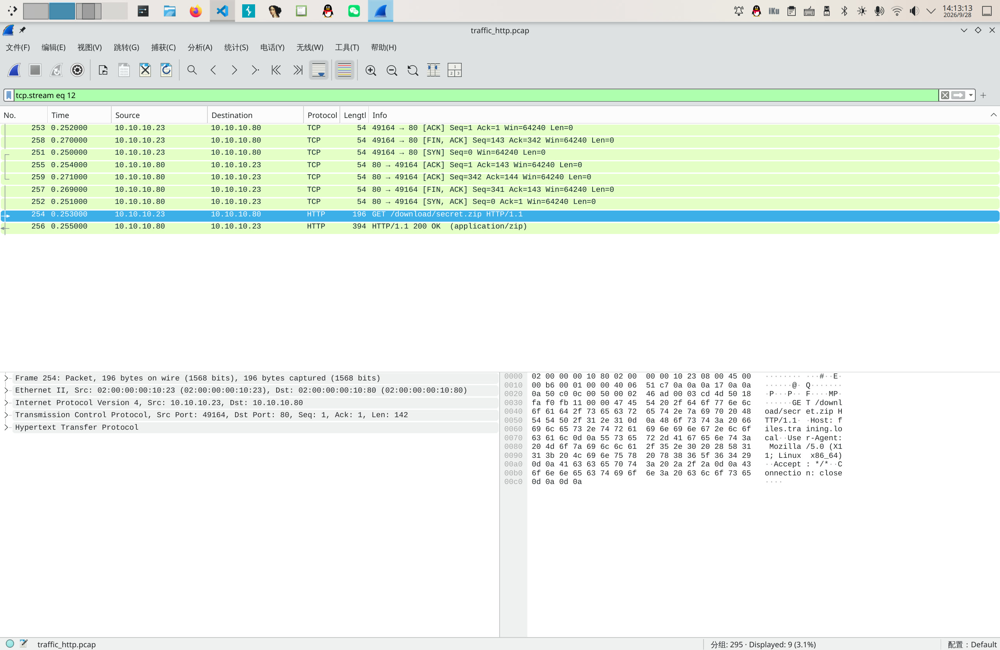

# ez_traffic

用 Wireshark 打开 `.pcap` ， `http` 过滤，一眼望去：



`secret.zip` 要素察觉。

导出对象：

解压：

```bash
scetayh@yuprae-gentoo ~ $ cd Downloads/
scetayh@yuprae-gentoo ~/Downloads $ unzip secret.zip 
Archive:  secret.zip
  inflating: secret.txt              
scetayh@yuprae-gentoo ~/Downloads $ cat secret.txt 
MHhHYW1le3RyQGZmMWNfYW5hMXk1aXNfaTVfZlVuX2g3N3AhfQ==scetayh@yuprae-gentoo ~/Downloads $ 
```

Base64 解码得到 `0xGame{tr@ff1c_ana1y5is_i5_fUn_h77p!}` 。