# Strange_lsb

题干说：

> “单一的色彩只是噪音，唯有三原色交织之时，真相才会显现。”

使用 [StegSolve](https://github.com/Giotino/stegsolve) 查看究竟什么是 **单一的色彩只是噪音** 。

首先正常打开 `challenge.png` ：

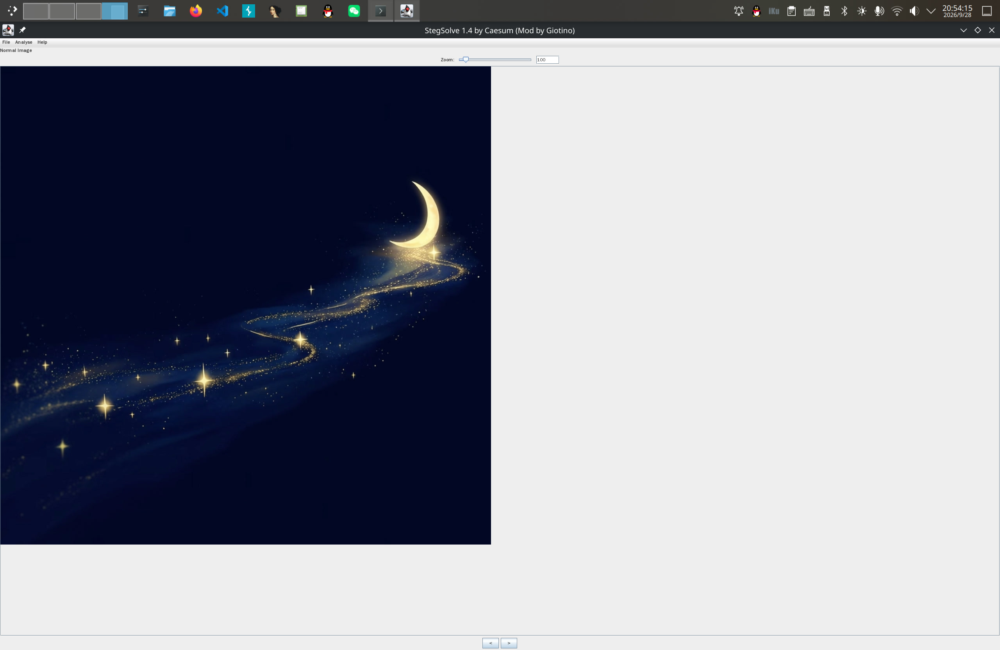

使用下方的左右箭头切换 bit plane ：

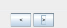

分别得到 Red / Green / Blue plane 0 ：

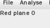

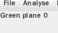

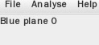

并保存三张图片为：

- `R0.png`
- `G0.png`
- `B0.png`

它们分别长这个样子：

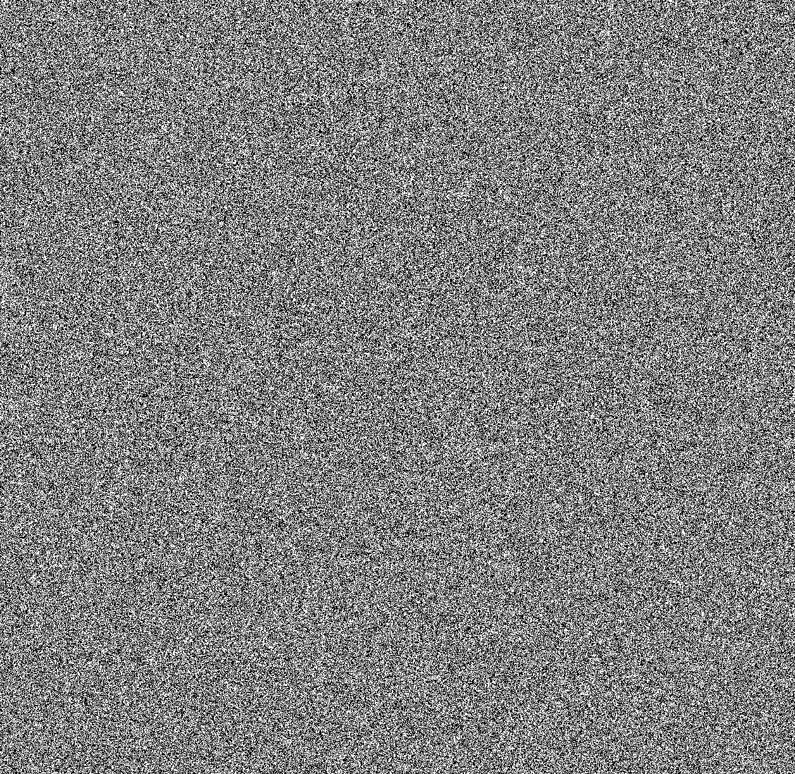

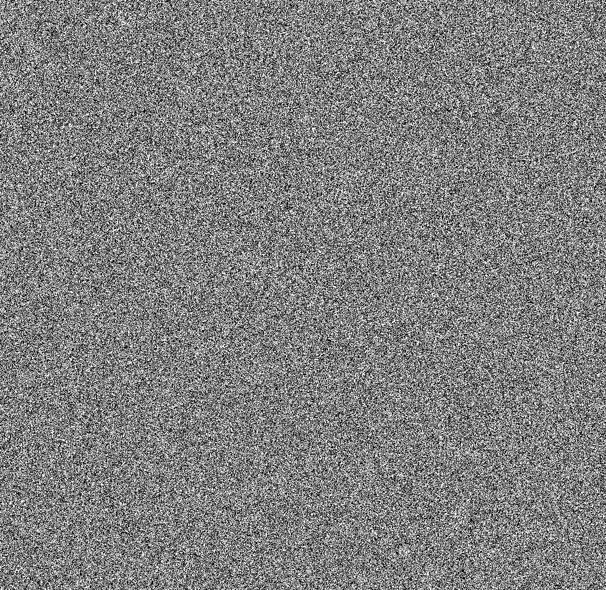

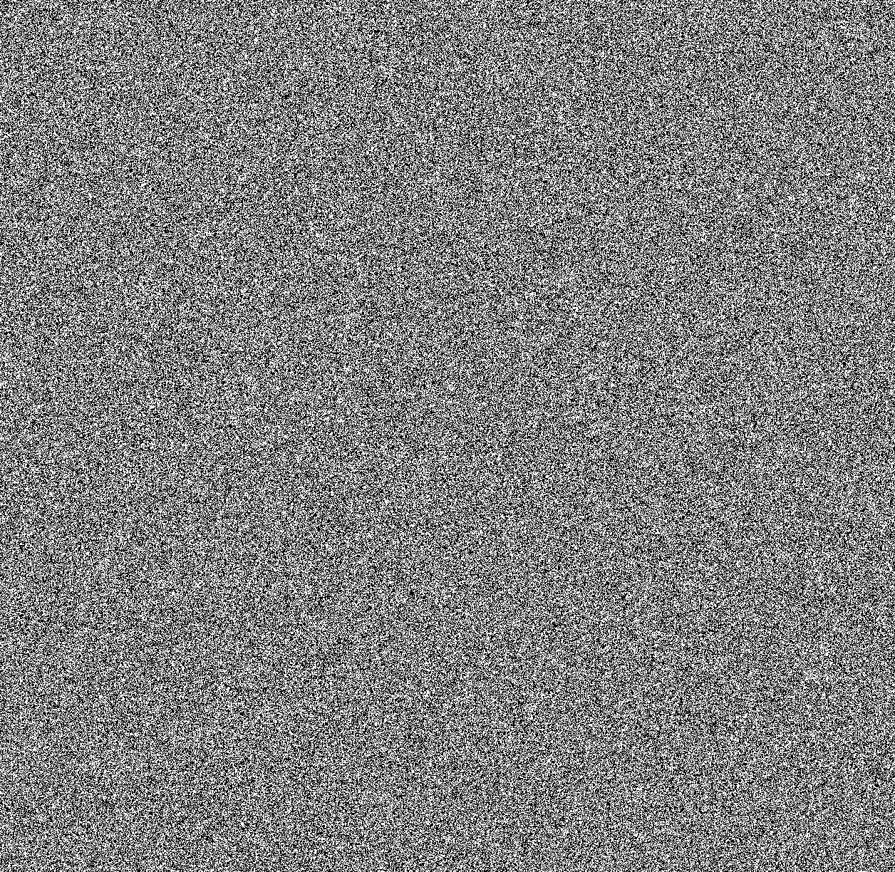

这就论证了 **单一的色彩只是噪音** 。

题干又说 **唯有三原色交织之时，真相才会显现** 。[StegSolve](https://github.com/Giotino/stegsolve) 有 Image Combiner 功能：

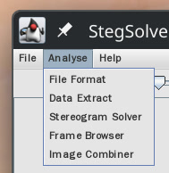

能够以 XOR 运算方式“交织三原色”。

首先打开 `R0.png` ，选择 Analyse > Image Combiner ，选取 `G0.png` ，即可来到这个页面：

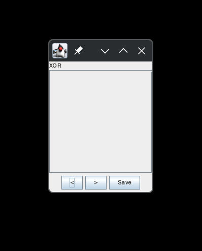

保存为 `R0XORG0.png` ：

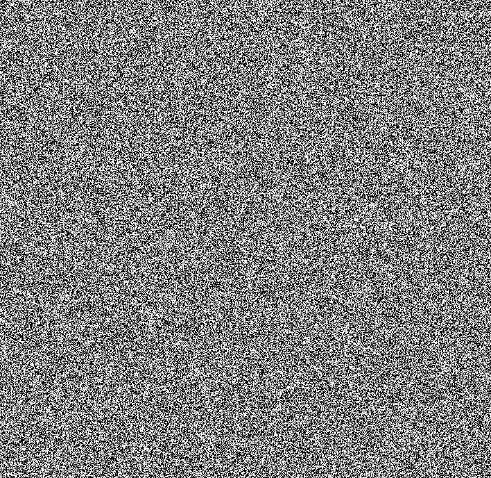

同样地，将 `R0XORG0.png` 与 `B0.png` 叠加，最终得到 `R0XORG0XORB0.png` ：

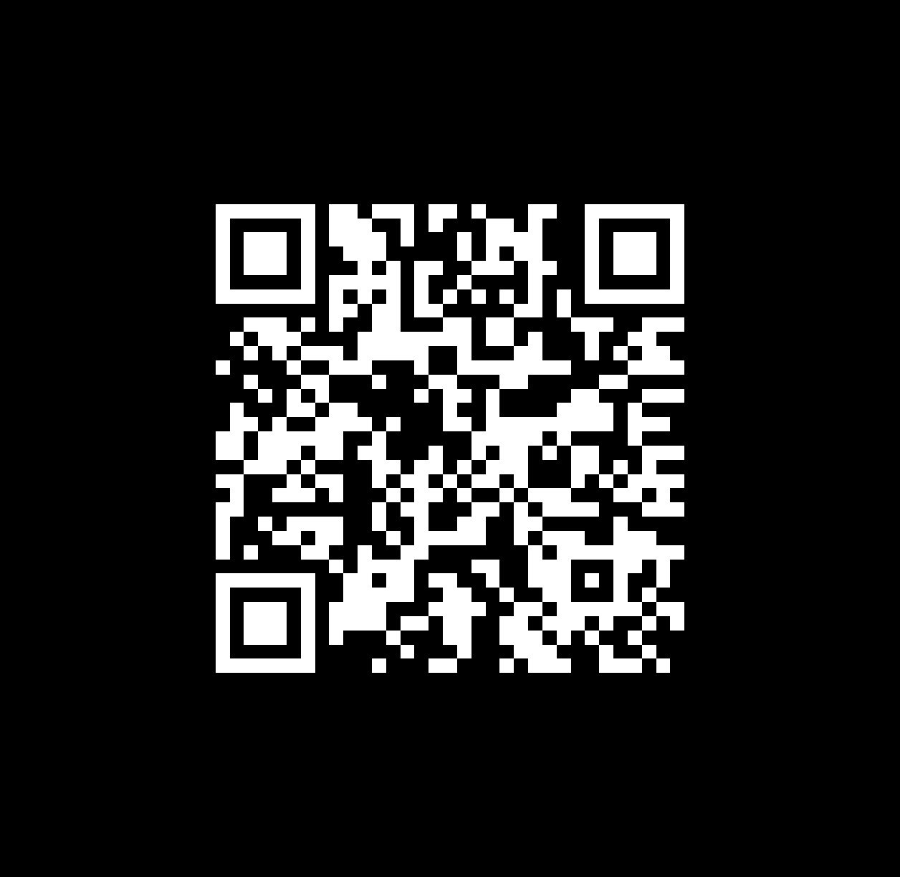

扫描二维码即可得到 flag `0xGame{LSB_x0r_Pl4n3_1s_4w3s0m3!}` 。