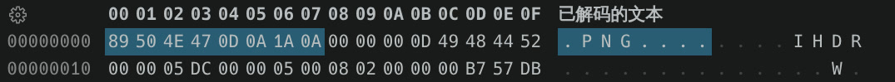
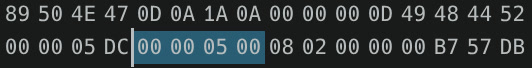

# 小伊卡...不胖...不胖...

题供压缩包解压，看 `题目描述.txt` ：

```
饿啊！你往电脑里放了什么？！好重…！
肖一咔系🐖，谁赞成谁反对？
反对？你看看它，一屁股把图坐扁了，你拿什么反对？😡
屏幕前的童鞋，请救救小伊卡，证明它不胖…不胖…
```

> 一屁股把图坐扁了

图片像素压扁了？人眼看不见？

先用 `exiftool`看一下：

``` 
ExifTool Version Number         : 13.30
File Name                       : fat_Y1k@.png
Directory                       : .
File Size                       : 1059 kB
File Modification Date/Time     : 2026:09:05 14:58:39+08:00
File Access Date/Time           : 2026:09:28 22:08:40+08:00
File Inode Change Date/Time     : 2026:09:28 22:08:40+08:00
File Permissions                : -rw-rw-rw-
File Type                       : PNG
File Type Extension             : png
MIME Type                       : image/png
Image Width                     : 1500
Image Height                    : 1280
Bit Depth                       : 8
Color Type                      : RGB
Compression                     : Deflate/Inflate
Filter                          : Adaptive
Interlace                       : Noninterlaced
White Point X                   : 0.3127
White Point Y                   : 0.329
Red X                           : 0.64
Red Y                           : 0.33
Green X                         : 0.3
Green Y                         : 0.6
Blue X                          : 0.15
Blue Y                          : 0.06
Background Color                : 255 255 255
Warning                         : [minor] Text/EXIF chunk(s) found after PNG IDAT (may be ignored by some readers) [x3]
Datecreate                      : 2026-09-05T06:56:20+00:00
Datemodify                      : 2026-09-05T06:56:20+00:00
Datetimestamp                   : 2026-09-05T06:56:21+00:00
Image Size                      : 1500x1280
Megapixels                      : 1.9
```

看输出知道图片的宽是 **1500** ，高是 **1280** 。

然后使用 ImageMagick 7 的 `identify` 命令：

```bash
scetayh@yuprae-gentoo ~/Downloads $ man identify 
scetayh@yuprae-gentoo ~/Downloads $ identify -format '%wx%h' fat_Y1k@.png 
identify: IHDR: CRC error `fat_Y1k@.png' @ error/png.c/MagickPNGError/1308.
scetayh@yuprae-gentoo ~/Downloads $ identify -format '%wx%h' 'fat_Y1k@.png'
identify: IHDR: CRC error `fat_Y1k@.png' @ error/png.c/MagickPNGError/1308.
scetayh@yuprae-gentoo ~/Downloads $ cp fat_Y1k{@,}.png 
scetayh@yuprae-gentoo ~/Downloads $ identify -format '%wx%h' 'fat_Y1k.png'
identify: IHDR: CRC error `fat_Y1k.png' @ error/png.c/MagickPNGError/1308.
```

这里我一开始没仔细看报错，以为 `@` 来 `@` 去是文件名的问题，后来才发现不是的，我 `identify` 自己头像发现一切正常：

```bash
scetayh@yuprae-gentoo ~/Downloads $ identify ~/Pictures/Tarikko-ScetayhChan_avatar.4.0.98422743_p0.1000x1000.jpeg 
/home/scetayh/Pictures/Tarikko-ScetayhChan_avatar.4.0.98422743_p0.1000x1000.jpeg JPEG 1000x1000 1000x1000+0+0 8-bit sRGB 516179B 0.000u 0:00.000
```

仔细看报错：

> IHDR: CRC error...

查得报错含义为 IHDR 中的数据和它后面保存的 CRC 校验值对不上。让人联想到不吻合的可能恰恰是像素记录值，因为题干说 **猪一屁股把图坐扁了** 。高明显小于宽，而且往往是竖直方向才能被一屁股压扁。如果是宽度的问题甚至宽高都有问题就麻烦了，可能需要枚举。

下面用脚本解压 IDAT 实测。过程看注释。

```python
import zlib, struct

data = open('fat_Y1k@.png','rb').read()
# 按照笔记：
# 签名 0 ~ 7 bytes
# Length 8 ~ 11 bytes
# Type IHDR 12 ~ 15 bytes
# ! Width 16 ~ 19 bytes
# ! Height 20 ~ 23 bytes
#
# 要读 16 ~ 23 bytes
w, h = struct.unpack('>II', data[16:24])

# 收集所有 IDAT 的 Payload
idat = b''
pos = 8 # 跳过签名
while pos < len(data):
    ln, typ = struct.unpack('>I4s', data[pos:pos+8])
    if typ == b'IDAT':
        idat += data[pos+8:pos+8+ln]
    pos += 12 + ln

raw = zlib.decompress(idat)

print('bytes:', len(raw))
print('IHDR height:', h)
print('bytes per line:', 1 + w*3)
print('factual lines:', len(raw) // (1 + w*3))
```

跑一下看看：

```bash
scetayh@yuprae-gentoo ~/Projects/0xgame2026-writeups $ cd week1/misc/6/
scetayh@yuprae-gentoo ~/Projects/0xgame2026-writeups/week1/misc/6 $ python3 lie_detect.py 
bytes: 6751500
IHDR height: 1280
bytes per line: 4501
factual lines: 1500
```

怎么说？真实行数 1500 和 IHDR 不符？

这时候根据笔记，把 Height 的 20 ~ 23 bytes 那 4 个字节从 1280 改成 1500 。但 CRC 不过关的话有些软件不一定认。所以还是需要修复。

先使用 VS Code 拓展 Hex 编辑器打开文件：



PNG 签名清晰可辨。



这四位就是 20 ~ 23 bytes 。到时候把它们从 `00 00 05 00` (1280) 改成 `00 00 05 DC` (1500) ，并修正 CRC 。

脚本在此：

```python
import binascii

with open("fat_Y1k@.png","rb") as f:
    buf = bytearray(f.read())

buf[20] = 0x00
buf[21] = 0x00
buf[22] = 0x05
buf[23] = 0xDC

# 又按照笔记：
# 签名 0 ~ 7 bytes
# Length 8 ~ 11 bytes
# ! Type IHDR 12 ~ 15 bytes
# ! Payload 16 ~ 28 bytes
# CRC 29 ~ 32 bytes
new_crc = binascii.crc32(buf[12 : 29]) & 0xFFFFFFFF
buf[29:33] = new_crc.to_bytes(4, byteorder='big')

with open("fixed.png","wb") as out:
    out.write(buf)
```

运行后得到：

