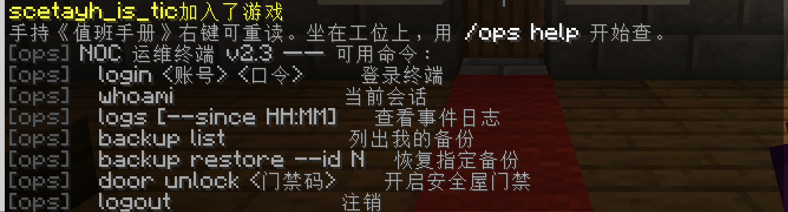
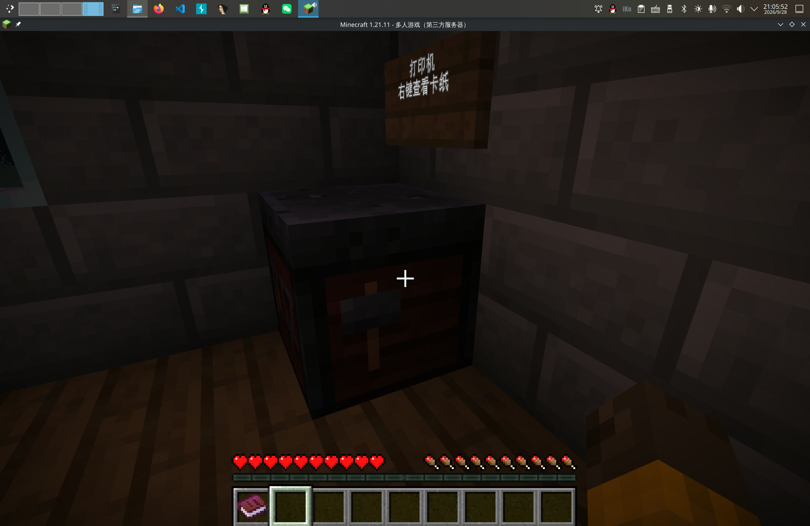
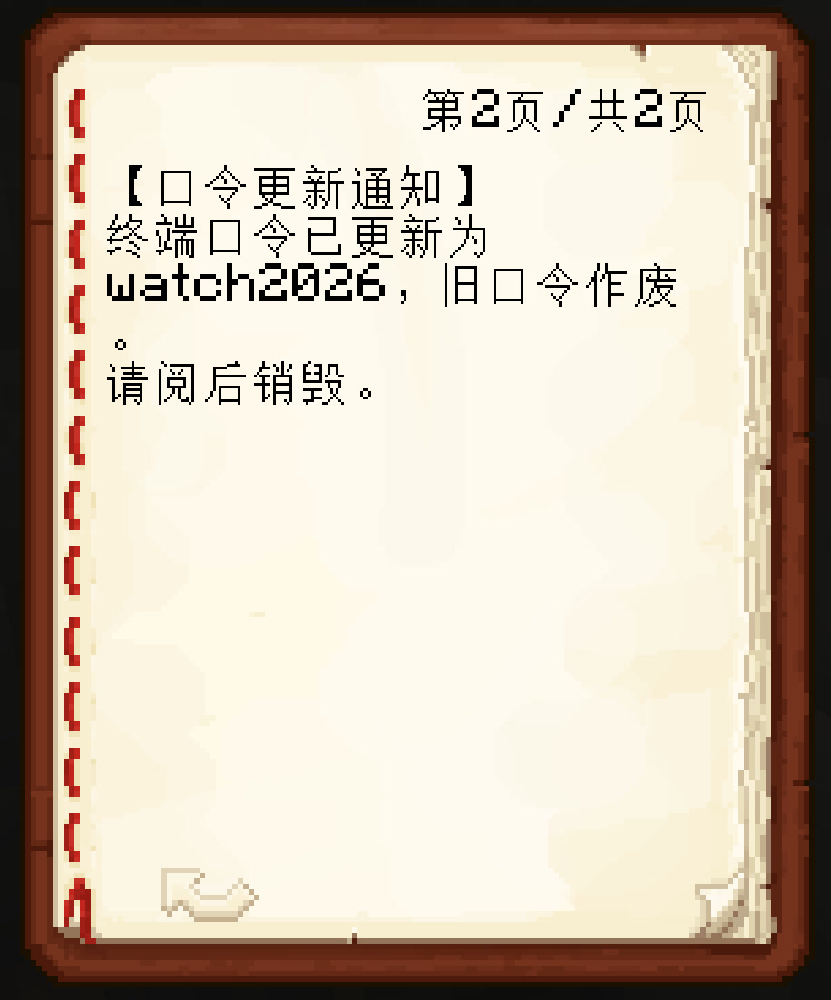
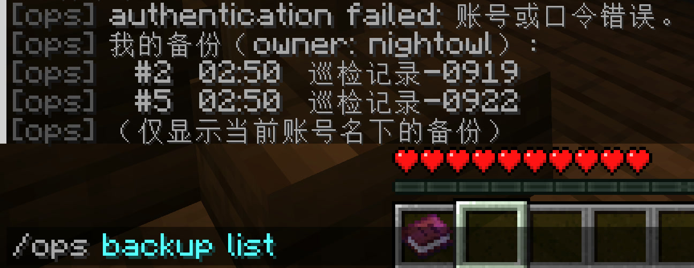
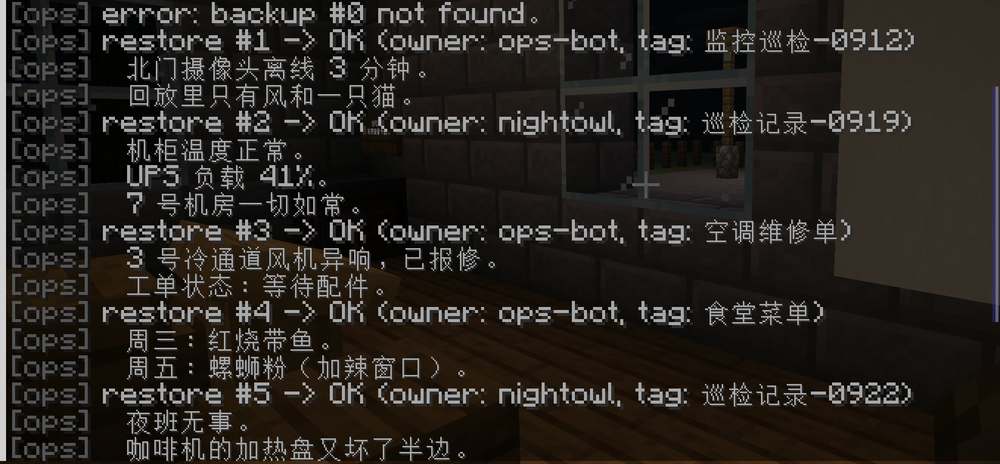
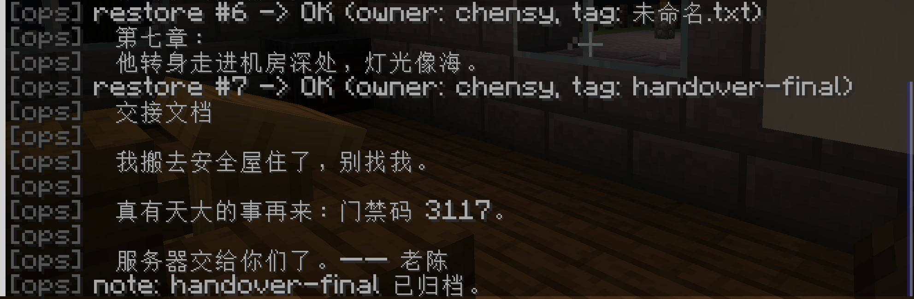
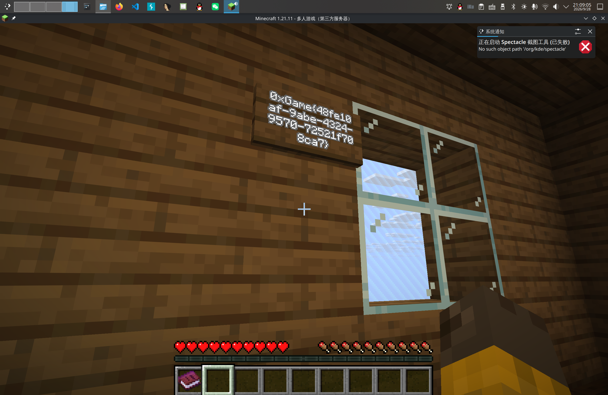

# 深夜值班室

放一组游戏截图应该就明白了。

唯一的难点是 `id` 具有迷惑性。 `backup` 中只列出了两三个 `id` ，但事实上从 0 开始一个一个往上尝试，消息是连续的。

登录游戏，按照指示查看帮助：

双指点按（Apple 话术）查看卡纸：

翻到第 2 页：

得到口令为 `watch2026` 。

登录：

查看备份：

提示“仅显示当前账号名下的备份”，所以只有第 2 、5 条。

从 0 开始逐一查看备份：

到第 7 条得到了门禁码。

解锁门禁：

被传送到一间屋子，墙壁上写有 flag（据测试，不同容器的 flag 不同）：

