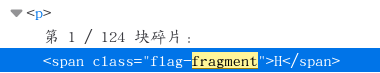
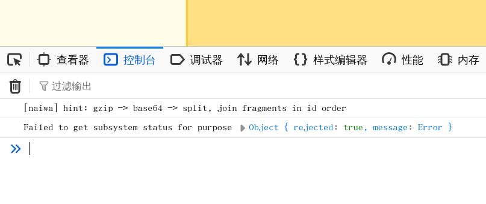

# 奶蛙的博客

所谓“美丽的汤”是 Python 的 HMTL 解析库。 ~~（但是我不想用）~~

这个博客的 entries 出奇地多，很有可能是生成了碎片化文本让答题者拼凑。

查看一篇文章的 HTML，可以看到类似这样的内容：

```html
<span class="flag-fragment">H</span>
```



所有 entry 的地址都是 `/page?id=1` 这种。用 Shell ：

```bash
readonly URL='http://8000-62a68483-e567-4b44-9923-adea1464e2d0.challenge.ctfplus.cn/page?id='

for ((i=1; i<=124; i++)); do
    lin_content="$(curl -sS "$URL"$i | grep '<span class="flag-fragment">')"
    rest=${lin_content#*>}
    fragment=${rest%%<*}
    printf '%s' "$fragment"
done
printf '\n'
```

组合得到：

```bash
scetayh@yuprae-gentoo ~/Projects/0xgame2026-writeups $ cd week1/misc/5/
scetayh@yuprae-gentoo ~/Projects/0xgame2026-writeups/week1/misc/5 $ chmod +x compose_fragments.sh 
scetayh@yuprae-gentoo ~/Projects/0xgame2026-writeups/week1/misc/5 $ ./compose_fragments.sh 
```

可以看到终端不紧不慢地吐出一行字：

```
H4sIAAAAAAAA/wTAwQ2AMAgF0JXaADM4xo9BbQ&#43;UA0GrMe7uK/eyjv11rpNhfLYu0OBpAvYNWsxIU0AXxYMjuA3yBGsUEWQnVE8Kp/z&#43;AAAA//&#43;XJ0P/SwAAAA==
```

这个 Base64 直接强解是乱码的。我粘贴到 Konsole 里甚至提示我说有 Control-D 。

去主页找了一下线索，控制台其实是有这种 hint 的：



<p align="center">
  <small>这其实是出题过程；解题要反着来</small>
</p>

解码后写入 `flag.gz` 文件：

```bash
printf '%s' 'H4sIAAAAAAAA/wTAwQ2AMAgF0JXaADM4xo9BbQ&#43;UA0GrMe7uK/eyjv11rpNhfLYu0OBpAvYNWsxIU0AXxYMjuA3yBGsUEWQnVE8Kp/z&#43;AAAA//&#43;XJ0P/SwAAAA==' \
  | sed 's/&#43;/+/g' \ # 这种操作明显是人眼看不出来的：`&#43;` 是 HTML 对加号 `+` 的转义写法，要还原；如果用了 Python 就没这么多事了，但 Shell 确实减少了代码量
  | base64 -d > flag.gz
```

文件类型没有问题：

```bash
scetayh@yuprae-gentoo ~/Projects/0xgame2026-writeups/week1/misc/5 $ file flag.gz
flag.gz: gzip compressed data, original size modulo 2^32 75
```

解压并显示内容：

```bash
scetayh@yuprae-gentoo ~/Projects/0xgame2026-writeups/week1/misc/5 $ gzip -dc flag.gz
0xGame{n41w4_l4ugh5_cr4wl5_4nd_c0ll3ct5_3v3ry_fr4gm3nt_4cr055_th3_1nt3rn3t}scetayh@yuprae-gentoo ~/Projects/0xgame2026-writeups/week1/misc/5 $ 
```

易得 flag 为 `0xGame{n41w4_l4ugh5_cr4wl5_4nd_c0ll3ct5_3v3ry_fr4gm3nt_4cr055_th3_1nt3rn3t}` 。