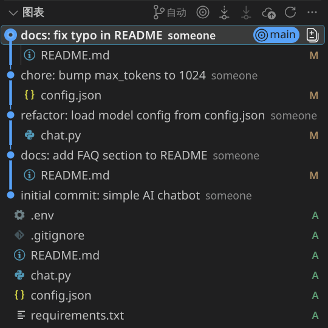
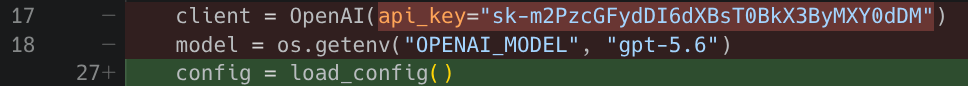
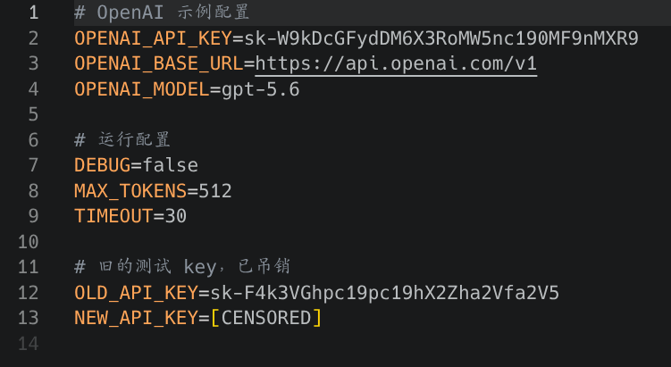

# 粗心的小x

聊天记录 `chat_export.json` 第 15 行：

```json
      "content": "为什么点运行报错？sk-T7xQcGFydDE6MHhHYW1le0QwX24wdF8"
```

`sk-T7xQcGFydDE6MHhHYW1le0QwX24wdF8` 像是 API Key 。

然后看看 Git 仓库提交历史：



逐一排查。紧接着在 refactor 那次提交 `chat.py` 差异中看到：



有个 `sk-m2PzcGFydDI6dXBsT0BkX3ByMXY0dDM` 。

而在初次提交 `.env` 中看到：



有 `sk-W9kDcGFydDM6X3RoMW5nc190MF9nMXR9` 和 `sk-F4k3VGhpc19pc19hX2Zha2Vfa2V5` 。

整理得到：

- `sk-T7xQcGFydDE6MHhHYW1le0QwX24wdF8`
- `sk-m2PzcGFydDI6dXBsT0BkX3ByMXY0dDM`
- `sk-W9kDcGFydDM6X3RoMW5nc190MF9nMXR9`
- `sk-F4k3VGhpc19pc19hX2Zha2Vfa2V5`

去掉 `sk-` 做 Base64 解码，得到：

- `O糚part1:0xGame{D0_n0t_`
- `沜髉art2:uplO@d_pr1v4t3`
- `[?part3:_th1ngs_t0_g1t}`
- `?This_is_a_fake_key`

组合得到 flag 为 `0xGame{D0_n0t_uplO@d_pr1v4t3_th1ngs_t0_g1t}` 。