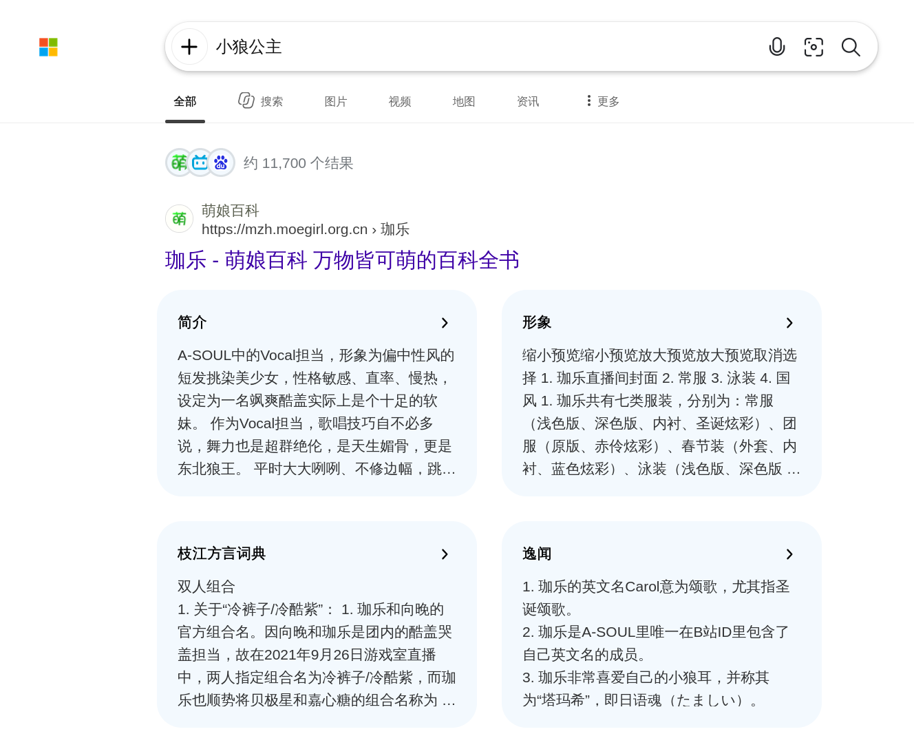
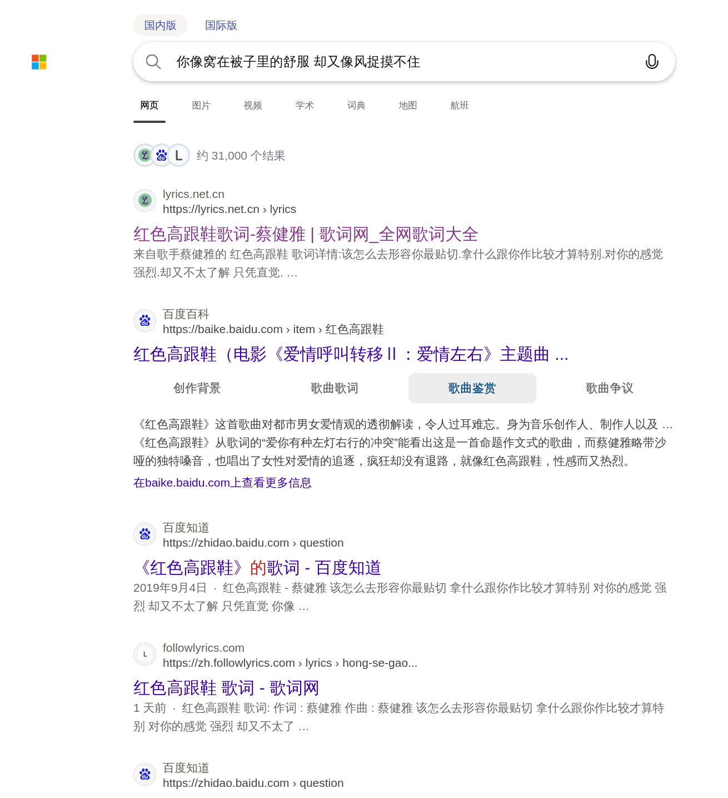
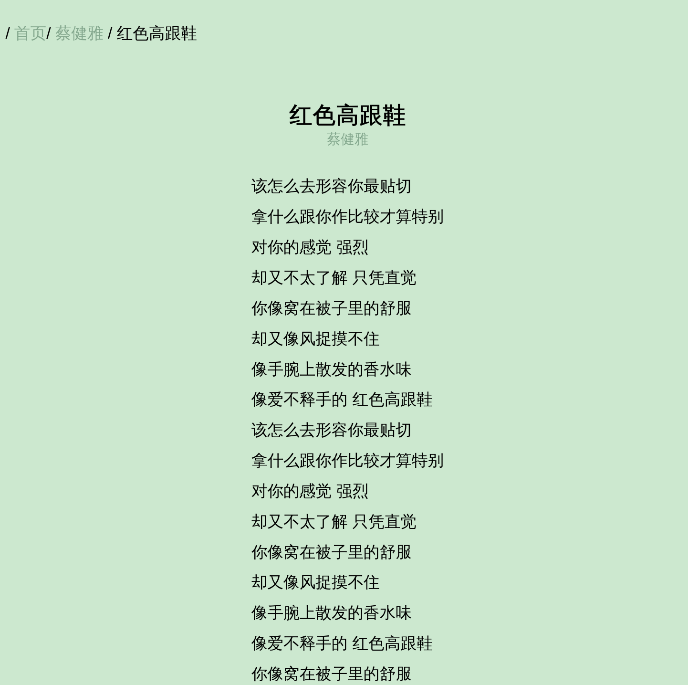
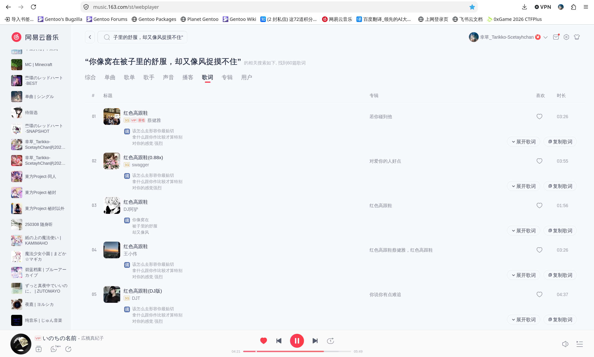
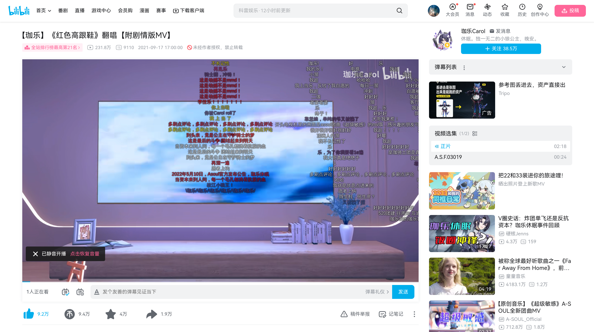
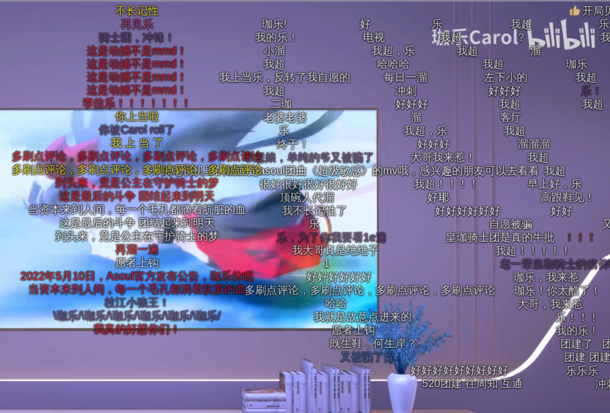
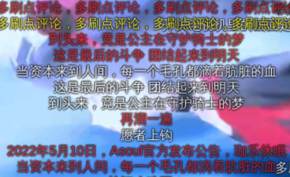
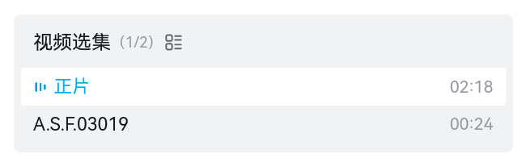
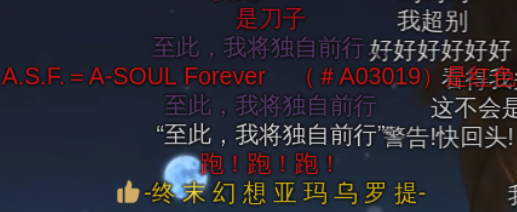
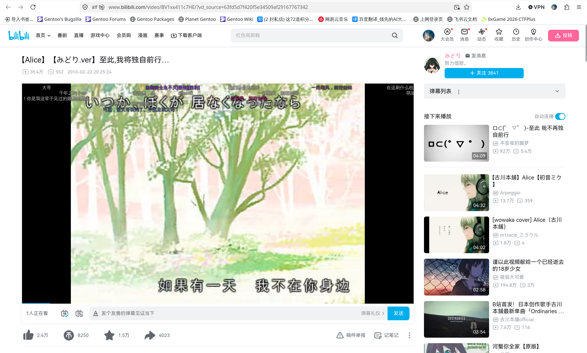

# 至此,我将独自前行...

首先搜索“小狼公主”：



小狼公主指的是珈乐。不巧的是今天萌百服务器寄掉了，Cloudflare 流量代理报 522 ，只能将就看看别的网页了。

根据浏览内容，确认珈乐（Carol）是一位 Vtuber ，~~我不管我不管反正都是V家的~~虚拟偶像女团 A-SOUL 成员，官方称“因身体与学业原因暂停日常活动”。

题干有一处引用强调：

> “你像窝在被子里的舒服，却又像风捉摸不住”

这个也搜索一下：



第一个结果：



这是句歌词，歌曲为《红色高跟鞋》，原唱蔡健雅。到云村验证：




合理推测珈乐翻唱过这首歌曲，因此去 B 站找一下：


点开第二个：



看到弹幕透露了些什么：





以及评论区。


> 可以确定不是“因身体与学业原因”暂停活动了。
>
> 

观察页面，可以看到有个 P2 ~~自古P2无人看~~：



看这个视频：


弹幕出现了关键词：



> 至此，我将独自前行

这正好是本题的标题。在 B 站上搜索它：


第一个视频的日期是……





看到评论区：


> “到头来是公主一直在守护骑士的梦”

这些句子的感情基调是一样的。整条线索链串起来，事实上已经暗示了珈乐半毕业的原因。

整理信息：

- BV 号：《红色高跟鞋》`BV1db4y117Q1` 或《至此,我将独自前行…》`BV1xx411c7HE`
- 线索字符串：`A.S.F.03019`
- 指向视频的发布时间：`2010-02-22-20:25:24`

实际上题目说了是“线索字符串指向视频的发布时间”，因此寻找 BV 号的时候我们还不知道《至此,我将独自前行…》这个视频，所以应该取《红色高跟鞋》。整理得到：

```
0xGame{BV1db4y117Q1_A.S.F.03019_2010-02-22-20:25:24}
```

经提交检验，这的确是 flag 。