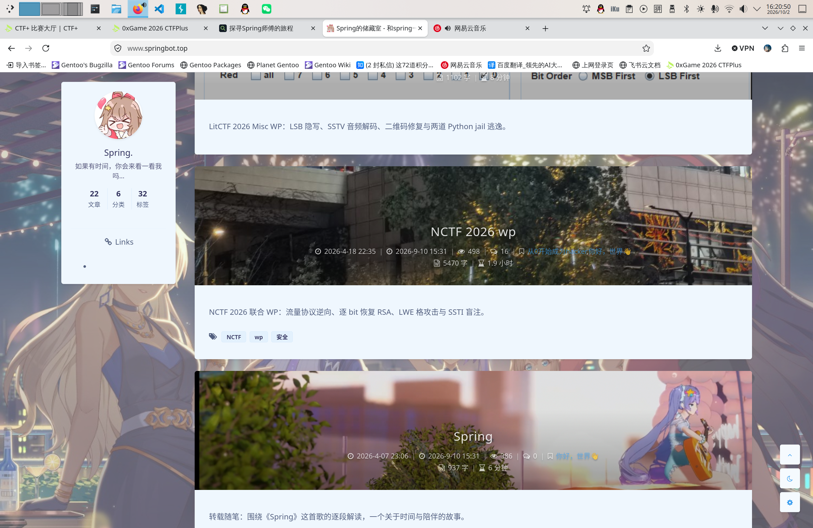
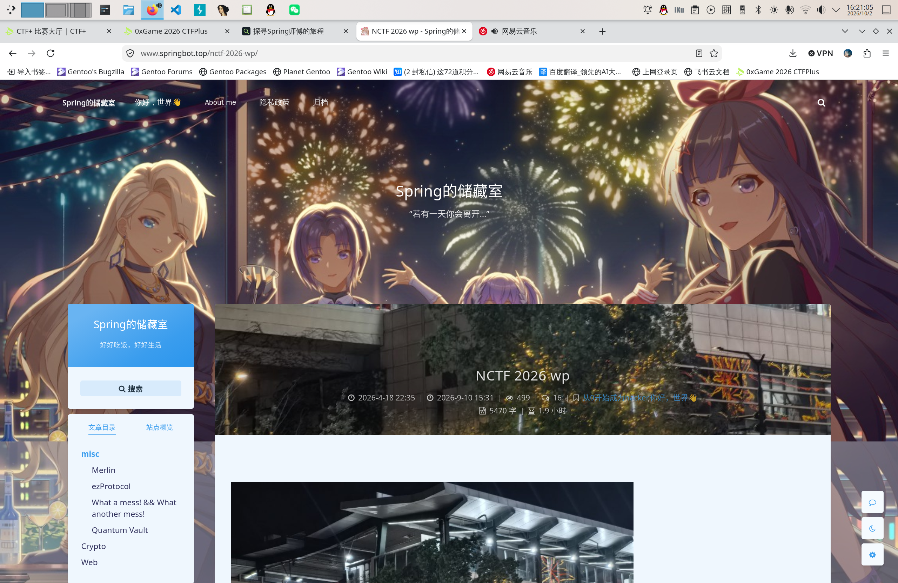
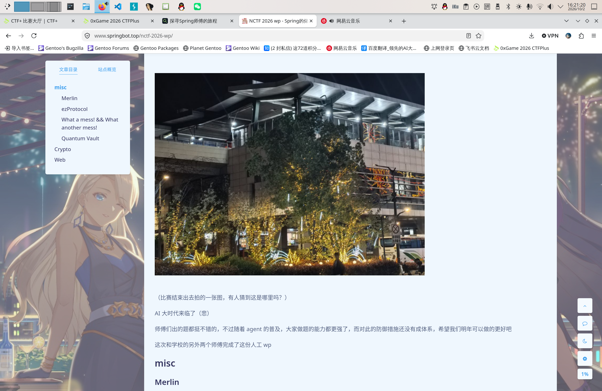
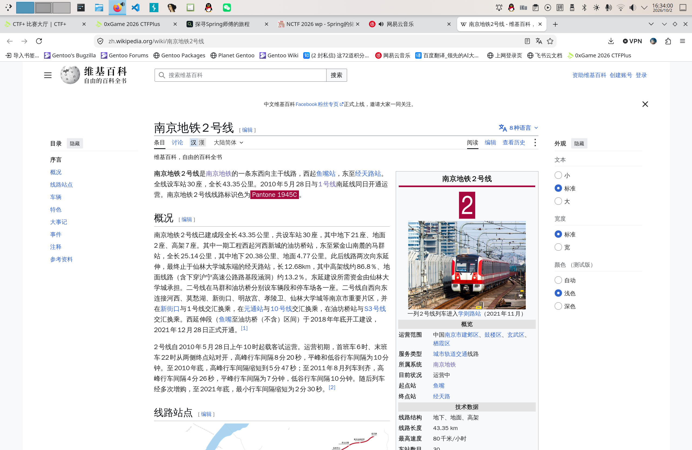
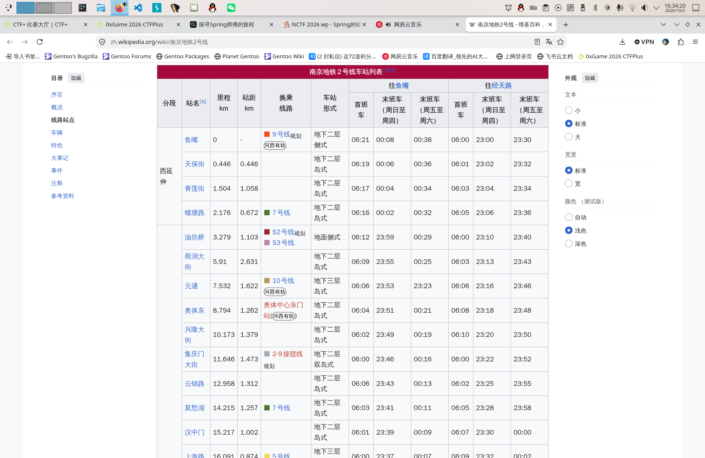
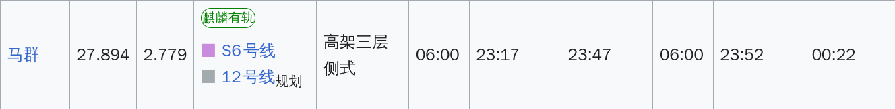

# Spring的旅程-1

牢完 NCTF WP 还和朋友出去吃饭，十有八九就在南京。提交后确实：

> 江苏省_南京市

至于[博客](https://www.springbot.top)：


朝下翻：



点进[《NCTP 2026 wp》](https://www.springbot.top/nctf-2026-wp/)：



可以看到题供图：



所以博客页面地址就是：

> https://www.springbot.top/nctf-2026-wp/

`exiftool` 看一下图片：

```bash
(base) scetayh@yuprae-gentoo ~/Downloads $ exiftool eat.jpg 
ExifTool Version Number         : 13.30
File Name                       : eat.jpg
Directory                       : .
File Size                       : 2.6 MB
# ...
Make                            : HUAWEI
Camera Model Name               : nova 14
# ...
Date/Time Original              : 2026:04:06 19:22:45
Create Date                     : 2026:04:06 19:22:45
# ...
```

那么“设备/型号”和具体拍摄时刻分别为：

> HUAWEI/nova 14

> 2026年04月06日19:22:45

至于建筑，作为电车宅一眼就看出来这是地铁的**高架三层侧式车站（elevated three-story side-platform station）**。考虑到 Spring. 在 NJUPT 上学，最近的也就是最有可能乘坐的地铁线路是 2 号线。查阅[维基百科](https://zh.wikipedia.org/wiki/%E5%8D%97%E4%BA%AC%E5%9C%B0%E9%93%812%E5%8F%B7%E7%BA%BF)：



看车站列表：



找到唯一的高架三层侧式车站：



**马群**。高德地图对地铁站的命名格式类似于“三山街·工商银行(地铁站)”，经提交检验，确实是马群。从而：

> 马群(地铁站)

最后的彩蛋呢，先在答题进度页面找了各种 assets ，发现没有；然后去博客文章页面往下翻，最终在评论区发现：


> 0sint_master?

提交六个答案，得到 flag 为 `0xGame{cb3758c1-0908-4fef-91c6-790d623ef773}` 。