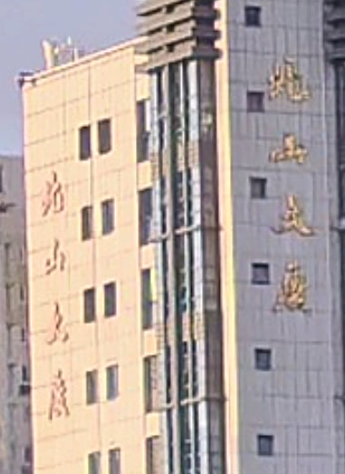
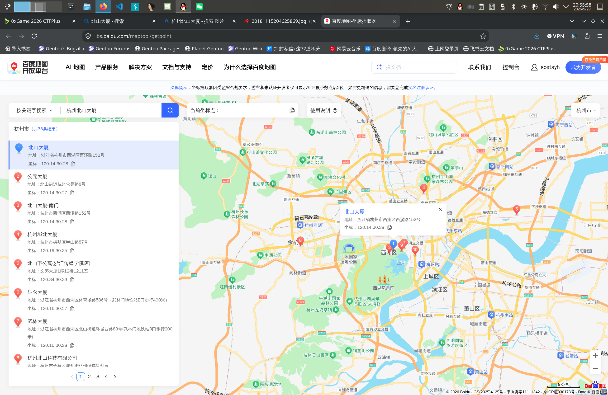
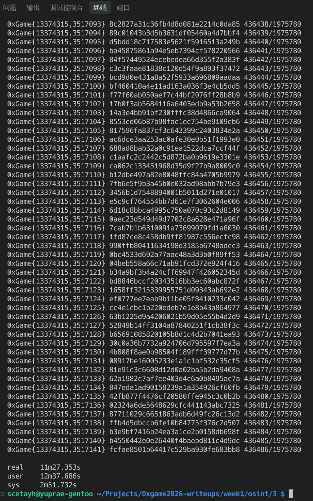

# Spring的旅程-2


)

画面中央的建筑上：



**“北山大厦”**。

搜索得到：


鉴于**杭州**距离**南京**比较近，首先考虑**杭州**。

继续搜索图片：


观察第一张：


)

可以看到网图和题供图非常相似，窗户布局以及建筑上部的饰檐几乎一样。只不过网图只有一个竖写的“北山大厦”，而题供图有两个。鉴于网图的日期是：


7年前，所以我们有理由认为现在的大厦的确有两列竖写文字。

然后使用这个 [百度地图-坐标拾取器](https://lbs.baidu.com/maptool/getpoint) 搜索“杭州北山大厦”：



可以看到建筑的坐标大概是：

```
120.14,30.28
```


此处经度右增，纬度上增，所以范围控制在：

```
120.14~120.15,30.27~30.28
```

然后来到这个网站：

- [Coordinate Converter | WGS84, GCJ-02 and BD-09 | DevKitLab](https://www.devkitlab.com/en/tools/coordinate-converter/)

它提供了地图坐标转换器，可以把经纬度转换成不同的业内标准，比如所谓的**百度墨卡托坐标（BD-09MC）**。

按照 **BD-09 (Baidu lng/lat) → BD-09MC (Baidu Mercator)** 的规则带入，得到：

```
13374069.143~13375182.35, 3516567.3753~3518337.1481
```

取整可得：

```
13374069~13375183, 3516567~3518338
```

用 Shell 写个笛卡尔积枚举脚本：

```bash
target=fcfae8501b64417c529ba930fe683bb8
x_start=13374069
x_end=13375183
y_start=3516567
y_end=3518338

total=$(( ( x_end - x_start + 1 ) * ( y_end - y_start + 1 ) ))

count=0

for ((x=x_start; x<=x_end; x++)); do
    for ((y=y_start; y<=y_end; y++)); do
        printf -v flag '0xGame{%s,%s}' $x $y
        hash=$(printf '%s' "$flag" | md5sum | awk '{print $1}')

        echo "$flag $hash $count/$total"

        [[ $hash = "$target" ]] && \
            exit 0

        ((count++))
    done
done
```

运行：

```bash
scetayh@yuprae-gentoo ~/Projects/0xgame2026-writeups/week1/osint/3 $ time ./crack_md5.sh 
0xGame{13374069,3516567} 7b2530365f27603a3fd81453d38efb5b 0/1975780
0xGame{13374069,3516568} f7f77293185aa70b79395cbdc518ebf6 1/1975780
0xGame{13374069,3516569} 11ea02533118028fdcda7e80f1ef9688 2/1975780
0xGame{13374069,3516570} b74f0459d201cc41c9024735fd3aa2c6 3/1975780
0xGame{13374069,3516571} f57cb6f995d96d32d6cc8cd5e5199c73 4/1975780
0xGame{13374069,3516572} b3294195ebdd6d823d9ef75a8e9f809f 5/1975780
0xGame{13374069,3516573} 755427985b3cfe5641735709fd1802cd 6/1975780
0xGame{13374069,3516574} 2ea06ac5a02a67e9eb6051eeb86edf24 7/1975780
0xGame{13374069,3516575} 03886eae06df902f18d4cf317a77cfe5 8/1975780
0xGame{13374069,3516576} 78451560c9566048920f2f4522784536 9/1975780
...
```

12 min 之后就找到了：

```bash
xGame{13374315,3517136} 02324a6de5648629cfc441143abc7325 436481/1975780
0xGame{13374315,3517137} 87711029c6651863adb6d49fc26c13d2 436482/1975780
0xGame{13374315,3517138} ffb4d5dbccb6fe10b84775f376c2d507 436483/1975780
0xGame{13374315,3517139} b3e9bf7416b24ea3a1ce2b0158db698f 436484/1975780
0xGame{13374315,3517140} b4550442e0e26440f4baebd811c4d9dc 436485/1975780
0xGame{13374315,3517141} fcfae8501b64417c529ba930fe683bb8 436486/1975780

real    11m27.353s
user    12m37.686s
sys     2m51.732s
```



这一行：

```
0xGame{13374315,3517141} fcfae8501b64417c529ba930fe683bb8 436486/1975780
```

得到的 flag 为 `0xGame{13374315,3517141}` 。