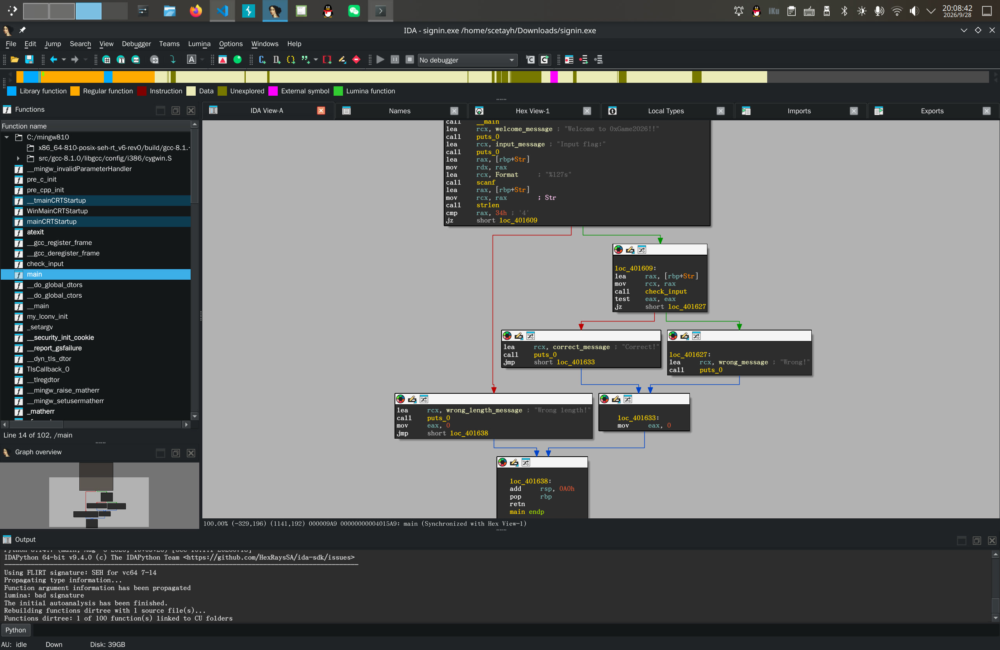
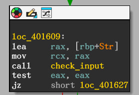
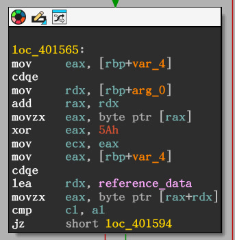
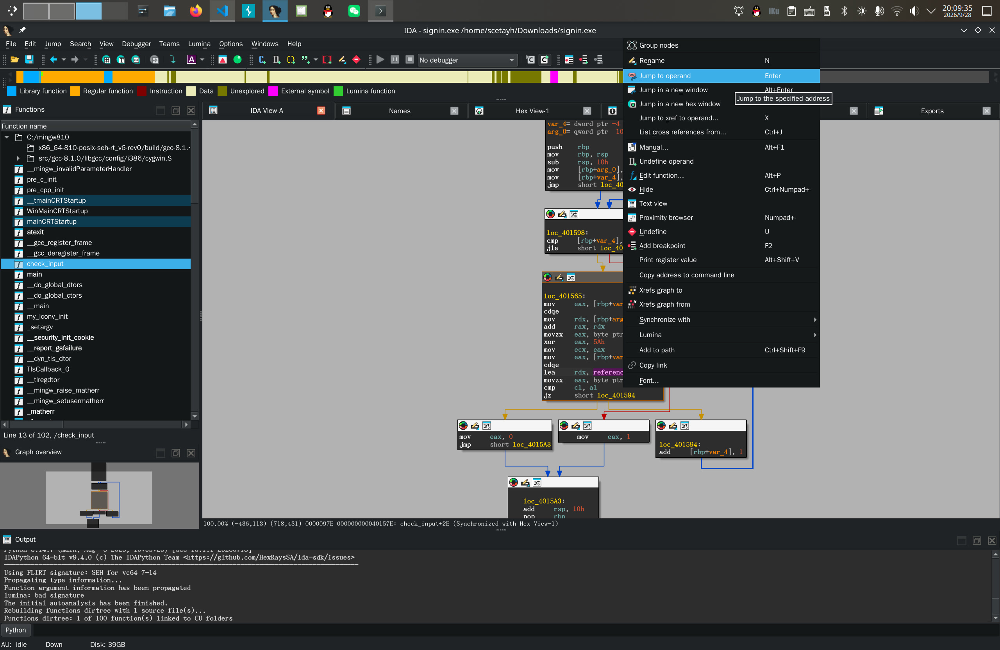
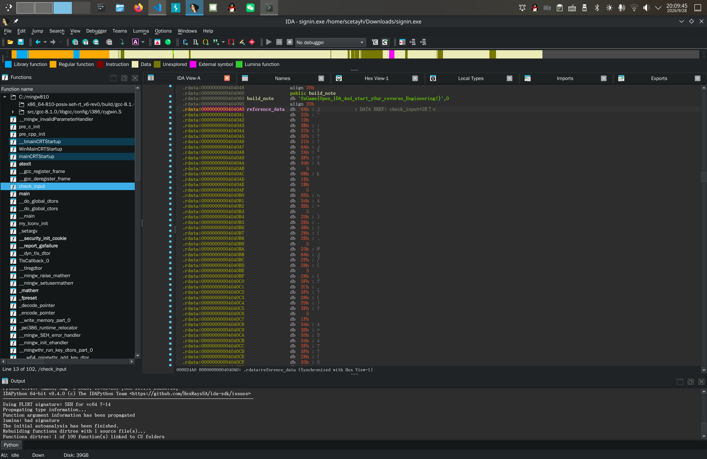
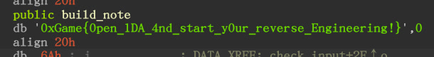

# signin

把 `signin.exe` 拖进 IDE ：

可见 `main` 函数里有一个基本的判断输入 flag 是否正确的逻辑。看向类似于 `if` 的分支：

这里有一个 `check_input` 函数被调用。转向这个函数：

可以看到判断输入是否正确的依据是 `reference_data` ：

所以双指点按，并跳转到这个操作数：

观察页面：

得到 flag ：

所以答案就是 `0xGame{0pen_1DA_4nd_start_y0ur_reverse_Engineering!}` 。