# ez_upx

题目叫 **“ez_upx”** ，应该是 UPX 有关的了。

IDA 打开康康……

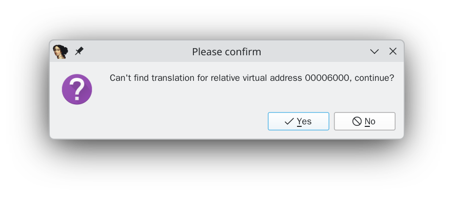

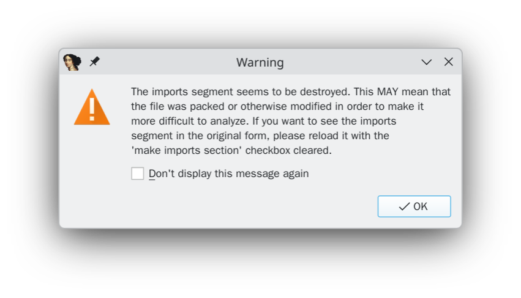

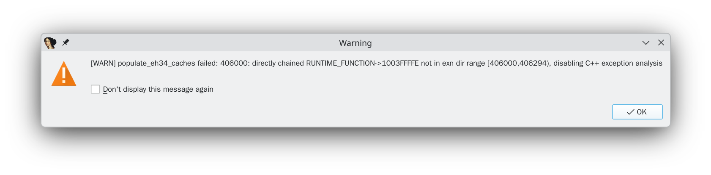

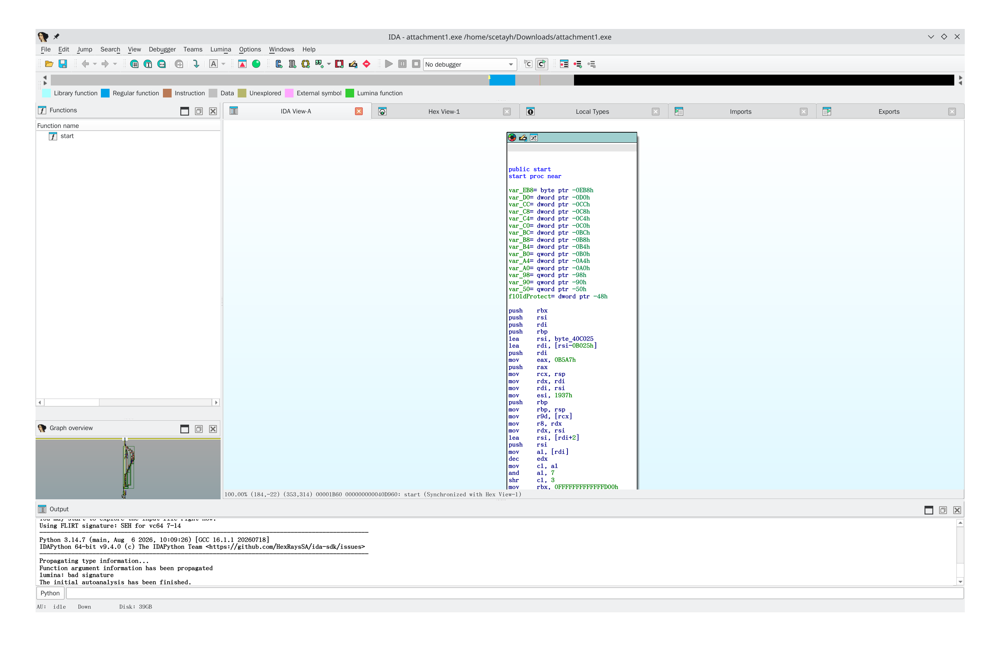

看看 Segments ：

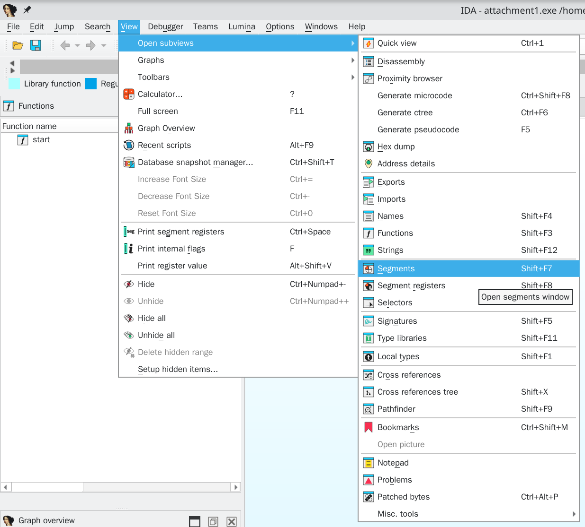

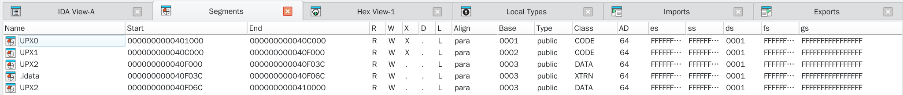

猜想正确。先现场 `emerge` 一个 `upx` 出来，然后脱掉压缩壳：

```bash
scetayh@yuprae-gentoo ~/Downloads $ upx -d attachment1.exe 
                       Ultimate Packer for eXecutables
                          Copyright (C) 1996 - 2026
UPX 5.1.0       Markus Oberhumer, Laszlo Molnar & John Reiser    Jan 7th 2026

        File size         Ratio      Format      Name
   --------------------   ------   -----------   -----------
     17408 <-     10752   61.76%    win64/pe     attachment1.exe

Unpacked 1 file.
```

回 IDA 重载，这次没有提示和报错。

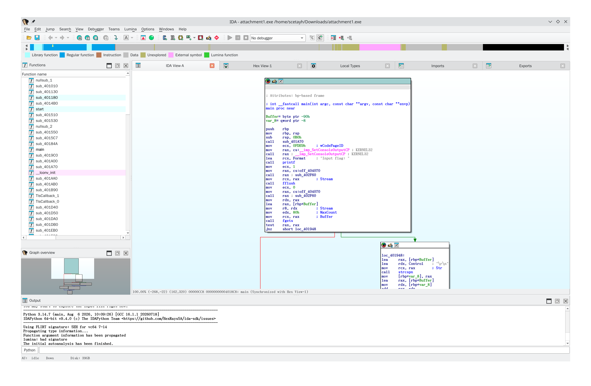

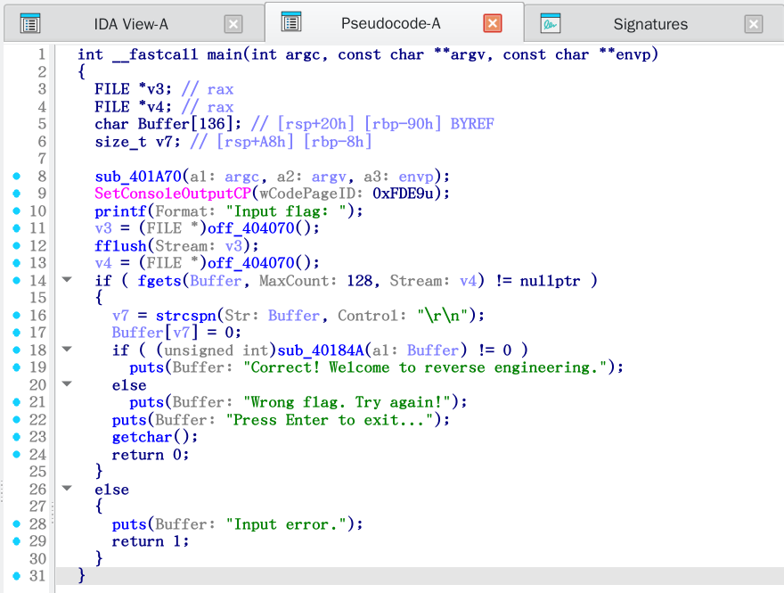

这一行的判断逻辑：

```c
if ( (unsigned int)sub_40184A(a1: Buffer) != 0 )
```

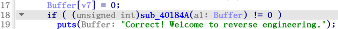

几乎肯定就是 flag 验证函数。双击进入：

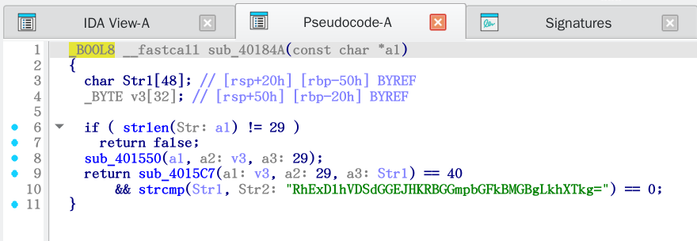

看到 Base 64 编码过的字符串了：

```
RhExDlhVDSdGGEJHKRBGGmpbGFkBMGBgLkhXTkg=
```

这个解码的结果是二进制。看看其他地方，比如：

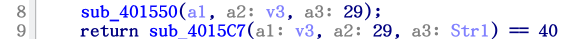

```c
// ...
  sub_401550(a1, a2: v3, a3: 29);
  return sub_4015C7(a1: v3, a2: 29, a3: Str1) == 40
// ...
```

`sub_401550()` 和 `sub_4015C7()` 两个函数。

先看第一个：

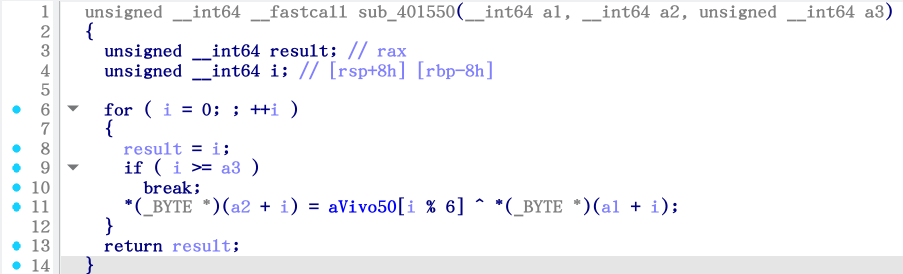

第 11 行：

```c
    *(_BYTE *)(a2 + i) = aVivo50[i % 6] ^ *(_BYTE *)(a1 + i);
```

`^` 做异或运算而且又是循环，让人想到之前那个 [Interesting_ppt](../../misc/4/index.md) 里面的加密手段。这里看一下 `aVivo50` 是什么：

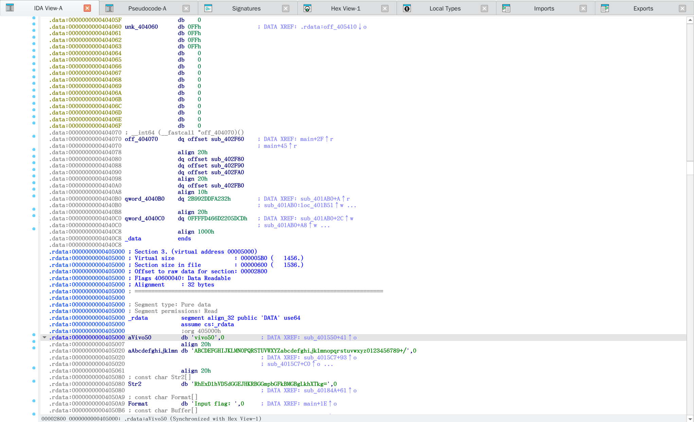

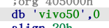

对的没问题，字符串字面量，外加一个 `\0` 收尾，这就是密钥。所以现在的思路是把那个 Base64 编码解码，然后和密钥做循环异或运算：

```python
import base64
bytes(b ^ b"vivo50"[i % 6] for i, b in enumerate(base64.b64decode("RhExDlhVDSdGGEJHKRBGGmpbGFkBMGBgLkhXTkg="))).decode()
```

```bash
scetayh@yuprae-gentoo ~ $ python3
Python 3.14.7 (main, Aug  6 2026, 10:09:26) [GCC 16.1.1 20260718] on linux
Type "help", "copyright", "credits" or "license" for more information.
>>> import base64
>>> bytes(b ^ b"vivo50"[i % 6] for i, b in enumerate(base64.b64decode("RhExDlhVDSdGGEJHKRBGGmpbGFkBMGBgLkhXTkg="))).decode()
'0xGame{N0www_y0u_kn0w_UPX!!!}'
>>> 
```

flag 为 `0xGame{N0www_y0u_kn0w_UPX!!!}` 。