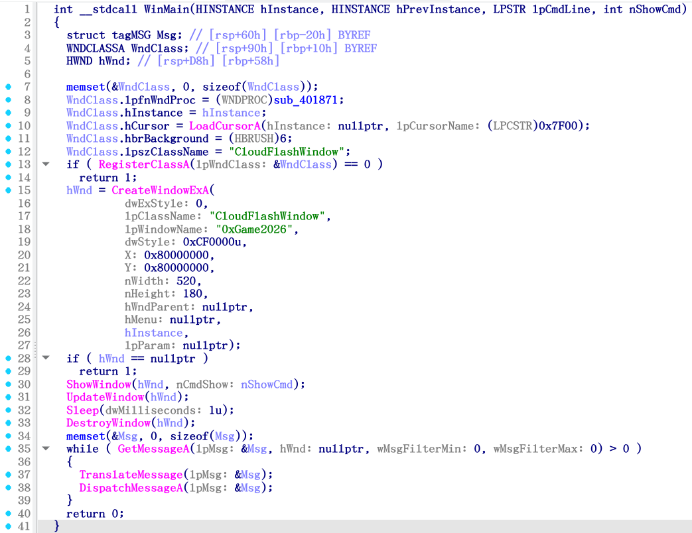
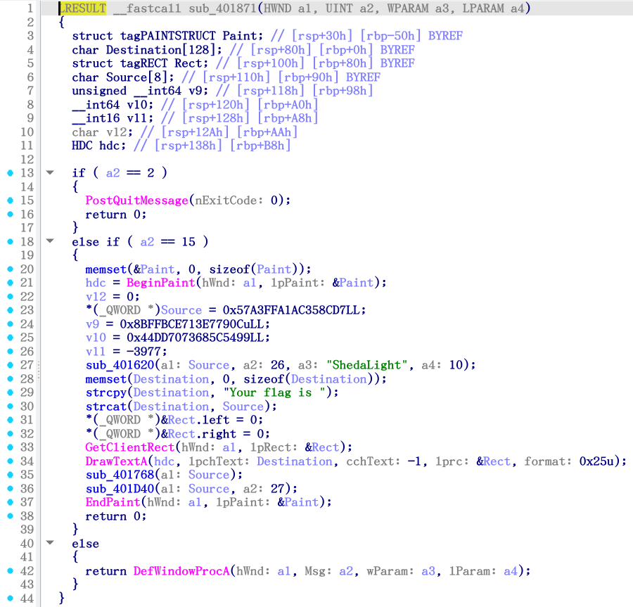
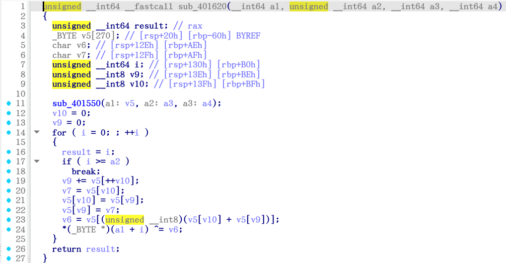
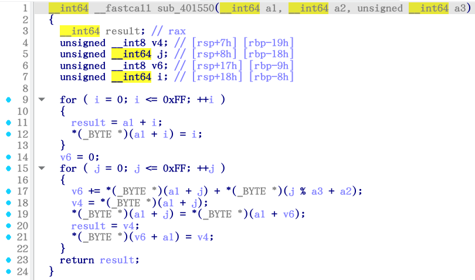

# 欸？云朵



> 咦？是不是有什么东西闪过去了？

确实很快（伪代码 lines 30 - 33）：

```c
  ShowWindow(hWnd, nCmdShow: nShowCmd);
  UpdateWindow(hWnd);
  Sleep(dwMilliseconds: 1u); // 1 毫秒
  DestroyWindow(hWnd);
```

Line 8：

```c
  WndClass.lpfnWndProc = (WNDPROC)sub_401871;
```

反编译 `sub_401871()` ：



Lines 23 - 29 ：

```c
    *(_QWORD *)Source = 0x57A3FFA1AC358CD7LL;
    v9 = 0x8BFFBCE713E7790CuLL;
    v10 = 0x44DD7073685C5499LL;
    v11 = -3977;
    sub_401620(a1: Source, a2: 26, a3: "ShedaLight", a4: 10);
    memset(Destination, 0, sizeof(Destination));
    strcpy(Destination, "Your flag is ");
```

`ShedaLight` 恰好是 10 个字符，应该是 C `sizeof()` / `strlen()` / `strnlen()` 一类的东西。

`Source` 明明只有 8 个字符，函数 `sub_401620()` 里却传了 26 ，这在 C 中是不安全要溢出的；但考虑反编译出来的 `Source` 很有可能只截取了前一部分，并且后面紧跟着 `v9` 、`v10` 、`v11` 三个变量：

- `Source`
  - `57 A3 FF A1 AC 35 8C D7`
  - 8 bytes
- `v9`
  - `8B FF BC E7 13 E7 79 0C`
  - 8 bytes
- `v10`
  - `44 DD 70 73 68 5C 54 99`
  - 8 bytes
- `v11`
  - `F0 77`
  - 2 bytes

恰为 26 bytes 。猜想正确。

先反编译函数 `sub_401620()` ：



Lines 11 - 26 ：

```c
  sub_401550(a1: v5, a2: a3, a3: a4);
  v10 = 0;
  v9 = 0;
  for ( i = 0; ; ++i )
  {
    result = i;
    if ( i >= a2 )
      break;
    v9 += v5[++v10];
    v7 = v5[v10];
    v5[v10] = v5[v9];
    v5[v9] = v7;
    v6 = v5[(unsigned __int8)(v5[v10] + v5[v9])];
    *(_BYTE *)(a1 + i) ^= v6;
  }
  return result;
```

这里有很多变量，全部用 `v` + 数字 的形式表示了。变量设定来设定去，还有数组索引，加运算和异或运算，像是在加密。

反编译第 11 行出现的函数 `sub_401550()` ：



Lines 9 - 23 ：

```c
  for ( i = 0; i <= 0xFF; ++i )
  {
    result = a1 + i;
    *(_BYTE *)(a1 + i) = i;
  }
  v6 = 0;
  for ( j = 0; j <= 0xFF; ++j )
  {
    v6 += *(_BYTE *)(a1 + j) + *(_BYTE *)(j % a3 + a2);
    v4 = *(_BYTE *)(a1 + j);
    *(_BYTE *)(a1 + j) = *(_BYTE *)(a1 + v6);
    result = v4;
    *(_BYTE *)(v6 + a1) = v4;
  }
  return result;
```

把伪代码改一改就可以汇总成一个 C 文件：

```c
#include <stdint.h>
#include <stdio.h>

void sub_401550(uint8_t *a1, const uint8_t *a2, size_t a3) {
    // lines 4 - 7
    uint8_t v4;
    size_t j;
    uint8_t v6;
    size_t i;

    // lines 9 - 13
    for (i = 0; i <= 0xFF; ++i) {
        a1[i] = i;
    }

    // line 14
    v6 = 0;

    // lines 15 - 22
    for (j = 0; j <= 0xFF; ++j) {
        v6 += a1[j] + a2[j % a3];
        v4 = a1[j];
        a1[j] = a1[v6];
        a1[v6] = v4;
    }
}

void sub_401620(uint8_t *a1, size_t a2, const uint8_t *a3, size_t a4) {
    // lines 4 - 9
    uint8_t v5[270];
    char v6;
    char v7;
    size_t i;
    uint8_t v9;
    uint8_t v10;

    // line 11
    sub_401550(v5, a3, a4);

    // lines 12 - 13
    v10 = 0;
    v9 = 0;

    // lines 14 - 24
    for (i = 0; i < a2; ++i) {
        v9 += v5[++v10];
        v7 = v5[v10];
        v5[v10] = v5[v9];
        v5[v9] = v7;
        v6 = v5[(uint8_t)(v5[v10] + v5[v9])];
        a1[i] ^= v6;
    }
}

int main() {
    // lines 23 - 26
    uint8_t Source[26] = {
        // 小端序
        0xD7, 0x8C, 0x35, 0xAC, 0xA1, 0xFF, 0xA3, 0x57, // Source
        0x0C, 0x79, 0xE7, 0x13, 0xE7, 0xBC, 0xFF, 0x8B, // v9
        0x99, 0x54, 0x5C, 0x68, 0x73, 0x70, 0xDD, 0x44, // v10
        0x77, 0xF0                                      // v11
    };

    // line 27
    const uint8_t key[] = "ShedaLight";
    sub_401620(Source, 26, key, 10);

    // line 29
    printf("Your flag is ");

    for (int i = 0; i < 26; ++i)
        putchar(Source[i]);

    putchar('\n');

    return 0;
}
```

编译运行：

```bash
scetayh@yuprae-gentoo ~/Projects/0xgame2026-writeups $ cd week1/reverse/3/
scetayh@yuprae-gentoo ~/Projects/0xgame2026-writeups/week1/reverse/3 $ gcc -Wall -Wextra -O2 -o plagiarized plagiarized.c 
scetayh@yuprae-gentoo ~/Projects/0xgame2026-writeups/week1/reverse/3 $ ./plagiarized 
Your flag is 0xGame{Dyn4m1c_1$_s0_Fun!}
```

所以 flag 是 `0xGame{Dyn4m1c_1$_s0_Fun!}` 。