# 欸？云朵のrevenge

> 某个红色的很烫的女孩子很生气……

> 可莉！蹦蹦炸弹！
>
> ~~怎么哪里都有原批（恼）~~

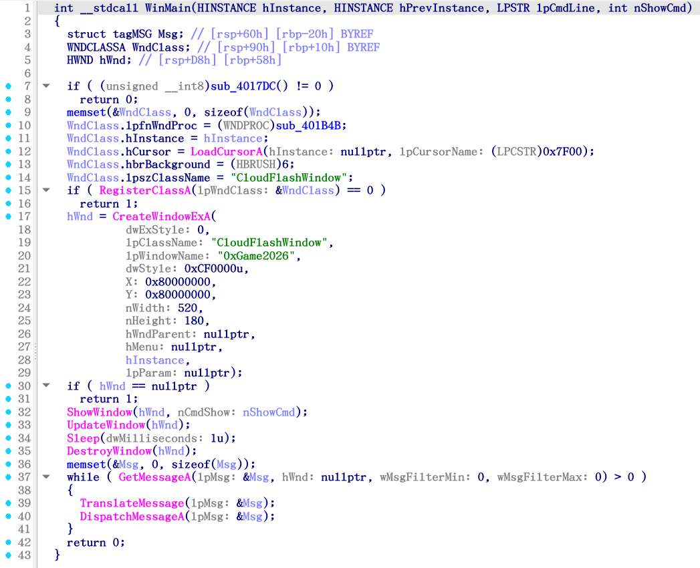

Line 10：

```c
  WndClass.lpfnWndProc = (WNDPROC)sub_401B4B;
```

`sub_401B4B()` ：

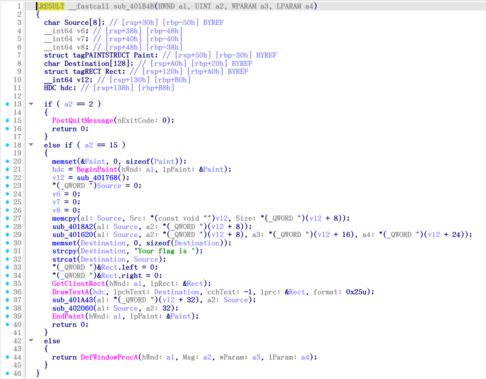

Line 22 ：

```c
    v12 = sub_401768();
```

Lines 28 - 29 ：

```c
    sub_4018A2(a1: Source, a2: *(_QWORD *)(v12 + 8));
    sub_401620(a1: Source, a2: *(_QWORD *)(v12 + 8), a3: *(_QWORD *)(v12 + 16), a4: *(_QWORD *)(v12 + 24));
```

## `sub_401768()`

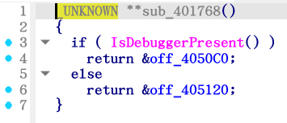

### `off_4050C0` ：


```
.rdata:00000000004050C0 off_4050C0      dq offset unk_405070    ; DATA XREF: sub_401768+15↑o
.rdata:00000000004050C8                 db  1Fh
.rdata:00000000004050C9                 db    0
.rdata:00000000004050CA                 db    0
.rdata:00000000004050CB                 db    0
.rdata:00000000004050CC                 db    0
.rdata:00000000004050CD                 db    0
.rdata:00000000004050CE                 db    0
.rdata:00000000004050CF                 db    0
.rdata:00000000004050D0                 db  48h ; H
.rdata:00000000004050D1                 db  50h ; P
.rdata:00000000004050D2                 db  40h ; @
.rdata:00000000004050D3                 db    0
.rdata:00000000004050D4                 db    0
.rdata:00000000004050D5                 db    0
.rdata:00000000004050D6                 db    0
.rdata:00000000004050D7                 db    0
.rdata:00000000004050D8                 db  0Ah
.rdata:00000000004050D9                 db    0
.rdata:00000000004050DA                 db    0
.rdata:00000000004050DB                 db    0
.rdata:00000000004050DC                 db    0
.rdata:00000000004050DD                 db    0
.rdata:00000000004050DE                 db    0
.rdata:00000000004050DF                 db    0
.rdata:00000000004050E0                 db 0ADh
.rdata:00000000004050E1                 db  50h ; P
.rdata:00000000004050E2                 db  40h ; @
.rdata:00000000004050E3                 db    0
.rdata:00000000004050E4                 db    0
.rdata:00000000004050E5                 db    0
.rdata:00000000004050E6                 db    0
.rdata:00000000004050E7                 db    0
.rdata:00000000004050E8                 db  4Eh ; N
.rdata:00000000004050E9                 db  4Fh ; O
.rdata:00000000004050EA                 db 0EFh
.rdata:00000000004050EB                 db 0BCh
.rdata:00000000004050EC                 db  81h
.rdata:00000000004050ED                 db  4Eh ; N
.rdata:00000000004050EE                 db  4Fh ; O
.rdata:00000000004050EF                 db 0EFh
.rdata:00000000004050F0                 db 0BCh
.rdata:00000000004050F1                 db  81h
.rdata:00000000004050F2                 db  4Eh ; N
.rdata:00000000004050F3                 db  4Fh ; O
.rdata:00000000004050F4                 db 0EFh
.rdata:00000000004050F5                 db 0BCh
.rdata:00000000004050F6                 db  81h
.rdata:00000000004050F7                 db  4Eh ; N
.rdata:00000000004050F8                 db  4Fh ; O
.rdata:00000000004050F9                 db 0EFh
.rdata:00000000004050FA                 db 0BCh
.rdata:00000000004050FB                 db  81h
.rdata:00000000004050FC                 db  4Eh ; N
.rdata:00000000004050FD                 db  4Fh ; O
.rdata:00000000004050FE                 db 0EFh
.rdata:00000000004050FF                 db 0BCh
.rdata:0000000000405100                 db  81h
.rdata:0000000000405101                 db  0Dh
.rdata:0000000000405102                 db  0Ah
.rdata:0000000000405103                 db    0
.rdata:0000000000405104                 db    0
.rdata:0000000000405105                 db    0
.rdata:0000000000405106                 db    0
.rdata:0000000000405107                 db    0
.rdata:0000000000405108                 db    0
.rdata:0000000000405109                 db    0
.rdata:000000000040510A                 db    0
.rdata:000000000040510B                 db    0
.rdata:000000000040510C                 db    0
.rdata:000000000040510D                 db    0
.rdata:000000000040510E                 db    0
.rdata:000000000040510F                 db    0
.rdata:0000000000405110                 db    0
.rdata:0000000000405111                 db    0
.rdata:0000000000405112                 db    0
.rdata:0000000000405113                 db    0
.rdata:0000000000405114                 db    0
.rdata:0000000000405115                 db    0
.rdata:0000000000405116                 db    0
.rdata:0000000000405117                 db    0
.rdata:0000000000405118                 db    0
.rdata:0000000000405119                 db    0
.rdata:000000000040511A                 db    0
.rdata:000000000040511B                 db    0
.rdata:000000000040511C                 db    0
.rdata:000000000040511D                 db    0
.rdata:000000000040511E                 db    0
.rdata:000000000040511F                 db    0
```

> NO NO NO NO NO

`unk_405070` ：

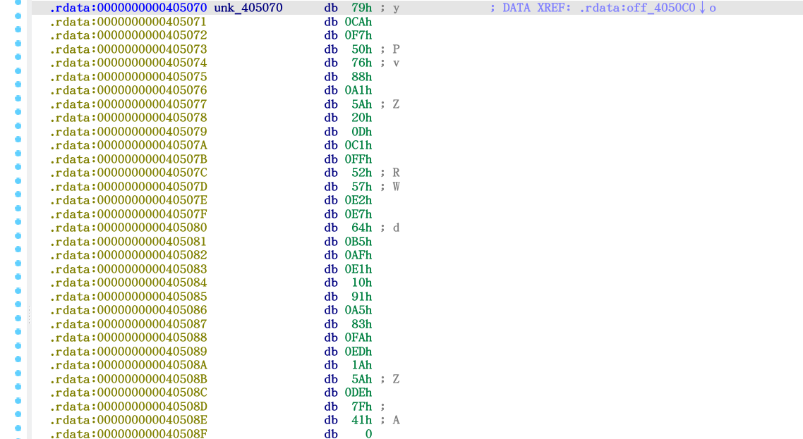

紧邻上方：

```
.rdata:0000000000405048 a0xgame2026     db '0xGame2026',0
.rdata:0000000000405053                 align 8
.rdata:0000000000405058 a0xgame2025     db '0xGame2025',0
.rdata:0000000000405063                 align 10h
```

### `off_405120` ：


```
.rdata:0000000000405120 off_405120      dq offset unk_405090    ; DATA XREF: sub_401768:loc_401786↑o
.rdata:0000000000405128                 db  1Dh
.rdata:0000000000405129                 db    0
.rdata:000000000040512A                 db    0
.rdata:000000000040512B                 db    0
.rdata:000000000040512C                 db    0
.rdata:000000000040512D                 db    0
.rdata:000000000040512E                 db    0
.rdata:000000000040512F                 db    0
.rdata:0000000000405130                 db  58h ; X
.rdata:0000000000405131                 db  50h ; P
.rdata:0000000000405132                 db  40h ; @
.rdata:0000000000405133                 db    0
.rdata:0000000000405134                 db    0
.rdata:0000000000405135                 db    0
.rdata:0000000000405136                 db    0
.rdata:0000000000405137                 db    0
.rdata:0000000000405138                 db  0Ah
.rdata:0000000000405139                 db    0
.rdata:000000000040513A                 db    0
.rdata:000000000040513B                 db    0
.rdata:000000000040513C                 db    0
.rdata:000000000040513D                 db    0
.rdata:000000000040513E                 db    0
.rdata:000000000040513F                 db    0
.rdata:0000000000405140                 db 0E8h
.rdata:0000000000405141                 db  50h ; P
.rdata:0000000000405142                 db  40h ; @
.rdata:0000000000405143                 db    0
.rdata:0000000000405144                 db    0
.rdata:0000000000405145                 db    0
.rdata:0000000000405146                 db    0
.rdata:0000000000405147                 db    0
.rdata:0000000000405148                 db    0
.rdata:0000000000405149                 db    0
.rdata:000000000040514A                 db    0
.rdata:000000000040514B                 db    0
.rdata:000000000040514C                 db    0
.rdata:000000000040514D                 db    0
.rdata:000000000040514E                 db    0
.rdata:000000000040514F                 db    0
.rdata:0000000000405150                 db    0
.rdata:0000000000405151                 db    0
.rdata:0000000000405152                 db    0
.rdata:0000000000405153                 db    0
.rdata:0000000000405154                 db    0
.rdata:0000000000405155                 db    0
.rdata:0000000000405156                 db    0
.rdata:0000000000405157                 db    0
.rdata:0000000000405158                 db    0
.rdata:0000000000405159                 db    0
.rdata:000000000040515A                 db    0
.rdata:000000000040515B                 db    0
.rdata:000000000040515C                 db    0
.rdata:000000000040515D                 db    0
.rdata:000000000040515E                 db    0
.rdata:000000000040515F                 db    0
```

`unk_405090` ：

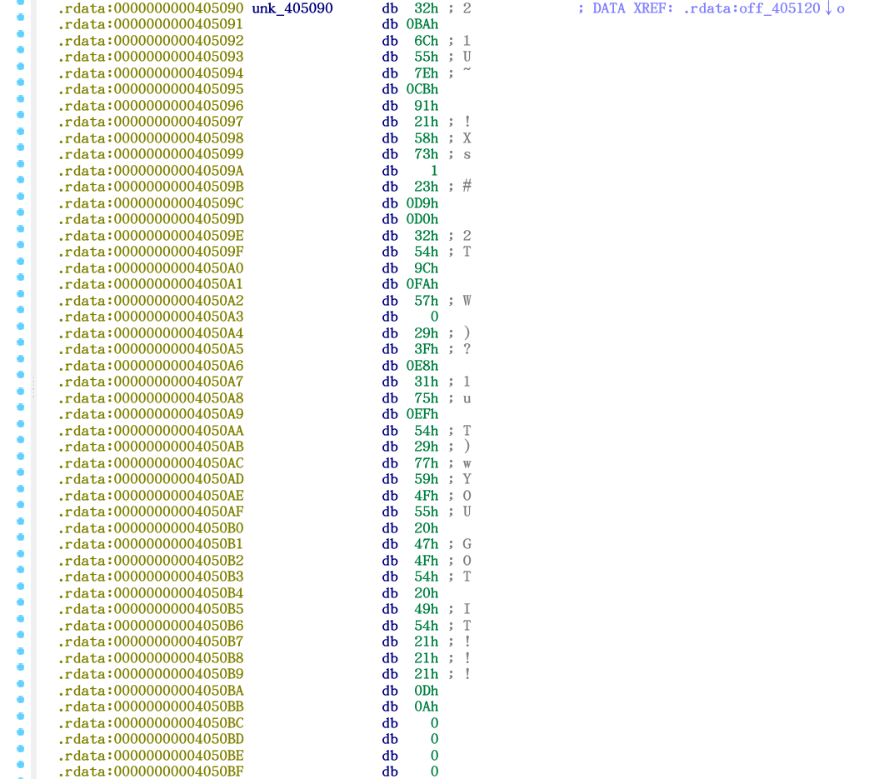

> YOU GOT IT!!!

## `sub_4018A2()`

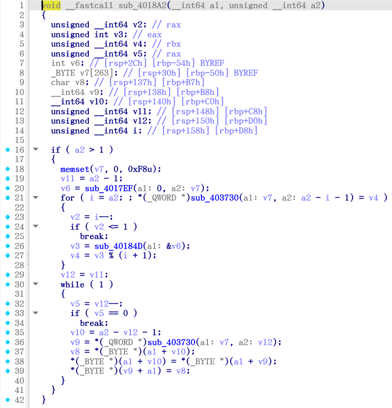

Lines 20 - 21：

```c
    v6 = sub_4017EF(a1: 0, a2: v7);
    for ( i = a2; ; *(_QWORD *)sub_403730(a1: v7, a2: a2 - i - 1) = v4 )
```

Line 26：

```c
      v3 = sub_40184D(a1: &v6);
```

Line 36：

```c
      v9 = *(_QWORD *)sub_403730(a1: v7, a2: v12);
```

### `sub_4017EF()`

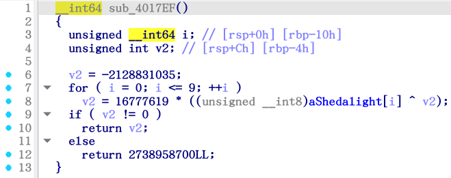

`aShedalight` ：


### `sub_403730()`

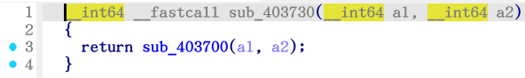

`sub_403700()` ：

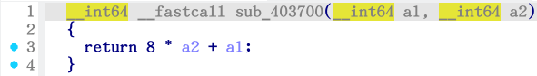

### `sub_40184D()`

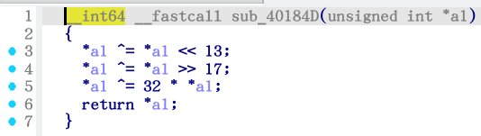

## `sub_401620()`

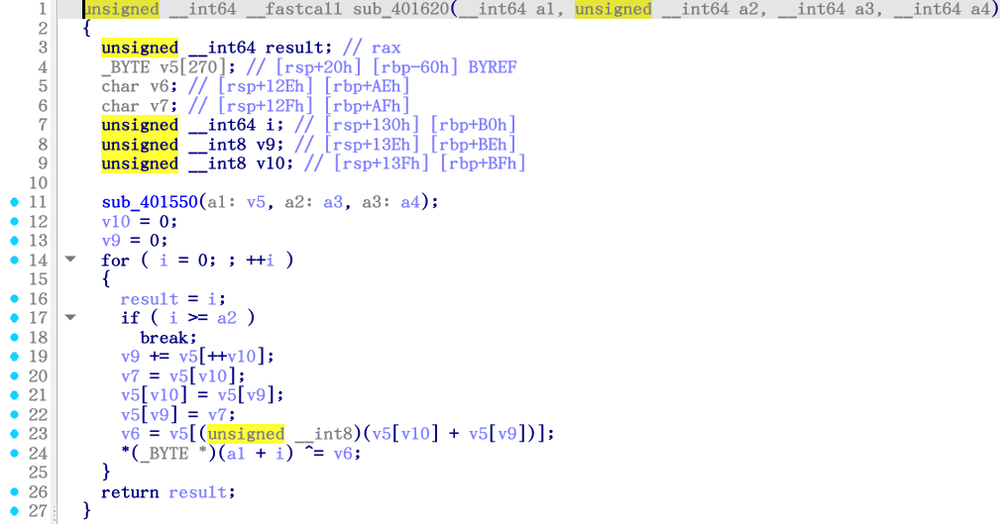

`sub_401550()` ：

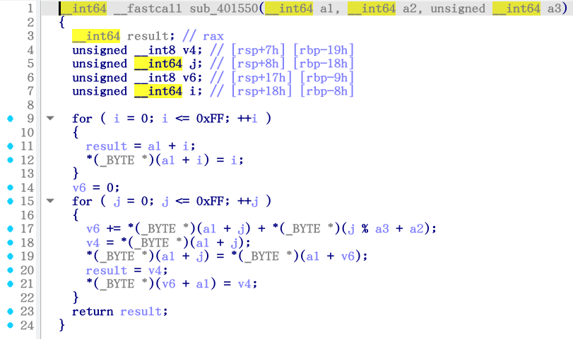