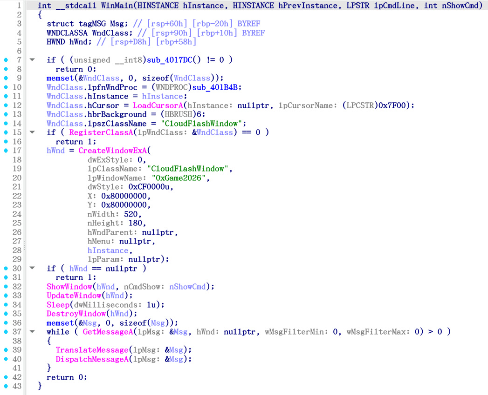
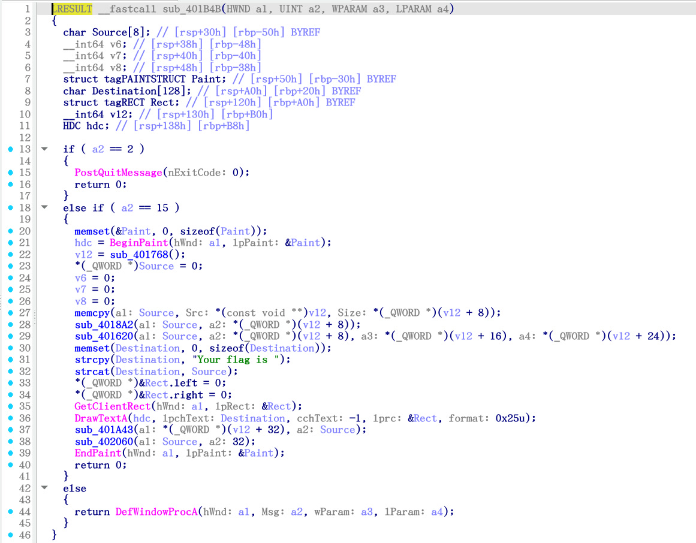

# 欸？云朵のrevenge

> 某个红色的很烫的女孩子很生气……

> 可莉！蹦蹦炸弹！
>
> ~~怎么哪里都有原批（恼）~~



Line 10：

```c
  WndClass.lpfnWndProc = (WNDPROC)sub_401B4B;
```

`sub_401B4B()` ：



从 `sub_401B4B()` 出发，检查各关键字段之间的引用及调用关系，汇总如下：

- `sub_401B4B()`
  - `sub_401768()`
    - `off_4050C0`
    - `off_405120`
  - `sub_4018A2()`
    - `sub_4017EF()`
      - `aShedalight`
    - `sub_403730()`
      - `sub_403700()`
    - `sub_40184D()`
  - `sub_401620()`
    - `sub_401550()`

然后格式化为 C 即可。这一过程包含：

1. 复制关键函数；
2. 导出并处理关键数据如 `off_4050C0` 等为 C 类型；
3. 切断非关键分支，如设置 `if (1)`（值得一提的是如果设置条件为 `0` 即进入非调试分支，那么得到的 flag 为 `0xGame{What_@re_U_doing!!???}` ）等；
4. 注释掉无关语句；
5. 修正函数类型并调整形参；
6. 设置 MSVC 中各类型的宏定义；
7. 补全头文件；
8. 删除 IDA 伪代码形参；
9. 强制转换类型；
10. 在 `sub_401B4B()` 中将 `Source` 缓冲区大小改为宏 `#define SOURCE_BUF_SIZE 256` 以防缓冲区溢出；
11. 添加 flag 打印语句；
12. 编写 `main()` 函数作为入口点；
13. 编译运行。

```c
#include <stdint.h>
#include <stdio.h>
#include <string.h>

#define __int64 long long
#define __int8 char
#define __fastcall
#define _BYTE unsigned char
#define _QWORD unsigned long long
#define LRESULT __int64

#define SOURCE_BUF_SIZE 256

unsigned char byte_405070[] = {0x79, 0xCA, 0xF7, 0x50, 0x76, 0x88, 0xA1, 0x5A,
                               0x20, 0x0D, 0xC1, 0xFF, 0x52, 0x57, 0xE2, 0xE7,
                               0x64, 0xB5, 0xAF, 0xE1, 0x10, 0x91, 0xA5, 0x83,
                               0xFA, 0xED, 0x1A, 0x5A, 0xDE, 0x7F, 0x41, 0x00};
unsigned char a0xgame2026[] = "0xGame2026";
unsigned char aYouGotIt[] = "YOU GOT IT!!!\r\n";
struct {
    unsigned char *offset_unk_405070;  // +0
    unsigned __int64 dq1;              // +8
    unsigned char *offset_a0xgame2026; // +16
    unsigned __int64 dq2;              // +24
    unsigned char *offset_aYouGotIt;   // +32
} off_4050C0 = {byte_405070, 0x1F, a0xgame2026, 0x0A, aYouGotIt};

unsigned char byte_405090[] = {
    0x32, 0xBA, 0x6C, 0x55, 0x7E, 0xCB, 0x91, 0x21, 0x58, 0x73, 0x01, 0x23,
    0xD9, 0xD0, 0x32, 0x54, 0x9C, 0xFA, 0x57, 0x00, 0x29, 0x3F, 0xE8, 0x31,
    0x75, 0xEF, 0x54, 0x29, 0x77, 0x59, 0x4F, 0x55, 0x20, 0x47, 0x4F, 0x54,
    0x20, 0x49, 0x54, 0x21, 0x21, 0x21, 0x0D, 0x0A, 0x00, 0x00, 0x00, 0x00};
unsigned char a0xgame2025[] = "0xGame2025";
unsigned char qword_4050E8[] = {
    0x4E, 0xF4, 0xCE, 0x1B, 0xE8, 0xF4, 0xF4, 0xEF, 0xBC, 0x81, 0x4E, 0x4F,
    0xEF, 0xBC, 0x81, 0x4E, 0x4F, 0xEF, 0xBC, 0x81, 0x4E, 0x4F, 0xEF, 0xBC,
    0x81, 0x0D, 0x0A, 0x00, 0x00, 0x00, 0x00, 0x00, 0x00, 0x00, 0x00, 0x00,
    0x00, 0x00, 0x00, 0x00, 0x00, 0x00, 0x00, 0x00, 0x00, 0x00, 0x00, 0x00,
    0x00, 0x00, 0x00, 0x00, 0x00, 0x00, 0x00, 0x00};
struct {
    unsigned char *offset_unk_405090;   // +0
    unsigned __int64 dq1;               // +8
    unsigned char *offset_a0xgame2025;  // +16
    unsigned __int64 dq2;               // +24
    unsigned char *offset_qword_4050E8; // +32
} off_405120 = {byte_405090, 0x1D, a0xgame2025, 0x0A, qword_4050E8};

/*_UNKNOWN*/ unsigned __int64 **sub_401768() {
    if (/*IsDebuggerPresent()*/ 1)
        return (unsigned __int64**)&off_4050C0;
    else
        return (unsigned __int64**)&off_405120;
}

unsigned char aShedalight[] = "ShedaLight";

__int64 sub_4017EF(unsigned __int64 i, unsigned int v2) {
    // unsigned __int64 i; // [rsp+0h] [rbp-10h]
    // unsigned int v2;    // [rsp+Ch] [rbp-4h]

    v2 = -2128831035;
    for (i = 0; i <= 9; ++i)
        v2 = 16777619 * ((unsigned __int8)aShedalight[i] ^ v2);
    if (v2 != 0)
        return v2;
    else
        return 2738958700LL;
}

__int64 __fastcall sub_403700(__int64 a1, __int64 a2) { return 8 * a2 + a1; }

__int64 __fastcall sub_403730(__int64 a1, __int64 a2) {
    return sub_403700(a1, a2);
}

__int64 __fastcall sub_40184D(unsigned int *a1) {
    *a1 ^= *a1 << 13;
    *a1 ^= *a1 >> 17;
    *a1 ^= 32 * *a1;
    return *a1;
}

void __fastcall sub_4018A2(__int64 a1, unsigned __int64 a2) {
    unsigned __int64 v2;  // rax
    unsigned int v3;      // eax
    unsigned __int64 v4;  // rbx
    unsigned __int64 v5;  // rax
    int v6;               // [rsp+2Ch] [rbp-54h] BYREF
    _BYTE v7[263];        // [rsp+30h] [rbp-50h] BYREF
    char v8;              // [rsp+137h] [rbp+B7h]
    __int64 v9;           // [rsp+138h] [rbp+B8h]
    __int64 v10;          // [rsp+140h] [rbp+C0h]
    unsigned __int64 v11; // [rsp+148h] [rbp+C8h]
    unsigned __int64 v12; // [rsp+150h] [rbp+D0h]
    unsigned __int64 i;   // [rsp+158h] [rbp+D8h]

    if (a2 > 1) {
        memset(v7, 0, 0xF8u);
        v11 = a2 - 1;
        v6 = sub_4017EF(0, (intptr_t)v7);
        for (i = a2;; *(_QWORD *)sub_403730((intptr_t)v7, a2 - i - 1) = v4) {
            v2 = i--;
            if (v2 <= 1)
                break;
            v3 = sub_40184D(&v6);
            v4 = v3 % (i + 1);
        }
        v12 = v11;
        while (1) {
            v5 = v12--;
            if (v5 == 0)
                break;
            v10 = a2 - v12 - 1;
            v9 = *(_QWORD *)sub_403730((intptr_t)v7, v12);
            v8 = *(_BYTE *)(a1 + v10);
            *(_BYTE *)(a1 + v10) = *(_BYTE *)(a1 + v9);
            *(_BYTE *)(v9 + a1) = v8;
        }
    }
}

__int64 __fastcall sub_401550(__int64 a1, __int64 a2, unsigned __int64 a3) {
    __int64 result;     // rax
    unsigned __int8 v4; // [rsp+7h] [rbp-19h]
    unsigned __int64 j; // [rsp+8h] [rbp-18h]
    unsigned __int8 v6; // [rsp+17h] [rbp-9h]
    unsigned __int64 i; // [rsp+18h] [rbp-8h]

    for (i = 0; i <= 0xFF; ++i) {
        result = a1 + i;
        *(_BYTE *)(a1 + i) = i;
    }
    v6 = 0;
    for (j = 0; j <= 0xFF; ++j) {
        v6 += *(_BYTE *)(a1 + j) + *(_BYTE *)(j % a3 + a2);
        v4 = *(_BYTE *)(a1 + j);
        *(_BYTE *)(a1 + j) = *(_BYTE *)(a1 + v6);
        result = v4;
        *(_BYTE *)(v6 + a1) = v4;
    }
    return result;
}

unsigned __int64 __fastcall sub_401620(__int64 a1, unsigned __int64 a2,
                                       __int64 a3, __int64 a4) {
    unsigned __int64 result; // rax
    _BYTE v5[270];           // [rsp+20h] [rbp-60h] BYREF
    char v6;                 // [rsp+12Eh] [rbp+AEh]
    char v7;                 // [rsp+12Fh] [rbp+AFh]
    unsigned __int64 i;      // [rsp+130h] [rbp+B0h]
    unsigned __int8 v9;      // [rsp+13Eh] [rbp+BEh]
    unsigned __int8 v10;     // [rsp+13Fh] [rbp+BFh]

    sub_401550((intptr_t)v5, a3, a4);
    v10 = 0;
    v9 = 0;
    for (i = 0;; ++i) {
        result = i;
        if (i >= a2)
            break;
        v9 += v5[++v10];
        v7 = v5[v10];
        v5[v10] = v5[v9];
        v5[v9] = v7;
        v6 = v5[(unsigned __int8)(v5[v10] + v5[v9])];
        *(_BYTE *)(a1 + i) ^= v6;
    }
    return result;
}

LRESULT __fastcall sub_401B4B(/*HWND a1, UINT a2, WPARAM a3, LPARAM a4*/) {
    char Source[SOURCE_BUF_SIZE]; // [rsp+30h] [rbp-50h] BYREF
    // __int64 v6;     // [rsp+38h] [rbp-48h]
    // __int64 v7;     // [rsp+40h] [rbp-40h]
    // __int64 v8;     // [rsp+48h] [rbp-38h]
    // struct tagPAINTSTRUCT Paint; // [rsp+50h] [rbp-30h] BYREF
    char Destination[128]; // [rsp+A0h] [rbp+20h] BYREF
    // struct tagRECT Rect;         // [rsp+120h] [rbp+A0h] BYREF
    __int64 v12; // [rsp+130h] [rbp+B0h]
                 // HDC hdc;                     // [rsp+138h] [rbp+B8h]

    // if (a2 == 2) {
    //     PostQuitMessage(nExitCode : 0);
    //     return 0;
    // } else if (a2 == 15) {
    // memset(&Paint, 0, sizeof(Paint));
    // hdc = BeginPaint(hWnd : a1, lpPaint : &Paint);
    v12 = (intptr_t)sub_401768();
    *(_QWORD *)Source = 0;
    // v6 = 0;
    // v7 = 0;
    // v8 = 0;
    memcpy(Source, *(const void **)v12, *(_QWORD *)(v12 + 8));
    sub_4018A2((intptr_t)Source, *(_QWORD *)(v12 + 8));
    sub_401620((intptr_t)Source, *(_QWORD *)(v12 + 8),
               *(_QWORD *)(v12 + 16), *(_QWORD *)(v12 + 24));
    memset(Destination, 0, sizeof(Destination));
    strcpy(Destination, "Your flag is ");
    strcat(Destination, Source);
    // *(_QWORD *)&Rect.left = 0;
    // *(_QWORD *)&Rect.right = 0;
    // GetClientRect(hWnd : a1, lpRect : &Rect);
    // DrawTextA(hdc, lpchText : Destination, cchText : -1, lprc : &Rect,
    //           format : 0x25u);
    // sub_401A43(*(_QWORD *)(v12 + 32), Source);
    // sub_402060(Source, 32);
    // EndPaint(hWnd : a1, lpPaint : &Paint);

    printf("%s\n", Destination);

    return 0;
    // } else {
    //     return DefWindowProcA(hWnd : a1, Msg : a2, wParam : a3, lParam : a4);
    // }
}

int main() { return sub_401B4B(); }
```

```bash
scetayh@yuprae-gentoo ~/Projects/0xgame2026-writeups/week1/reverse/4 $ gcc -O2 -o main main.c 
scetayh@yuprae-gentoo ~/Projects/0xgame2026-writeups/week1/reverse/4 $ ./main 
Your flag is 0xGame{Dyn4m1c_Dyn4m1c_Dyn4m1c}
```

从而得到 flag 为 `0xGame{Dyn4m1c_Dyn4m1c_Dyn4m1c}` 。