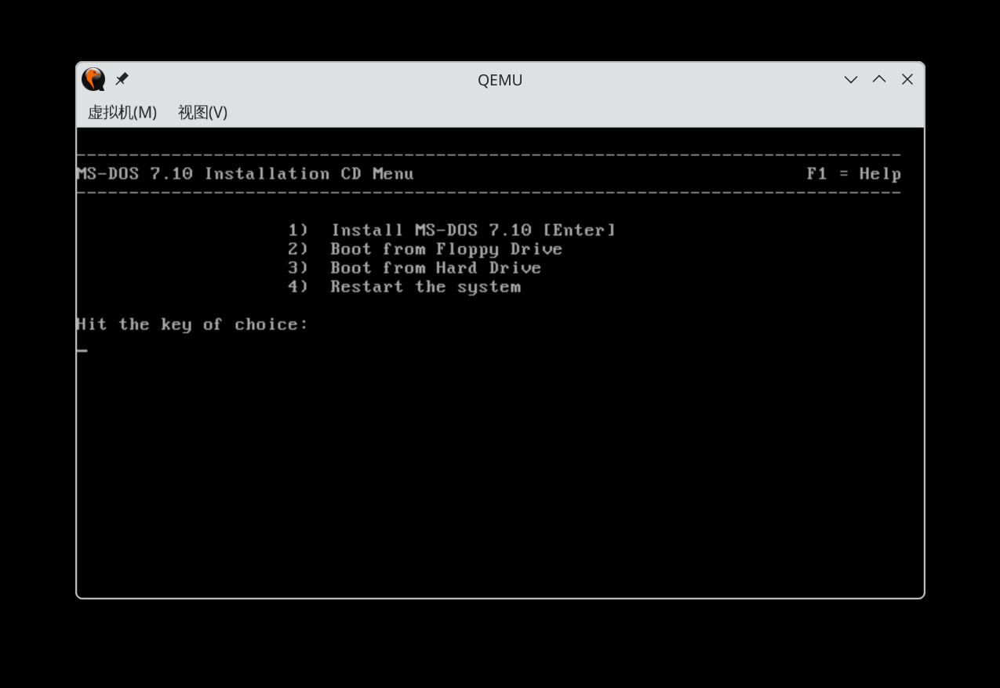
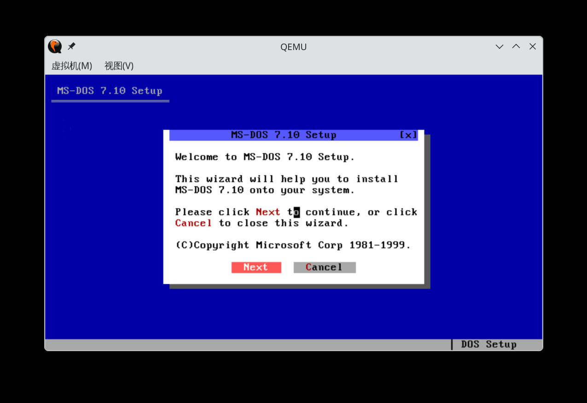
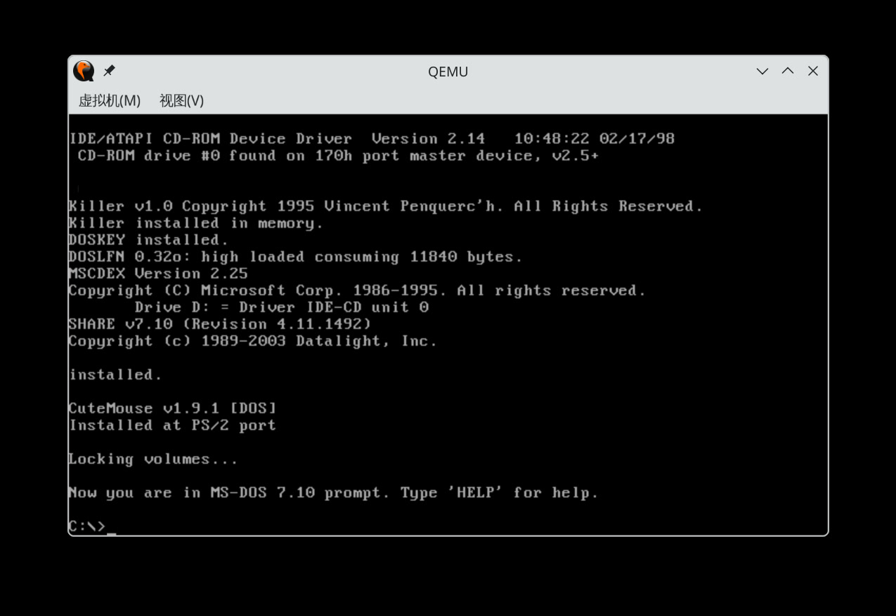
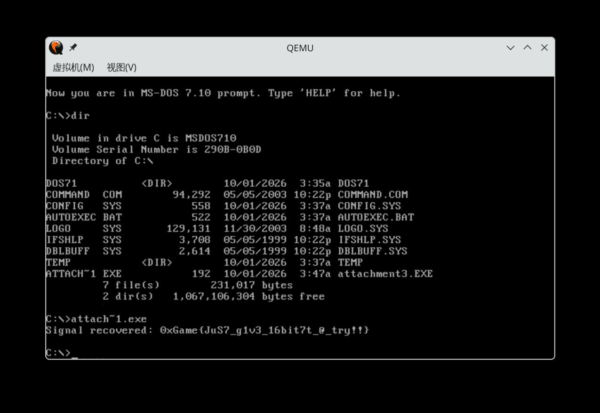

# 旧时代的信号

在 Gentoo `/etc/portage/make.conf` 中设置：

```ini
QEMU_SOFTMMU_TARGETS="x86_64"
```

然后编译安装 QEMU ：

```bash
sudo emerge --ask --verbose --keep-going --load-average=6.4 app-emulation/qemu
```

新建磁盘映像文件：

```bash
scetayh@yuprae-gentoo ~/Downloads $ qemu-img create -f qcow2 dos71.qcow2 1G
Formatting 'dos71.qcow2', fmt=qcow2 cluster_size=65536 extended_l2=off compression_type=zlib size=1073741824 lazy_refcounts=off refcount_bits=16
```

完成后用 `qemu-system-i386` 命令从光盘映像启动 ：

```bash
qemu-system-x86_64 \
    -m 64M \
    -cpu pentium \
    -hda dos71.qcow2 \
    -cdrom dos71cd.iso \
    -boot d \
    -vga cirrus
```





安装。

（几分钟后……）



DOS 启动正常。先关机：

```cmd
shutdown -s
```

然后在宿主机中，挂载 QCOW2 磁盘映像并复制 `attachment3.EXE`：

```bash
scetayh@yuprae-gentoo ~/Downloads $ sudo modprobe nbd max_part=8
scetayh@yuprae-gentoo ~/Downloads $ sudo qemu-nbd --connect=/dev/nbd0 dos71.qcow2
scetayh@yuprae-gentoo ~/Downloads $ sudo mount /dev/nbd0p1 --mkdir /mnt/dos
scetayh@yuprae-gentoo ~/Downloads $ sudo cp attachment3.EXE /mnt/dos/
scetayh@yuprae-gentoo ~/Downloads $ sudo umount /mnt/dos
scetayh@yuprae-gentoo ~/Downloads $ sudo qemu-nbd --disconnect /dev/nbd0
/dev/nbd0 disconnected
```

再次启动 DOS ：

```bash
qemu-system-x86_64 \
    -m 64M \
    -cpu pentium \
    -hda dos71.qcow2 \
    -vga cirrus
```

运行 `attachment3.EXE` ：

```dos
d:
attach~1.exe
```

查看输出：



从而得到 flag 为 `0xGame{JuS7_g1v3_16bit7t_@_try!!}` 。