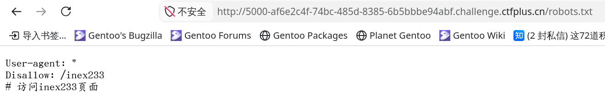
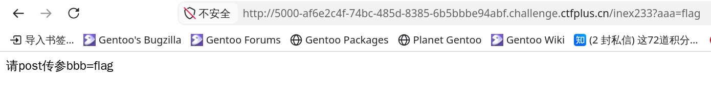

# 一切的开始

“扫扫目录康康”提示我们看看常见的站点信息文件 `robots.txt` ：



听命：


继续：



我觉得 cURL 可能更方便一点。转到终端：

```bash
scetayh@yuprae-gentoo ~/Projects/0xgame2026-writeups $ curl -X POST http://5000-af6e2c4f-74bc-485d-8385-6b5bbbe94abf.challenge.ctfplus.cn/inex233?aaa=flag -d 'bbb=flag'
scetayh@yuprae-gentoo ~/Projects/0xgame2026-writeups $ echo "啊？"
啊？
scetayh@yuprae-gentoo ~/Projects/0xgame2026-writeups $ curl -X POST http://5000-af6e2c4f-74bc-485d-8385-6b5bbbe94abf.challenge.ctfplus.cn/inex233?aaa=f
lag -H 'Cookie: sweet=sweet' -d 'bbb=flag'
你必须来自127.0.0.1scetayh@yuprae-gentoo ~/Projects/0xgame2026-writeups $ echo "还来？"
还来？
scetayh@yuprae-gentoo ~/Projects/0xgame2026-writeups $ curl -X POST http://5000-af6e2c4f-74bc-485d-8385-6b5bbbe94abf.challenge.ctfplus.cn/inex233?aaa=flag -H 'Cookie: sweet=sweet' -H 'Origin: http://127.0.0.1' -d 'bbb=flag'
你必须来自127.0.0.1scetayh@yuprae-gentoo ~/Projects/0xgame2026-writeups $ curl -X POST http://5000-af6e2c4f-74bc-485d-8385-6b5bbbe94abf.challenge.ctfplus.cn/inex233?aaa=flag -H 'Cookie: sweet=sweet' -H 'Origin: http://127.0.0.1' -H 'Referer: http://127.0.0.1/' -d 'bbb=flag'
请json传参web：flagscetayh@yuprae-gentoo ~/Projects/0xgame2026-writeups $ curl -X POST http://5000-af6e2c4f-74bc-485d-8385-6b5bbbe94abf.challenge.ctfplus.cn/inex233?aaa=flag -H 'Cookie: sweet=sweet' -H 'Origin: http://127.0.0.1' -H 'Referer: http://127.0.0.1/' -d 'bbb=flag' --data '{"bbb":"flag","web"--data '{"web":"flag"}'
请json传参web：flagscetayh@yuprae-gentoo ~/Projects/0xgame2026-writeups $ curl -X POST http://5000-af6e2c4f-74bc-485d-8385-6b5bbbe94abf.challenge.ctfplus.cn/inex233?aaa=flag -H 'Cookie: sweet=sweet' -H 'Origin: http://127.0.0.1' -H 'Referer: http://127.0.0.1/' -d 'b-H 'Content-Type: application/json'i
on/json' --data '{"web":"flag"}'
<!doctype html>
<html lang=en>
<title>400 Bad Request</title>
<h1>Bad Request</h1>
<p>The browser (or proxy) sent a request that this server could not understand.</p>
scetayh@yuprae-gentoo ~/Projects/0xgame2026-writeups $ ^C
scetayh@yuprae-gentoo ~/Projects/0xgame2026-writeups $ curl -X POST http://5000-af6e2c4f-74bc-485d-8385-6b5bbbe94abf.challenge.ctfplus.cn/inex233?aaa=flag -H 'Cookie: sweet=sweet' -H 'Origin: http://127.0.0.1' -H 'Referer: http://127.0.0.1/' -d 'bbb=flag' -H 'Content-Type: application/json' --data '{"bbb": "flag", "web": "flag"}'
<!doctype html>
<html lang=en>
<title>400 Bad Request</title>
<h1>Bad Request</h1>
<p>The browser (or proxy) sent a request that this server could not understand.</p>
scetayh@yuprae-gentoo ~/Projects/0xgame2026-writeups $ curl -X POST http://5000-af6e2c4f-74bc-485d-8385-6b5bbbe94abf.challenge.ctfplus.cn/inex233?aaa=flag -H 'Cookie: sweet=sweet' -H 'Origin: http://127.0.0.1' -H 'Referer: http://127.0.0.1/' -H 'Content-Type: application/json' --data '{"bbb": "flag", "web": "flag"}'
0xGame{caaf82eb-83c3-49dc-a732-02cf673a994b}scetayh@yuprae-gentoo ~/Projects/0xgame2026-writeups $ 
```

周旋一番，得到 `0xGame{caaf82eb-83c3-49dc-a732-02cf673a994b}` 。