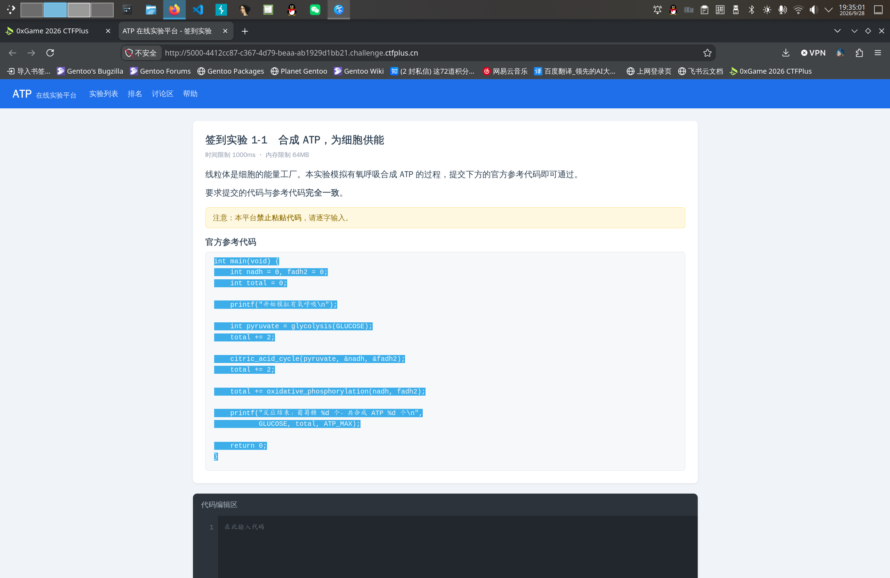
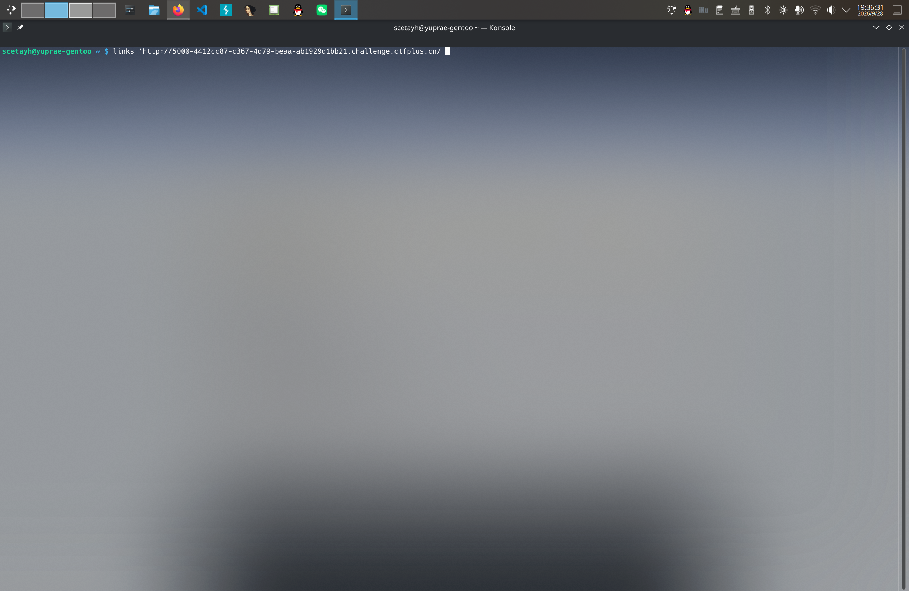
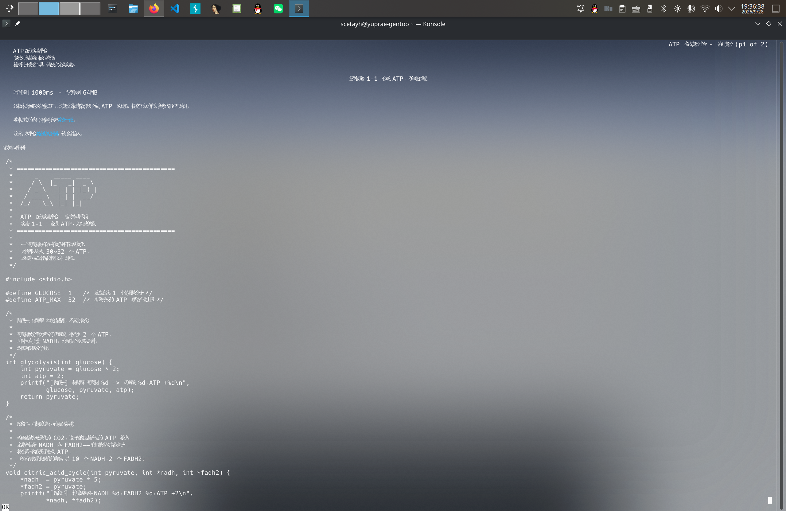
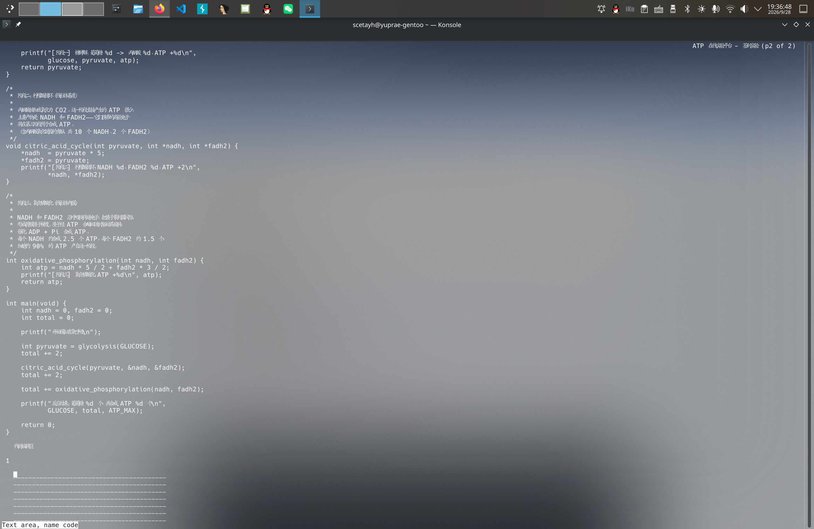
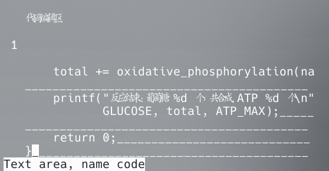
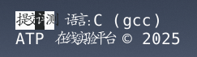
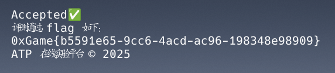

# ATP代码实验

本题的解决方式比较粗糙。先重启回 macOS ，把整个源代码拷贝下来，ASCII 字符直接转成 AppleScript 中的模拟键盘输入，非 ASCII 字符转成 `$` 便于人判断，然后运行脚本，把 `$` 改成汉字。

**正常解法是禁用 JavaScript 。**

实际上我还有第三个雷霆办法，如下图所示。

  <small>Control-C</small>

 

  <small><kbd>links 'http://5000-4412cc87-c367-4d79-beaa-ab1929d1bb21.challenge.ctfplus.cn/'</kbd></small>

 

  <small>ATP</small>

 

  <small>Scroll down</small>

 

  <small>Control-V</small>

 

  <small>Enter</small>

 

  <small>Done</small>

 

于是我们就拿到了 flag `0xGame{b5591e65-9cc6-4acd-ac96-198348e98909}
` ……（抱头蹲防）