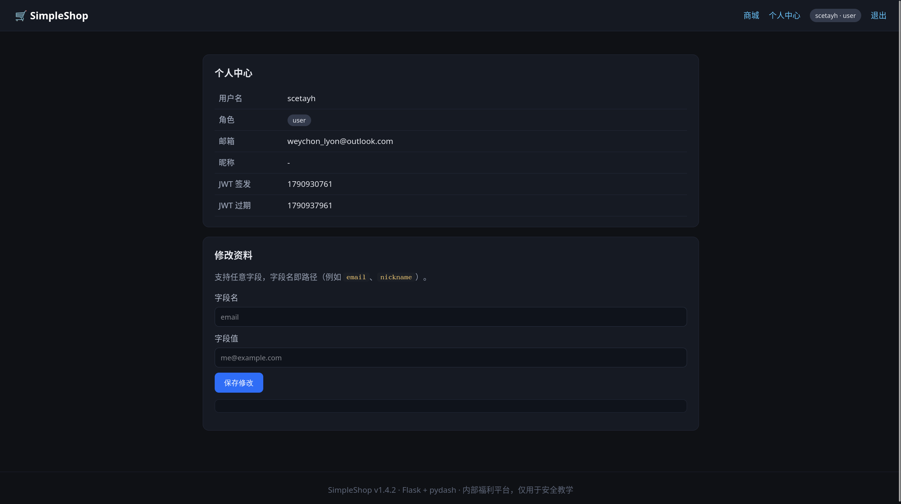
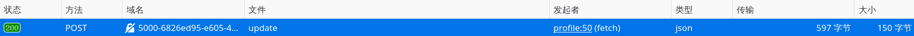
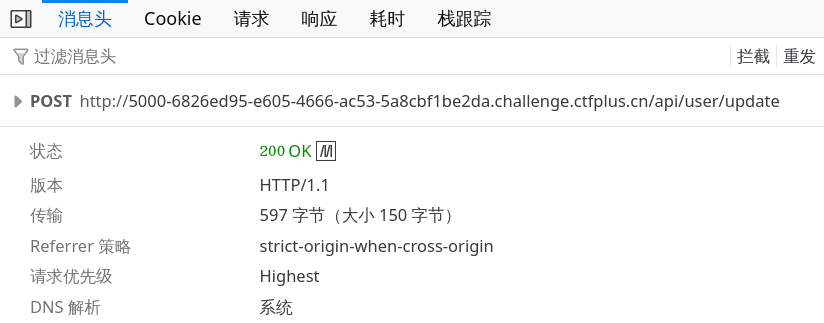
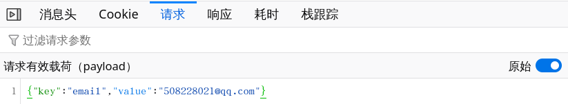
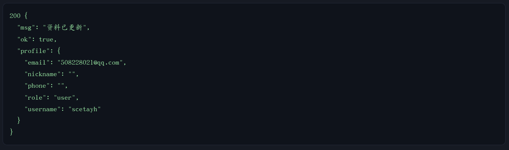

# pollute the key

注册这样一个账号后来到个人中心：




交点数据上去，看一看“保存修改”发的请求：





- `/api/user/update`



- `{"key":"email","value":"508228021@qq.com"}`

返回：

```json
200 {
  "msg": "资料已更新",
  "ok": true,
  "profile": {
    "email": "508228021@qq.com",
    "nickname": "",
    "phone": "",
    "role": "user",
    "username": "scetayh"
  }
}
```



我看 `app.py` 里边有 JWT encode / decode ，每次