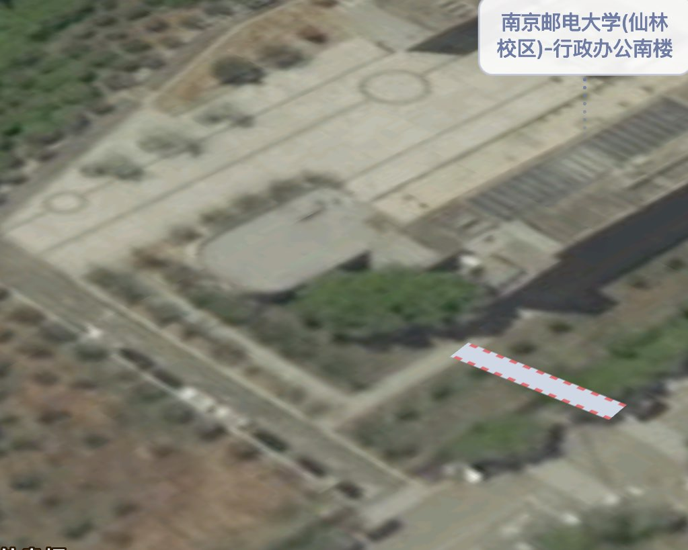
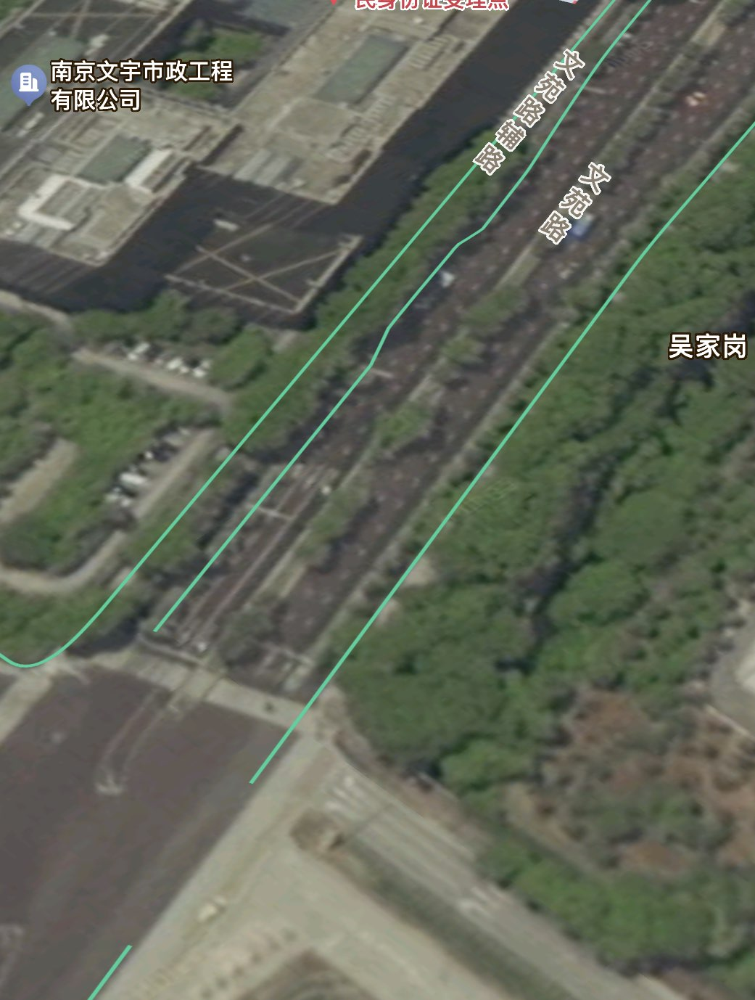

# Spring的旅程-3

感觉像校内。因为远处就是高层，不太像学校，所以这张照片应该是在学校边界附近拍的。开百度地图卫星图沿着学校轮廓找了一下，最后发现：

圆角边的楼，还有向右前方的小道上又分出一条向左前方的小道，而且远处校外是：

市政公司的建筑，线索是吻合的。

查阅得到行政南楼一楼知名区域是**中天科技报告厅**。那么 flag 应该是 `0xGame{南京邮电大学(仙林校区)-行政办公南楼_中天科技报告厅}` 。提交正确。