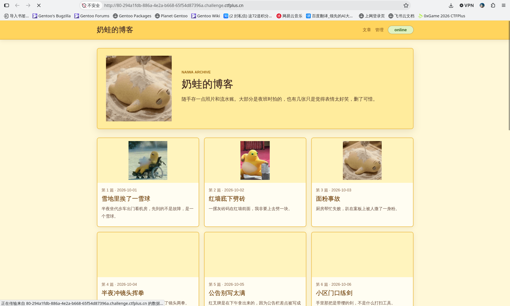
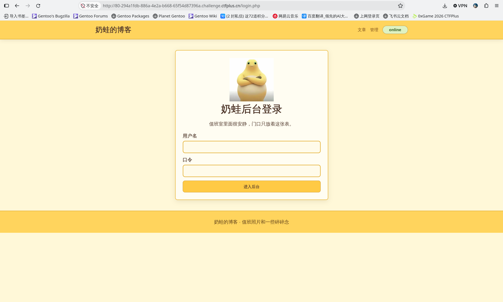
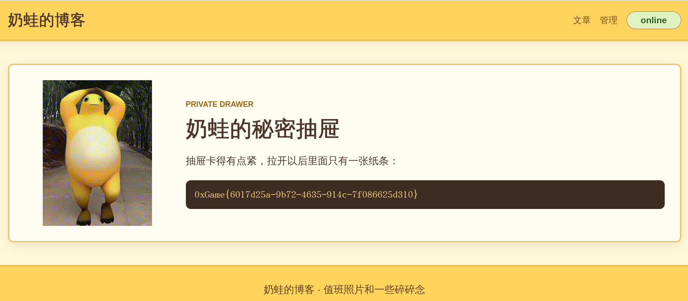

# 奶蛙的服务器

网页打开时 502 。登 SSH ：

```bash
repair@dep-294a1fdb-886a-4e2a-b668-65f54d87396a-db66f8c77-jq7pk:~$ systemctl nginx
Unknown command verb 'nginx', did you mean 'link'?             
repair@dep-294a1fdb-886a-4e2a-b668-65f54d87396a-db66f8c77-jq7pk:~$ systemctl      
System has not been booted with systemd as init system (PID 1). Can't operate.
```

`systemd` 不是 init ！

```bash
repair@dep-294a1fdb-886a-4e2a-b668-65f54d87396a-db66f8c77-jq7pk:~$ service
-bash: service: command not found
repair@dep-294a1fdb-886a-4e2a-b668-65f54d87396a-db66f8c77-jq7pk:~$ sudo service
unrecognized service: 
supported services: nginx, php-fpm
```

看服务：

```bash
repair@dep-294a1fdb-886a-4e2a-b668-65f54d87396a-db66f8c77-jq7pk:~$ sudo service nginx
nginx is running
repair@dep-294a1fdb-886a-4e2a-b668-65f54d87396a-db66f8c77-jq7pk:~$ sudo service php-fpm
php-fpm is stopped
config: /srv/naiwa/config/service.ini
mode=recovery
maintenance=on
listen=127.0.0.1:8088
secret_backend=disabled
runtime=broken
```

`/srv/naiwa/config/service.ini` 调为生产环境，取消维护状态：

```bash
repair@dep-294a1fdb-886a-4e2a-b668-65f54d87396a-db66f8c77-jq7pk:~$ sudo nano /srv/naiwa/config/service.ini
[sudo] password for repair: 
Sorry, user repair is not allowed to execute '/usr/bin/nano /srv/naiwa/config/service.ini' as root on dep-294a1fdb-886a-4e2a-b668-65f54d87396a-db66f8c77-jq7pk.
```

啊？我能用什么？

```bash
repair@dep-294a1fdb-886a-4e2a-b668-65f54d87396a-db66f8c77-jq7pk:~$ sudo -l
Matching Defaults entries for repair on dep-294a1fdb-886a-4e2a-b668-65f54d87396a-db66f8c77-jq7pk:
    env_reset, mail_badpass, secure_path=/usr/local/sbin\:/usr/local/bin\:/usr/sbin\:/usr/bin\:/sbin\:/bin, use_pty

User repair may run the following commands on dep-294a1fdb-886a-4e2a-b668-65f54d87396a-db66f8c77-jq7pk:
    (root) NOPASSWD: /usr/local/sbin/service, /usr/local/sbin/php-fpm-service
```

看看配置文件的权限：

```bash
repair@dep-294a1fdb-886a-4e2a-b668-65f54d87396a-db66f8c77-jq7pk:~$ ls -ld /srv/naiwa/config/service.ini
-rw-r--r-- 1 repair repair 192 Oct  4 16:35 /srv/naiwa/config/service.ini
```

有的，不用 `sudo` ：

```bash
nano /srv/naiwa/config/service.ini
```

内容是：

```ini
[service]
mode = recovery
maintenance = on
listen = 127.0.0.1:8088
secret_backend = disabled

[notes]
owner = naiwa
last_incident = archive worker lost its public route after a sleepy restart
```

模式从恢复改成生产，取消维护状态，监听 host 改为 0.0.0.0 。这还有个“秘密后门”，后期应该要用，把它启用。

```ini
[service]
mode = production
maintenance = off
listen = 0.0.0.0:8088
secret_backend = enabled

[notes]
owner = naiwa
last_incident = archive worker lost its public route after a sleepy restart
```

启动 `php-fpm` :

```bash
repair@dep-294a1fdb-886a-4e2a-b668-65f54d87396a-db66f8c77-jq7pk:~$ sudo service php-fpm start
php-fpm refused to start: /srv/naiwa/config/service.ini is not production-ready
current:
  mode=production
  maintenance=off
  listen=0.0.0.0:8088
  secret_backend=enabled
```

还是不行，怀疑监听端口。

```bash
repair@dep-294a1fdb-886a-4e2a-b668-65f54d87396a-db66f8c77-jq7pk:~$ cat /etc/nginx/nginx.conf 
# ...

http {
    # ...

    server {
        listen 80;
        # ...
        }
    }
}
```

改为 80 端口：

```ini
[service]
mode = production
maintenance = off
listen = 0.0.0.0:80
secret_backend = enabled

[notes]
owner = naiwa
last_incident = archive worker lost its public route after a sleepy restart
```

启动服务：

```bash
repair@dep-294a1fdb-886a-4e2a-b668-65f54d87396a-db66f8c77-jq7pk:~$ sudo service php-fpm start
[05-Oct-2026 02:58:36] NOTICE: fpm is running, pid 259
[05-Oct-2026 02:58:36] NOTICE: ready to handle connections
php-fpm started
```

浏览器刷新页面，进去了。



右上角“管理”点一下：



路径是 `/login.php` ，去 SSH 看：

```bash
cat /var/www/html/login.php 
```

```php
$adminPassword = 'chocolate9';
```

```php
if ($_SERVER['REQUEST_METHOD'] === 'POST') {
    $user = (string)($_POST['username'] ?? '');
    $pass = (string)($_POST['password'] ?? '');
    if ($user === 'admin' && $pass === $adminPassword) {
        $_SESSION['admin'] = true;
        header('Location: /admin.php');
        exit;
    }
    $error = '登录失败，请重新确认。';
}
```

Username `admin` ，password `chocolate9` 。登进去得到 flag 为 `0xGame{6017d25a-9b72-4635-914c-7f086625d310}`：

